# NAIFARM — MASTER BLUEPRINT

## Hệ sinh thái Chợ OCOP Thanh niên, chuyển đổi số nông nghiệp, giáo dục trải nghiệm và tình nguyện số Thành phố Đồng Nai

> **Gieo tri thức – Kết nối nhà nông – Lan tỏa giá trị.**
>
> Mỗi nhà vườn là một gian hàng số, một lớp học thực tiễn và một điểm đến trải nghiệm. Mỗi thanh niên là một cầu nối giúp nông sản Đồng Nai vươn xa.

| Thông tin | Nội dung |
|---|---|
| Cuộc thi | Hackathon Thành phố Đồng Nai năm 2026 |
| Đề lựa chọn | Đề 3 – Chợ OCOP Thanh niên (Kinh tế số – thương mại điện tử – khởi nghiệp) |
| Tên đề xuất | NaiFarm |
| Tên tiếng Anh | NaiFarm – Youth-powered Digital Agriculture and Community Marketplace |
| Định vị | Youth-powered Digital Agriculture Ecosystem |
| Phạm vi | Thành phố Đồng Nai sau hợp nhất Đồng Nai và Bình Phước, 95 xã/phường |
| Phiên bản | 3.0 – Unified Workspace & Lean Business Architecture (6 workspace) |
| Mốc bối cảnh | 24/11/2026 |
| Mục đích | Nguồn đặc tả thống nhất cho thiết kế, phát triển, vận hành, phân quyền, nghiệm thu, thuyết minh, demo và phản biện |
| Trạng thái | Đề xuất thiết kế, không phải báo cáo kết quả triển khai |

**Cách đọc:** BẮT BUỘC là nội dung đề thi; ĐIỂM CỘNG là yêu cầu khuyến khích ghi trực tiếp trong đề; P0 là phạm vi ưu tiên hiện thực hóa; P1 là mở rộng có chọn lọc; P2 là lộ trình. Các persona, nhà vườn và số liệu demo phải được ghi nhãn giả lập. Các nhận định về nhu cầu mở rộng là giả thuyết cần xác thực. Nguồn chính thức được liệt kê cuối tài liệu. Không coi toàn bộ 10 phân hệ là cam kết hoàn thành trong 24 giờ.

**Quy tắc đọc phiên bản 3.0:** V3 thay V1, role4 và V2 làm nguồn đặc tả duy nhất. Giữ nguyên 10 phân hệ, 24 capability B01–B24, yêu cầu đề thi, nghiệp vụ đầy đủ, dữ liệu, sáng tạo, bảo mật và lộ trình. Tối ưu từ 28 danh mục chức danh và 23 workspace V2 thành 6 workspace đăng nhập; 4 persona gốc giữ nguyên, chức danh là bộ quyền có scope, không phải portal. Chương 5 và 10 xác định điểm vào giao diện; chương 7, 9 và 12 xác định quyền nghiệp vụ. Không gộp quyền pháp lý chỉ vì dùng chung giao diện. P0/P1/P2 chỉ là thứ tự triển khai, không phải loại bỏ người dùng mở rộng. Tài liệu là đề xuất thiết kế, dữ liệu mẫu có nhãn; không tuyên bố đối tác hay tích hợp thực tế chưa xác minh.

## Mục lục

1. [Tóm tắt điều hành](#1-tóm-tắt-điều-hành)
2. [Đề thi chính thức và chiến lược chấm điểm](#2-đề-thi-chính-thức-và-chiến-lược-chấm-điểm)
3. [Bối cảnh Đồng Nai mới](#3-bối-cảnh-đồng-nai-mới)
4. [Thực trạng và bài toán](#4-thực-trạng-và-bài-toán)
5. [Người dùng và các bên liên quan](#5-người-dùng-và-các-bên-liên-quan)
6. [Định danh, định vị và hệ sinh thái](#6-định-danh-định-vị-và-hệ-sinh-thái)
7. [Đặc tả 10 phân hệ](#7-đặc-tả-10-phân-hệ)
8. [Danh mục sáng tạo mở rộng](#8-danh-mục-sáng-tạo-mở-rộng)
9. [Luồng sử dụng](#9-luồng-sử-dụng)
10. [Danh mục màn hình và UX/UI](#10-danh-mục-màn-hình-và-uxui)
11. [Dữ liệu mẫu và địa giới](#11-dữ-liệu-mẫu-và-địa-giới)
12. [Kiến trúc, công nghệ và dữ liệu](#12-kiến-trúc-công-nghệ-và-dữ-liệu)
13. [Phạm vi MVP và kế hoạch 24 giờ](#13-phạm-vi-mvp-và-kế-hoạch-24-giờ)
14. [Vận hành, tài chính và tác động](#14-vận-hành-tài-chính-và-tác-động)
15. [Lợi thế cạnh tranh và rủi ro](#15-lợi-thế-cạnh-tranh-và-rủi-ro)
16. [Chiến lược sơ loại, hồ sơ và demo](#16-chiến-lược-sơ-loại-hồ-sơ-và-demo)
17. [Checklist nghiệm thu](#17-checklist-nghiệm-thu)
18. [Nguồn tham khảo](#18-nguồn-tham-khảo)
19. [Phương án chốt](#19-phương-án-chốt)

---

# 1. Tóm tắt điều hành

NaiFarm không phải một sàn bán nông sản thông thường. Sản phẩm giải quyết khoảng cách giữa giá trị nông sản, năng lực số của nhà nông, nhu cầu minh bạch của người mua và năng lực cống hiến của thanh niên. Thương mại điện tử là nền tảng; thanh niên là lực lượng kết nối; giáo dục thực hành là cơ chế tạo giá trị lâu dài; bản đồ, 3D và livestream là phương tiện kết nối trải nghiệm với tiêu dùng; chứng nhận và đo lường tác động là cơ chế ghi nhận đóng góp có minh chứng.

**Bài toán chính:** Một nhà vườn có sản phẩm tốt nhưng thiếu kỹ năng bán trực tuyến, chưa có nhật ký sản xuất đầy đủ và khách hàng khó kiểm chứng nguồn gốc. Trong khi đó thanh niên có năng lực số nhưng cần công việc cụ thể, người thụ hưởng và cơ chế ghi nhận. NaiFarm biến nhu cầu hỗ trợ thành nhiệm vụ có đầu ra, kết nối nhà vườn với người mua, người học và người hỗ trợ.

**Giá trị cốt lõi:** Nhà nông bán hàng và từng bước tự chủ; người mua biết rõ dữ liệu nguồn gốc và mua thuận tiện; thanh niên học, làm, đóng góp và nhận ghi nhận; nhà trường có nơi thực hành; du khách hiểu và trải nghiệm nông sản; cộng đồng có số liệu tác động đáng tin cậy.

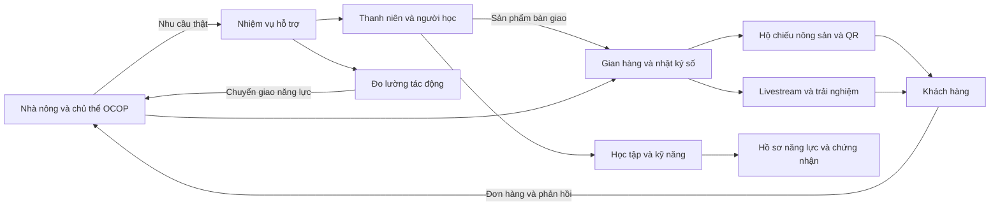

**Khác biệt nhất:** Farm as a Classroom – biến nhà vườn thành phòng thực hành mở, kết hợp Service-Learning (học tập gắn với phục vụ cộng đồng). Thay vì chỉ làm bài tập giả định hoặc hỗ trợ một lần, người học giải quyết nhu cầu cụ thể của nhà vườn, bàn giao sản phẩm, được đánh giá và giúp nhà nông tự thực hiện về sau.

## 1.1. Tra cứu nhanh: chức năng nằm ở đâu?

| Nhu cầu | Không gian chính | Bên phối hợp / xử lý tiếp |
|---|---|---|
| Mua nông sản, quét QR, live, tour, đặt trước | W01 | W02 xác nhận đơn/booking, W05 logistics |
| Đăng bán bằng AI, nhật ký, kho, hồ sơ OCOP, RFQ, tour | W02 | W03 hỗ trợ nháp, W04 đối chiếu tài liệu, W05 xác minh nguồn |
| Tình nguyện trực tiếp/online, kỹ năng, học, đồ án, 3D | W03 | W02 nhận đầu ra, W04 duyệt giờ, W05 đánh giá học thuật |
| Điều phối hộ, chiến dịch, giờ, chứng nhận nội bộ | W04 | W02/W03 xác nhận, W05 tài trợ hoặc phối hợp |
| Trường, giảng viên, B2B, doanh nghiệp, chuyên gia, cơ quan, giao nhận | W05 | W01/W02/W03/W04 theo nghiệp vụ và thỏa thuận |
| Tài khoản, grant, dữ liệu chuẩn, kiểm duyệt, CSKH, audit | W06 | Chuyển cấp đúng chủ nghiệp vụ, không tự quyết thay |

**Một vòng đời mẫu:** Ba Tư (W02) gửi yêu cầu → Thu Hà (W04) điều phối → Minh Anh (W03) hỗ trợ đăng nháp và nộp đầu ra → Ba Tư (W02) duyệt sản phẩm, xác nhận bàn giao → Thu Hà (W04) duyệt giờ → Ngọc Linh (W01) xem QR, đặt đơn → Ba Tư (W02) xác nhận đơn. Nếu nhiệm vụ là bài tập, giảng viên (W05) chấm độc lập; nếu có tranh chấp, W06 tiếp nhận và chuyển đúng người quyết. Không tạo bản ghi trùng.

# 2. Đề thi chính thức và chiến lược chấm điểm

## 2.1. Nội dung đề 3

Nguồn: đề thi chính thức vòng sơ loại, tệp `CamScanner 24-11-2026 08.45.pdf`, trang 3–4 [S0].

Bối cảnh đề thi nêu các chủ thể OCOP, nhà vườn Đồng Nai có sản phẩm tốt như chôm chôm, sầu riêng Long Khánh, bưởi Tân Triều, hạt điều, cà phê nhưng chưa biết bán hàng trực tuyến, chưa có nhật ký sản xuất và khách hàng khó kiểm chứng nguồn gốc. Đoàn viên, thanh niên làm cầu nối số hỗ trợ nhà vườn.

| Đối tượng bắt buộc | Nhiệm vụ chính |
|---|---|
| Chủ nhà vườn 50 tuổi | Đăng sản phẩm, cập nhật thông tin, quản lý đơn |
| Thanh niên hỗ trợ số | Chụp ảnh, đăng sản phẩm, livestream |
| Khách hàng tại TP. Hồ Chí Minh | Khám phá, kiểm tra nguồn gốc, đặt mua |

### Sáu nhóm màn hình bắt buộc

| Mã đề | Nội dung bắt buộc | Cách NaiFarm đáp ứng | Tiêu chí đạt |
|---|---|---|---|
| R1 | Hồ sơ nhà vườn: câu chuyện, vị trí, chứng nhận OCOP | NaiFarmer, NaiMarket | Có vị trí, thông tin nhà sản xuất, chứng nhận và trạng thái |
| R2 | Đăng sản phẩm nhanh bằng ảnh và giọng nói | NaiFarmer | Có chụp/chọn ảnh, ghi âm hoặc nhận giọng nói, chỉnh sửa và xác nhận |
| R3 | Trang sản phẩm có QR truy xuất nguồn gốc và nhật ký mùa vụ | NaiTrace | QR dẫn đúng hồ sơ lô; nhật ký nhìn được, nguồn dữ liệu rõ |
| R4 | Giỏ hàng, đặt hàng, chọn hình thức nhận hàng | NaiMarket | Chọn số lượng, kiểm tra tiền, giao tận nơi hoặc nhận tại vườn/điểm nhận |
| R5 | Quản lý đơn hàng của nhà vườn | NaiFarmer | Xem, xác nhận, cập nhật trạng thái, xử lý đơn |
| R6 | Lịch livestream bán hàng của thanh niên hỗ trợ | NaiLive | Xem lịch, tạo phiên, biết nhà vườn và sản phẩm liên quan |

### Ba điểm cộng của đề

| Mã | Điểm cộng | Giải pháp |
|---|---|---|
| B1 | AI viết mô tả sản phẩm từ ảnh | Bản nháp multimodal kết hợp giọng nói, người bán xác nhận |
| B2 | Bản đồ nhà vườn kết hợp du lịch trải nghiệm | NaiMap và NaiExplore, lớp điểm tham quan, mùa vụ, gói trải nghiệm |
| B3 | Ghi nhận số giờ tình nguyện thanh niên hỗ trợ | NaiVolunteer, giờ xác nhận, minh chứng và NaiPass |

Dữ liệu bắt buộc theo đề: Nhà vườn Ba Tư (giả lập), 2,5 ha chôm chôm và sầu riêng tại Long Khánh, 5 sản phẩm có giá trong khoảng 35.000–120.000 đồng/kg, 2 đoàn viên hỗ trợ.

## 2.2. Thang điểm

| Tiêu chí | Điểm | Phân tích chiến lược |
|---|---:|---|
| Hiểu vấn đề và người dùng | 25 | Hiểu đúng nỗi đau từng vai trò trong bối cảnh Đồng Nai, chứng minh luồng chính giải quyết được vấn đề |
| Thiết kế giải pháp UX/UI | 30 | Luồng ít bước, nhất quán, dễ đọc trên điện thoại, trạng thái rỗng/lỗi, phù hợp người lớn tuổi |
| Tính sáng tạo | 20 | Cách tiếp cận mới, sử dụng dữ liệu, bản đồ, AI hợp lý; không sao chép |
| Tính khả thi và tác động | 25 | Phạm vi làm được trong 24 giờ, kiến trúc hợp lý, triển khai được tại xã/phường/trường học |
| Tổng | 100 | UX/UI và khả thi chiếm 55 điểm; không hi sinh luồng cốt lõi để chạy theo số lượng tính năng |

Khi bằng điểm, ưu tiên tiêu chí 2 rồi tiêu chí 4. Thiếu sản phẩm nộp số 1 hoặc 3 không được xét vòng chung kết. [S0, trang 2]

## 2.3. Quy định vòng sơ loại và nộp bài

| Nội dung | Yêu cầu |
|---|---|
| Thời gian | 08h00–15h00 ngày 24/11/2026, 7 giờ |
| Chọn đề | Mỗi đội chọn 1 trong 4 đề, nộp phiếu trước 08h30, không đổi sau mốc đó |
| Sơ loại | Chỉ yêu cầu thiết kế giao diện và luồng sử dụng; chưa yêu cầu lập trình hoàn chỉnh |
| Chung kết | 15 đội cao điểm nhất hiện thực hóa chính sản phẩm đã thiết kế trong 24 giờ |
| Sản phẩm 1 | PDF xuất từ công cụ thiết kế, tối thiểu đủ màn hình bắt buộc, đặt tên màn hình rõ |
| Sản phẩm 2 | Prototype bấm được hoặc đường dẫn trong thuyết minh; khuyến khích, thể hiện trọn ít nhất một luồng chính |
| Sản phẩm 3 | Bản thuyết minh tối đa 3 trang: vấn đề và người dùng; luồng chính; MVP 24 giờ; kiến trúc/công nghệ; AI đã dùng |
| Thư mục | `Doi[ma doi]_De3`, đặt trên màn hình máy tính |
| Bàn giao | 15h00 dừng làm, Tổ Thư ký sao chép, đội trưởng ký biên bản; không sửa sau giờ |
| Công cụ | Được dùng công cụ thiết kế, tài liệu và AI; ghi đúng công cụ AI đã dùng và mục đích |
| Dữ liệu | Đề cho phép bổ sung dữ liệu mẫu hợp lý, không dùng thông tin cá nhân thật của người khác |
| Công bằng | Không sao chép nguyên giao diện sản phẩm sẵn có; không trao đổi bài giữa các đội; ra/vào báo giám sát |

Tài liệu Markdown này là blueprint nội bộ, không thay thế bản thuyết minh tối đa 3 trang hay PDF thiết kế bắt buộc.

# 3. Bối cảnh Đồng Nai mới

## 3.1. Hành chính chính xác

Nghị quyết 202/2025/QH15 sắp xếp Đồng Nai và Bình Phước thành tỉnh Đồng Nai mới [S1]. Nghị quyết 30/2026/QH16 ngày 24/4/2026 thành lập Thành phố Đồng Nai trực thuộc Trung ương trên cơ sở toàn bộ tỉnh Đồng Nai; có hiệu lực từ 30/4/2026 [S2–S3].

| Thông số | Giá trị theo công bố thành lập |
|---|---:|
| Diện tích tự nhiên | 12.737,18 km² |
| Quy mô dân số | 4.491.408 người (khoảng 4,49 triệu) |
| Đơn vị hành chính cấp xã | 95 |
| Phường | 33 |
| Xã | 62 |

Không sử dụng bản đồ tỉnh Đồng Nai cũ; không xem Bình Phước là tỉnh hiện hành riêng biệt trong phạm vi dự án; không dùng cấp huyện cũ làm cấp quản trị hiện tại. Có thể giữ tên vùng lịch sử để tìm kiếm, kể chuyện đặc sản và bảo tồn tên chỉ dẫn địa lý; địa chỉ chính thức sử dụng xã/phường, Thành phố Đồng Nai. Danh mục đơn vị hành chính tham chiếu [S4]; kiểm tra mã, loại và hình học địa giới khi nhập dữ liệu GIS.

## 3.2. OCOP và tiềm năng nông nghiệp

Bài công bố 20/8/2026 của Viện Nghiên cứu chiến lược, chính sách Công Thương dẫn số liệu **đầu năm 2026**, không phải kiểm đếm ngày thi [S5]: 460 sản phẩm OCOP của 286 chủ thể, gồm 360 sản phẩm 3 sao (78,26%), 89 sản phẩm 4 sao (19,35%), 11 sản phẩm 5 sao (2,39%).

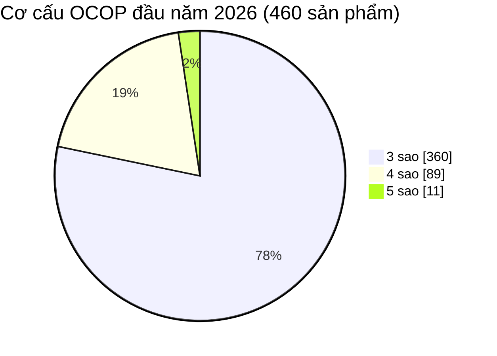

Báo cáo quý III và 9 tháng 2026 của cơ quan thống kê Đồng Nai [S6] ghi nhận:

| Cây trồng | Diện tích (ha) | Sản lượng (tấn) |
|---|---:|---:|
| Sầu riêng | 28.298,33 | 122.800,99 |
| Xoài | 12.088,70 | 109.067,80 |
| Bưởi | 11.059,83 | 85.575 |
| Mít | 10.939,56 | 77.363,79 |

Tính đến tháng 9/2026, báo cáo nêu 314 mã số vùng trồng xuất khẩu (22.075 ha) và 83 cơ sở đóng gói. Không đánh đồng mã vùng trồng với chứng nhận OCOP hoặc dùng số liệu toàn thành phố để suy ra tình trạng của một nhà vườn cụ thể.

## 3.3. Định hướng chính sách phù hợp

Kế hoạch 218/KH-UBND ngày 12/8/2026 về OCOP giai đoạn 2026–2030, theo thông tin công bố [S7–S8]: đánh giá mới và công nhận lại ít nhất 300 sản phẩm đến 2030; mục tiêu số hóa hồ sơ, dữ liệu và truy xuất QR đối với 100% sản phẩm OCOP; phấn đấu 100% sản phẩm tham gia ít nhất một kênh bán hàng hiện đại hoặc TMĐT; phát triển liên kết với du lịch nông thôn, văn hóa, ngành nghề địa phương.

Hội nghị kết nối OCOP với du lịch sinh thái nhà vườn diễn ra sáng 3/7/2026 tại phường Bình Lộc [S9–S10]. Bài công bố của Hội Nông dân là nguồn bổ sung, không nhầm ngày đăng với ngày tổ chức. Định hướng xúc tiến thương mại, số hóa, hỗ trợ nhà sản xuất cũng được thể hiện trong thông tin Sở Công Thương [S11]. Vì đã có các hoạt động xúc tiến và nền tảng bán hàng, NaiFarm không nên tuyên bố livestream hoặc QR là phát minh mới; tập trung khác biệt ở cơ chế hỗ trợ và kết nối giá trị.

## 3.4. Bản sắc nông sản hai vùng hợp nhất

| Nhóm sản phẩm | Không gian/câu chuyện đề xuất | Khả năng kết nối |
|---|---|---|
| Chôm chôm Long Khánh | Long Khánh, Bình Lộc, Bảo Vinh; mùa trái cây | Nhà vườn, lớp học sinh trưởng, tour |
| Bưởi Tân Triều | Tân Triều, câu chuyện vùng đặc sản | Mô hình 3D mặt cắt, tour, chế biến |
| Sầu riêng | Các vùng cây ăn quả Đồng Nai | Nhật ký lô, phân loại, đóng gói |
| Hạt điều Bình Phước | Không gian sản xuất phía Bắc thành phố | Quả giả/hạt điều, chế biến, quà tặng |
| Hồ tiêu | Vùng sản xuất truyền thống như Lộc Ninh | Bài học thu hoạch và chế biến |
| Cà phê, ca cao | Các vùng trồng, cơ sở chế biến phù hợp | Trải nghiệm từ quả đến thành phẩm |
| Rau nhíp, mật ong, nông sản bản địa | Tri thức cộng đồng, ví dụ khu vực Thọ Sơn | Giáo dục văn hóa, đa dạng sản phẩm |

Các vùng trên dùng làm gợi ý thiết kế nội dung; xác minh từng nhà sản xuất và vùng trồng trước khi công bố. Giữ nguyên tên thương hiệu/chỉ dẫn địa lý đã đăng ký (ví dụ Hạt điều Bình Phước), không tự đổi theo địa giới. Không gắn nhãn OCOP cho mọi loại nông sản; chỉ hiển thị khi có hồ sơ tương ứng.

# 4. Thực trạng và bài toán

## 4.1. Cây vấn đề

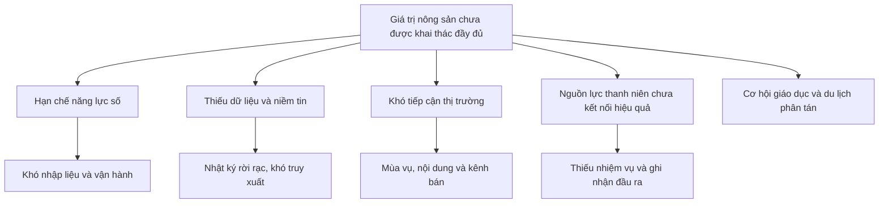

| Vấn đề | Biểu hiện/giả thuyết | Giải pháp | Chỉ số kiểm chứng |
|---|---|---|---|
| Khoảng cách số | Khó đăng sản phẩm, nhập liệu, quản lý | Ảnh, giọng nói, chữ lớn, thanh niên hỗ trợ | Tỷ lệ hoàn thành đăng bán, thời gian thao tác |
| Thị trường | Kênh bán truyền thống, khó quảng bá | Gian hàng, live, combo, đặt trước | Đơn hợp lệ, tỷ lệ chuyển đổi |
| Niềm tin | Người mua khó kiểm chứng nguồn gốc | QR lô hàng, nhật ký, mức xác minh | Tỷ lệ lô có dữ liệu, phản hồi khách |
| Thiếu dữ liệu | Ghi chép rời rạc | Nhật ký ảnh/giọng nói, lịch sử thay đổi | Tỷ lệ cập nhật nhật ký |
| Mùa vụ | Nguồn cung và nhu cầu lệch nhau | Lịch mùa, đặt trước, kết nối tiêu thụ | Tồn dư, tỷ lệ đáp ứng đặt trước |
| Nội dung | Thiếu kỹ năng viết, ảnh, video | AI bản nháp, nhiệm vụ truyền thông | Sản phẩm được số hóa |
| Tình nguyện | Thiếu nhiệm vụ, đầu ra và theo dõi | Nhiệm vụ có người thụ hưởng, minh chứng | Giờ xác nhận, sản phẩm bàn giao |
| Giáo dục | Thiếu nơi thực hành có ích | Farm as a Classroom, bài tập liên ngành | Số bài tập hoàn thành và được sử dụng |
| Du lịch | Khó hình dung, tìm và đặt trải nghiệm | Bản đồ, 360°, 3D, đặt lịch | Yêu cầu trải nghiệm, lượt tham gia |
| Duy trì | Phụ thuộc tình nguyện viên | Chuyển giao kỹ năng, Farmer Pass | Tỷ lệ nhà nông tự đăng lại |
| Lãng phí | Nông sản dư hoặc không đồng đều hình thức | NaiRescue, chế biến, combo | Khối lượng đủ điều kiện được tiêu thụ |

Đề thi trực tiếp xác định khó bán trực tuyến, thiếu nhật ký và khó kiểm chứng nguồn gốc. Những vấn đề bổ sung là giả thuyết thiết kế, không phải kết quả khảo sát. Khi có điều kiện, phỏng vấn nhà nông, thanh niên, khách hàng và giáo viên; quan sát thao tác; kiểm thử prototype; ghi kết quả thật, không tạo số liệu khảo sát giả.

## 4.2. Nguyên tắc giải quyết

- Nhà nông là chủ thể thụ hưởng và làm chủ dữ liệu, không biến họ thành người phụ thuộc công nghệ.
- Thanh niên là cầu nối số, không chỉ lao động miễn phí; nhiệm vụ tự nguyện, có phạm vi, hướng dẫn, minh chứng và bàn giao.
- Khách hàng có quyền biết nguồn gốc, mức xác minh, giá và điều kiện giao nhận.
- Giáo dục phải gắn với mục tiêu học tập, không chỉ tích điểm; du lịch phải gắn với trải nghiệm thật, không chỉ trình diễn 3D.
- AI hỗ trợ, không tự chứng nhận, không tự công bố thông tin thiếu căn cứ.
- Mọi tính năng mở rộng cần liên kết vào nghiệp vụ bán hàng, hỗ trợ hoặc truy xuất; không tạo các ứng dụng rời rạc.

# 5. Người dùng và các bên liên quan

## 5.1. Persona 01 – Chú Ba Tư, 50 tuổi (giả lập theo đề)

**Không gian sử dụng:** W02 – Nhà nông; toàn bộ chức năng mở rộng của chủ thể sản xuất, nhân viên, HTX và host nằm tại 5.6.2.

| Thuộc tính | Mô tả thiết kế |
|---|---|
| Bối cảnh | Chủ nhà vườn 2,5 ha chôm chôm và sầu riêng khu vực Long Khánh; dùng điện thoại để liên lạc |
| Nhu cầu | Đăng bán nhanh, quản lý đơn, biết ai hỗ trợ, lưu nhật ký |
| Nỗi đau | Khó viết mô tả, nhập dữ liệu, quản lý nhiều ứng dụng |
| Rào cản | Thời gian làm vườn, mạng yếu, thuật ngữ, thao tác nhỏ |
| Động lực | Tăng cơ hội tiêu thụ, tự chủ, giảm công sức |
| Jobs-to-be-done | Khi có nông sản cần bán, tôi muốn chụp ảnh và nói thông tin để đăng nhanh, kiểm tra được trước khi công bố |
| Thiết kế | Chữ lớn, nút lớn, tiếng Việt dễ hiểu, 3 bước, hướng dẫn âm thanh, nhờ hỗ trợ |
| Kết quả mong muốn | Có gian hàng, nhật ký và đơn hàng rõ; tự thực hiện được lần tiếp theo |

Hành trình: phát sinh nhu cầu → mở NaiFarmer → chụp ảnh/nói → kiểm tra AI → đăng bán → nhận đơn → xử lý → học cách tự làm. Cảm xúc giả định từ lo ngại công nghệ đến tin tưởng khi thấy bản nháp rõ ràng và thao tác thành công.

## 5.2. Persona 02 – Minh Anh, 21 tuổi (giả lập)

**Không gian sử dụng:** W03 – Thanh niên & người học; đầy đủ học tập, tình nguyện, dự án và hồ sơ năng lực tại 5.6.3.

| Thuộc tính | Mô tả thiết kế |
|---|---|
| Bối cảnh | Sinh viên/đoàn viên, thành thạo điện thoại, sáng tạo nội dung |
| Nhu cầu | Tìm nhiệm vụ theo kỹ năng, lịch rảnh; có hướng dẫn, minh chứng |
| Nỗi đau | Khó tìm đúng nhà vườn, khó chứng minh đóng góp |
| Rào cản | Lịch học, di chuyển, thiếu người hướng dẫn |
| Động lực | Cống hiến, học kỹ năng, hồ sơ năng lực |
| Jobs-to-be-done | Khi có thời gian rảnh, tôi muốn tìm nhiệm vụ phù hợp, làm ra sản phẩm có ích và được ghi nhận công bằng |
| Thiết kế | Lọc online/trực tiếp, kỹ năng, thời lượng; yêu cầu rõ; nộp minh chứng; lịch live |
| Kết quả mong muốn | Có sản phẩm bàn giao, phản hồi nhà nông và giờ xác nhận |

Hành trình: khám phá nhiệm vụ → nhận việc → thực hiện → nộp minh chứng → sửa nếu cần → xác nhận → hồ sơ kỹ năng/chứng nhận. Tình nguyện trực tuyến gồm thiết kế, viết bài, dựng video, dịch thuật, số hóa dữ liệu, 3D, phân tích dữ liệu.

## 5.3. Persona 03 – Ngọc Linh, 29 tuổi (giả lập)

**Không gian sử dụng:** W01 – Cá nhân; đầy đủ khách hàng, du khách, học mở và giám hộ tại 5.6.1.

| Thuộc tính | Mô tả thiết kế |
|---|---|
| Bối cảnh | Người tiêu dùng tại TP. Hồ Chí Minh, có nhu cầu mua nông sản và trải nghiệm cuối tuần |
| Nhu cầu | Giá, chất lượng, nguồn gốc, giao hàng thuận tiện |
| Nỗi đau | Quảng cáo khó kiểm chứng, thông tin chứng nhận không rõ |
| Động lực | Chất lượng, sự minh bạch, ủng hộ nhà sản xuất |
| Jobs-to-be-done | Khi mua nông sản từ xa, tôi muốn xem nhà vườn và hành trình lô hàng trước khi quyết định |
| Thiết kế | QR, mức độ xác minh, thông tin giao nhận, ảnh/live, bản đồ |
| Kết quả mong muốn | Đặt hàng thành công, theo dõi, phản hồi hoặc đặt trải nghiệm |

## 5.4. Persona 04 – Chị Thu Hà, 27 tuổi, Cán bộ Đoàn phường / Điều phối viên cơ sở (giả lập)

**Không gian sử dụng:** W04 – Điều phối; đầy đủ chương trình, Hội Nông dân, xã/phường và xác minh tại 5.6.4.

| Thuộc tính | Mô tả thiết kế |
|---|---|
| Bối cảnh | Cán bộ Đoàn phường Long Khánh, Thành phố Đồng Nai (phụ trách địa bàn trong 95 xã/phường); kiêm nhiệm nhiều hoạt động phong trào và hỗ trợ chuyển đổi số cộng đồng |
| Nhu cầu | Nắm bắt nhà vườn nào trên địa bàn cần hỗ trợ, thanh niên nào đang tham gia, hồ sơ OCOP nào đã đối chiếu, và có số liệu tác động minh bạch để tổng hợp báo cáo |
| Nỗi đau | Điều phối tình nguyện viên rời rạc qua nhóm chat và sổ tay; khó kiểm chứng minh chứng đầu ra; khó biết nhà vườn có tự chủ được sau hỗ trợ hay không; tốn nhiều thời gian cộng giờ thủ công |
| Rào cản | Thời gian hạn hẹp, không thể trực tiếp kiểm tra mọi phiên hỗ trợ tại vườn, ngại quy trình phê duyệt nhiều tầng phức tạp |
| Động lực | Kết nối đúng thanh niên có kỹ năng với nhà vườn địa phương, ghi nhận công bằng đóng góp của đoàn viên, tạo kết quả chuyển đổi số đo đếm được tại cơ sở |
| Jobs-to-be-done | Khi có nhà vườn gửi yêu cầu hoặc thanh niên nộp minh chứng trong phường phụ trách, tôi muốn kiểm tra nhanh đầu ra, đối chiếu hồ sơ cơ bản và xác nhận giờ đóng góp có minh chứng |
| Thiết kế | Bố cục 5 mục gọn (`Tổng quan, Cộng đồng, Nhiệm vụ, Xác minh, Tác động`), lọc tự động theo `unit_code` xã/phường, duyệt nhanh trên cả điện thoại và máy tính, ghi nhận lịch sử kiểm tra rõ ràng |
| Kết quả mong muốn | Điều phối đúng người – đúng việc, giữ chuẩn thông tin công bố trên sàn và xuất được số liệu tác động đáng tin cậy |

Hành trình: đăng nhập theo phạm vi xã/phường → xem danh sách việc chờ xử lý → rà soát yêu cầu hỗ trợ quá hạn hoặc cần điều phối → kiểm tra ảnh/giấy tờ nhà vườn gửi lên → đối chiếu minh chứng nhiệm vụ sau khi nhà vườn đã xác nhận → duyệt giờ tình nguyện và theo dõi chuyển biến tự chủ của nhà nông.

*(Lưu ý phạm vi: Trong P0, vai trò Điều phối viên cơ sở chỉ sử dụng các chức năng tối thiểu là duyệt nhiệm vụ, xác nhận giờ tình nguyện và đối chiếu hồ sơ cơ bản; không xây cổng hành chính phức tạp cho nhiều cấp sở/ngành. Đoàn/Hội là đối tác vận hành tiềm năng, không tuyên bố đã ký kết chính thức.)*


## 5.5. Mô hình tối ưu — 4 persona gốc, 6 workspace, một tài khoản

**Quyết định kiến trúc V3.0:** Giữ nguyên bốn persona 5.1–5.4 làm bốn hành trình trung tâm. Không tạo 28 kiểu tài khoản, không dựng 23 cổng riêng. Sản phẩm hoàn chỉnh có **6 workspace đăng nhập**, một vùng công khai không cần đăng nhập, một cơ chế xác thực, một hồ sơ cá nhân và một bộ dịch vụ nghiệp vụ. Khách chưa đăng nhập không phải một role. Tài khoản chỉ hiện workspace đã được cấp hoặc có thể đăng ký theo điều kiện; không hiển thị 6 lựa chọn bắt buộc khi mở app.

| Workspace | Người dùng chính / đối tượng gộp | Chủ thể quản lý | Route | Phạm vi thi |
|---|---|---|---|---|
| W01 Cá nhân | Ngọc Linh, khách mua, du khách, phụ huynh/giám hộ | Cá nhân tự quản; liên kết giám hộ được xác minh | `/account` | P0 |
| W02 Nhà nông | Ba Tư, chủ thể OCOP, nhân viên, HTX, cơ sở sản xuất, đơn vị đón khách | Chủ cơ sở / đại diện tổ chức sản xuất | `/farmer` | P0 |
| W03 Thanh niên & người học | Minh Anh, tình nguyện viên, học sinh, sinh viên, CLB, nhóm nghiên cứu | Điều phối theo nhiệm vụ; trường/giảng viên theo lớp; người chủ trì theo đề tài | `/volunteer` | P0; học tập mở rộng P1/P2 |
| W04 Điều phối | Thu Hà, điều phối xã/phường, quản lý chương trình Đoàn/Hội, Hội Nông dân | Tổ chức chủ trì chương trình, phạm vi địa bàn được giao | `/coordinator` | P0 |
| W05 Tổ chức & đối tác | Nhà trường, giáo viên, doanh nghiệp thu mua/tài trợ, logistics, chuyên gia, cơ quan chuyên môn | Đại diện từng tổ chức và người được giao việc | `/organization` | P1/P2 |
| W06 Admin | Quản trị hệ thống, CSKH, kiểm duyệt nền tảng, kiểm toán, tài chính nền tảng | Đơn vị vận hành; kiểm toán độc lập theo nhiệm vụ | `/admin` | P0 tối thiểu |

**Tại sao cần W05 và W06 riêng?** Trường học quản lý lớp/điểm; doanh nghiệp quản lý giao dịch và nhân sự; cơ quan chuyên môn có phạm vi xác minh riêng. Không bên nào mặc nhiên thuộc quyền Đoàn/Hội hoặc chủ vườn. W05 dùng một khung giao diện tổ chức chung, các tab bật theo loại tổ chức và nhiệm vụ. W06 quản trị hạ tầng và an toàn toàn hệ thống, không được thay các bên quyết định nghiệp vụ. Không lập workspace thứ 7 cho tài chính, chuyên gia, người giám hộ, học sinh, livestream, bản đồ hoặc 3D.

### 5.5.1. Phân biệt 5 khái niệm, tránh tạo role thừa

| Khái niệm | Ý nghĩa | Ví dụ |
|---|---|---|
| Persona | Mẫu người dùng phục vụ thiết kế | Ba Tư, Minh Anh, Ngọc Linh, Thu Hà |
| Workspace | Không gian thao tác theo mục tiêu | W02 Nhà nông, W03 Thanh niên |
| Organization type | Loại tổ chức, không phải role | farm, cooperative, school, business, logistics, authority, community_program, research, platform |
| Mức truy cập | 5 nhóm mẫu quyền tái sử dụng | cá nhân, thành viên tác nghiệp, quản lý, người duyệt, người xem/kiểm toán |
| Capability + scope | Quyền nguyên tử trên tài nguyên cụ thể | `mission.review_hours` ở chương trình A, phường B |

Mỗi tài khoản có thể tham gia nhiều tổ chức và có nhiều grant. Mức truy cập chỉ là mẫu chọn quyền, không mặc nhiên kế thừa mọi quyền thấp hơn. Quyền duyệt, tài chính, chứng nhận, chấm điểm, quyền đặc quyền luôn cấp riêng và kiểm tra xung đột lợi ích. Tên chức danh chỉ là thuộc tính hiển thị. Các khóa kỹ thuật cũ xuất hiện trong ma trận B01–B24, màn hình và kiểm thử là **bí danh bộ quyền tương thích (permission bundle)**, không phải 28 role đăng nhập, không phải 28 bảng user, không phải 28 dashboard. Có thể lưu cấu hình bundle để seed/test và mở rộng thành quyền nguyên tử; không thêm cột enum role cho mỗi chức danh. Dùng một `profiles` và quan hệ membership/grant.

## 5.6. Đặc tả theo 6 workspace (gộp đầy đủ đối tượng, không mất nghiệp vụ)

Các hồ sơ mở rộng lấy từ V2.0; là giả thuyết thiết kế cần kiểm chứng. Các bảng dưới chỉ giữ thông tin nghiệp vụ riêng của từng nhóm, tránh lặp lại persona gốc và UX chung. Tất cả quyền chỉ phát sinh sau xác minh/ủy quyền đúng phạm vi.
### 5.6.1. W01 – Cá nhân – Mua sắm & khám phá

**Menu:** Chợ · Khám phá · Đơn & lịch · Cá nhân (Live, học mở, QR là nội dung trong Chợ/Khám phá; Giỏ hàng là nút tiện ích). Trong Cá nhân có địa chỉ, đánh giá, khiếu nại, hồ sơ, quyền riêng tư và tab Gia đình nếu có liên kết. Giám hộ xem hoạt động được giao của trẻ, đồng ý/từ chối/rút đồng ý, không xem dữ liệu trẻ khác. Khách muốn tham gia nhiệm vụ hoặc học có lớp chuyển W03 sau khi đủ điều kiện. B2B có phê duyệt, hợp đồng, hạn mức dùng W05, không nhồi vào giỏ cá nhân.

| Đối tượng / bộ quyền | Nhu cầu và rào cản | Chức năng và đầu ra | Ai quản lý / giới hạn quyền | Mức |
|---|---|---|---|---|
| Khách hàng cá nhân / du khách (`customer`) | Ngọc Linh, 29 tuổi, TP.HCM; gia đình muốn mua và trải nghiệm; Khó kiểm tra nguồn gốc, chi phí giao, lịch tham quan | Giỏ, đơn, thanh toán, đánh giá, khiếu nại, đặt trải nghiệm, học mở | Tự quản tài khoản; CSKH hỗ trợ; nhà bán xử lý giao dịch; Chỉ đơn, lịch, địa chỉ và hồ sơ của mình; không xem thông tin khách khác | P0 |
| Cha mẹ / người giám hộ (`guardian`) | Người chịu trách nhiệm đồng ý cho trẻ tham gia; Cần biết lịch, rủi ro, người phụ trách và quyền riêng tư | Xem thông báo liên quan trẻ, đồng ý/từ chối từng hoạt động, yêu cầu rút đồng ý, liên hệ trường | Trường xác minh liên kết; người giám hộ quản lý quyết định đồng ý; Chỉ trẻ đã xác minh mối quan hệ; không xem lớp khác hay chấm điểm | P2 |

### 5.6.2. W02 – Nhà nông – Sản xuất & kinh doanh

**Menu:** Tổng quan · Sản phẩm & mùa vụ · Đơn hàng & kho · Hỗ trợ · Hồ sơ. Tab Sản phẩm có đăng ảnh/giọng, duyệt AI, nhật ký, lô, QR, chứng từ, đặt trước và nguồn dư. Tab Đơn có giao nhận, RFQ/báo giá, combo, đối soát, doanh thu theo quyền. Tab Hỗ trợ có yêu cầu, người đồng hành, xác nhận đầu ra, lịch live, bàn giao kỹ năng. Tab Hồ sơ có nhân sự, ủy quyền, Farmer Pass, vị trí, gói tour/360°, booking và an toàn. HTX dùng cùng giao diện, thêm chọn cơ sở, hộ thành viên, kho chung/lô hỗn hợp theo đồng ý. Chủ cơ sở đón khách dùng tab Trải nghiệm; đơn vị chỉ tổ chức tour cũng dùng W02 với bundle host và chỉ hiện tab cần thiết. Thanh niên được giao việc thao tác bản nháp trong W03, không được mở toàn bộ W02.

| Đối tượng / bộ quyền | Nhu cầu và rào cản | Chức năng và đầu ra | Ai quản lý / giới hạn quyền | Mức |
|---|---|---|---|---|
| Chủ nhà vườn / chủ thể sản xuất (`farm_owner`) | Chú Ba Tư, 50 tuổi; hộ nhỏ hoặc chủ thể OCOP; Khó thao tác số, ít thời gian, đầu ra mùa vụ | Hồ sơ, thành viên, sản phẩm, nhật ký, lô, giá, tồn, đơn, lịch live, yêu cầu hỗ trợ, tour, chuyển giao | Tự quản cơ sở; điều phối hỗ trợ theo địa bàn, hợp tác xã chỉ theo ủy quyền; Chịu trách nhiệm dữ liệu tự khai; duyệt công bố và quyền đại diện; không tự chứng nhận OCOP | P0 |
| Nhân viên / người thân hỗ trợ nhà vườn (`farm_staff`) | Người đóng gói, kế toán hoặc con cháu phụ quản lý; Cần chia việc không dùng chung tài khoản | Nhập nhật ký, tồn, đóng gói, hỗ trợ đơn theo quyền được giao | Chủ nhà vườn mời, giới hạn và thu hồi quyền; Không đổi chủ sở hữu, tài khoản nhận tiền, cấp quyền, duyệt ngoài phạm vi | P1 |
| Quản lý hợp tác xã / tổ hợp tác / doanh nghiệp sản xuất (`coop_manager`) | Đại diện đơn vị có nhiều thành viên, lô hàng và thương hiệu chung; Khó gom cung, chuẩn hóa truy xuất, phân chia trách nhiệm | Thành viên, yêu cầu mua/gom hàng, kho chung, gian hàng tổ chức, hợp đồng, lô, B2B, báo cáo | Đại diện tổ chức có quyền; thành viên có thể rút ủy quyền; Chỉ dữ liệu của tổ chức hoặc cơ sở đã chấp thuận chia sẻ; không tự sở hữu sản phẩm thành viên | P2 |
| Nhân viên hợp tác xã / đơn vị sản xuất (`coop_staff`) | Nhân viên kiểm hàng, kho, kinh doanh; Cần quyền theo công việc, tránh dùng chung mật khẩu | Nhập lô, tồn, đóng gói, báo giá dự thảo, giao nhận | Quản lý tổ chức phân công theo chức năng; Không đổi thành viên, không ký hợp đồng hoặc nhận tiền nếu không có quyền | P2 |
| Đơn vị tổ chức trải nghiệm / hướng dẫn viên (`experience_host`) | Nhà vườn đủ điều kiện đón khách hoặc đối tác du lịch; Khó quản lý sức chứa, lịch, an toàn và hủy | Gói trải nghiệm, ca, sức chứa, yêu cầu đặt, danh sách đoàn, check-in, sự cố | Chủ đơn vị tổ chức hoặc nhà vườn ủy quyền; đơn vị trường quản học sinh; Chỉ khách thuộc lịch mình; không tự nhận đã có giấy phép; nội dung phải có quyền | P1/P2 |

### 5.6.3. W03 – Thanh niên & người học

**Menu:** Tổng quan · Nhiệm vụ · Học tập · Hồ sơ năng lực (lịch live, dự án và minh chứng nằm trong Nhiệm vụ/Học tập). Sinh viên có thể vừa học vừa tình nguyện trong cùng không gian, không cần đăng ký hai tài khoản. Nhiệm vụ gồm online/tại chỗ, nhóm đồng hành, đăng nháp sản phẩm, nội dung/live, 3D, hồ sơ bàn giao, giờ, kỹ năng mềm/chuyên môn. Học tập gồm lớp, bài học, quiz, 3D, thực hành, đồ án, Field Lab, NCKH. Người học nhỏ tuổi chỉ thấy bài/lịch đã duyệt, không có chợ tác vụ người lạ, giao dịch thương mại hoặc công cụ ghi hình công khai; có consent và giám sát. Nhóm nghiên cứu dùng tab Dự án, người chủ trì/mentor phê duyệt trong W05 theo quyền. Chấm điểm, duyệt giờ và xác nhận đầu ra không nằm trong quyền của người nộp.

| Đối tượng / bộ quyền | Nhu cầu và rào cản | Chức năng và đầu ra | Ai quản lý / giới hạn quyền | Mức |
|---|---|---|---|---|
| Thanh niên / đoàn viên / tình nguyện viên trưởng thành (`volunteer`) | Minh Anh, 21 tuổi; có kỹ năng số hoặc chuyên ngành; Khó tìm nhiệm vụ, minh chứng và hướng dẫn | Hồ sơ kỹ năng, nhận nhiệm vụ, bản nháp có ủy quyền, live, nộp đầu ra, giờ, phản hồi, NaiPass | Đơn vị chương trình và điều phối viên quản lý nhiệm vụ; người thụ hưởng xác nhận; Không tự công bố thay nhà nông nếu chưa được ủy quyền; không duyệt giờ mình; không xem tài chính | P0 |
| Học sinh phổ thông chưa thành niên (`student_minor`) | Học Công nghệ, Sinh học, trải nghiệm hướng nghiệp; Thiếu môi trường an toàn và nội dung trực quan | Bài học phù hợp tuổi, quiz, nhiệm vụ mô phỏng/giám sát, nộp bài, xem phản hồi | Nhà trường/giáo viên quản lý lớp, người giám hộ đồng ý theo quy trình; Không tự nhận nhiệm vụ ngoài trường, ký hợp đồng, chat người lạ, live công khai hay chia sẻ vị trí; giao dịch độc lập không bật mặc định | P2 |
| Sinh viên / người học trưởng thành (`student_adult`) | Học nông nghiệp, CNTT, kinh tế, thiết kế, du lịch và ngành khác; Muốn bài thực hành và hồ sơ năng lực thực chất | Lớp, học liệu, nhiệm vụ đồ án, nhóm, nộp bài, kết quả, Learning Pass | Nhà trường/giảng viên quản lý học vụ; điều phối quản lý tình nguyện riêng; Chỉ lớp và bài mình; có thể nhận role volunteer riêng nếu đủ điều kiện | P1/P2 |
| Nhóm nghiên cứu / đội thi / CLB đổi mới sáng tạo (`researcher`) | Người nhận đề bài Field Lab, có người hướng dẫn; Thiếu dữ liệu thực tiễn và quyền sử dụng rõ ràng | Đề xuất dự án, xin dữ liệu, thí nghiệm, nộp kết quả, bàn giao và ghi nhận tác giả | Trường/đơn vị chủ trì, nhà vườn đồng ý, chuyên gia giám sát; Không tự khai thác dữ liệu cá nhân, không điều khiển thiết bị thật chưa được phép | P2 |

### 5.6.4. W04 – Điều phối cộng đồng

**Menu:** Tổng quan · Cộng đồng · Nhiệm vụ · Xác minh · Tác động. Một dashboard điều phối duy nhất, có bộ lọc chương trình/địa bàn khi được cấp nhiều phạm vi. Quản lý chương trình dùng thêm tab Chiến dịch, phân công điều phối, ngân sách/tài trợ theo quyền, khiếu nại, chứng nhận. Hội Nông dân dùng Cộng đồng/Tập huấn/Mentor theo hộ đồng ý tham gia; không mặc nhiên duyệt giờ. Điều phối xã/phường kiểm tra yêu cầu, an toàn, ghép kỹ năng, chứng từ cơ bản, xác nhận hai lớp, giờ tình nguyện và cấp pass nội bộ nếu được ủy quyền. Không điều phối lớp học, đơn hàng, giá bán hay xác nhận nguồn chứng từ pháp lý.

| Đối tượng / bộ quyền | Nhu cầu và rào cản | Chức năng và đầu ra | Ai quản lý / giới hạn quyền | Mức |
|---|---|---|---|---|
| Điều phối viên xã/phường (`local_coordinator`) | Thu Hà, 27 tuổi, cán bộ Đoàn hoặc người được giao nhiệm vụ; Thông tin rời rạc, khó điều phối và đối chiếu | Hàng chờ, cộng đồng, điều phối, hồ sơ, duyệt giờ, tác động theo địa bàn | Đơn vị chương trình cấp thành phố/cấp có thẩm quyền giao phạm vi; Admin kích hoạt theo yêu cầu đã duyệt; Không cấp OCOP/VietGAP, không sửa giá/đơn, không tự duyệt; không phải admin toàn hệ thống | P0 |
| Quản lý chương trình Đoàn/Hội cấp thành phố hoặc tổ chức tình nguyện (`program_manager`) | Người phụ trách chiến dịch đa xã/phường; Khó phân bổ nguồn lực, chuẩn hóa tiêu chí và báo cáo | Chiến dịch, điều phối viên, quy chế, phân công liên địa bàn, khiếu nại giờ, chứng nhận nội bộ | Lãnh đạo tổ chức triển khai; nền tảng xác minh tư cách và giới hạn quyền; Chỉ chương trình của tổ chức, không quản lý hành chính toàn thành phố mặc định | P1/P2 |
| Cán bộ Hội Nông dân / đơn vị hỗ trợ sản xuất (`farmer_association`) | Người kết nối hộ nông nghiệp và tập huấn; Thiếu danh sách nhu cầu, khó theo dõi năng lực số | Giới thiệu hộ có đồng ý, chương trình đào tạo, chuyên gia, phản hồi, báo cáo nhóm | Tổ chức Hội của mình; phối hợp nhà vườn, điều phối; Không đọc đơn/giá vốn chi tiết, không tự cấp chứng nhận hay bắt buộc hội viên tham gia | P2 |

### 5.6.5. W05 – Tổ chức & đối tác

**Menu chung:** Tổng quan · Thành viên & phạm vi · Công việc · Phê duyệt · Báo cáo (chỉ hiện mục có quyền). Chọn tổ chức đang làm việc, không chọn một role mới. Các tab nghiệp vụ: Trường học (lớp, giáo án, bài tập, chấm, chuyến, consent, đối tác); Doanh nghiệp (RFQ, báo giá, hợp đồng, thu mua, tài trợ, hạn mức); Logistics (chuyến được giao, tracking, sự cố); Chuyên môn (tư vấn, đề tài, học liệu, đối chiếu nguồn chứng từ); Cơ quan (báo cáo tổng hợp và hồ sơ được giao). Giáo viên chỉ thấy lớp và học vụ của mình; lãnh đạo trường thấy phạm vi được giao. Chuyên gia được mời chỉ thấy đề tài/case. Cơ quan đọc báo cáo không có quyền xác minh nguồn nếu chưa được cấp. Một tổ chức có thể bật nhiều bộ chức năng sau xác minh; không tự cấp quyền do khai loại tổ chức. Doanh nghiệp có hoạt động bán/sản xuất dùng W02 cho phía nhà bán, W05 cho thu mua/tài trợ nếu được cấp.

| Đối tượng / bộ quyền | Nhu cầu và rào cản | Chức năng và đầu ra | Ai quản lý / giới hạn quyền | Mức |
|---|---|---|---|---|
| Doanh nghiệp thu mua / nhà hàng / cửa hàng (`business_buyer`) | Nhân viên thu mua tìm nguồn ổn định và hồ sơ; Khó biết năng lực cung ứng và quy cách | RFQ, báo giá, mẫu thử, đặt số lượng lớn, hợp đồng, lịch giao, khiếu nại | Quản trị tổ chức doanh nghiệp, người duyệt mua hàng; Chỉ hồ sơ công khai hoặc được chia sẻ cho RFQ; không truy cập toàn bộ dữ liệu nhà vườn | P2 |
| Quản trị doanh nghiệp / nhà tài trợ / đối tác công nghệ (`business_manager`) | Đại diện doanh nghiệp muốn cung cấp nguồn lực hoặc mua hàng; Cần minh bạch chi phí, đầu ra và quyền nhân viên | Xác minh tổ chức, quản lý nhân sự, hạn mức mua, tài trợ chiến dịch, báo cáo tổng hợp | Doanh nghiệp tự quản; chương trình phê duyệt tài trợ, Admin đối chiếu tổ chức; Không mua điểm tình nguyện, không tiếp cận dữ liệu trẻ em hoặc hồ sơ cá nhân để tuyển dụng | P2 |
| Đơn vị vận chuyển / điểm nhận hàng (`logistics_operator`) | Nhân viên hoặc tài xế được giao chuyến; Cần địa chỉ đúng, khối lượng và điều kiện bảo quản | Nhận chuyến, xác nhận lấy, cập nhật tracking, bằng chứng giao, sự cố | Quản trị đối tác logistics; nhà bán điều phối giao nhận; Chỉ thông tin giao nhận tối thiểu của chuyến đang phụ trách; không thấy hồ sơ học/tình nguyện | P2 |
| Quản lý nhà trường / điều phối học vụ (`school_admin`) | Ban giám hiệu, phòng đào tạo hoặc cán bộ được giao; Cần duyệt giáo viên, lớp, đối tác, hoạt động an toàn và học vụ | Hồ sơ trường, giáo viên, lớp, chương trình, phê duyệt hoạt động, quyền và báo cáo | Lãnh đạo nhà trường; Admin chỉ kích hoạt tư cách tổ chức; Không sửa điểm tùy ý; không xem trường khác; không tự cấp tín chỉ ngoài quy chế | P2 |
| Giáo viên / giảng viên / người hướng dẫn học thuật (`teacher`) | Phụ trách môn Công nghệ, Sinh học, chuyên ngành hoặc đồ án; Thiếu bài toán thực tế, cần rubric, tài liệu và theo dõi | Soạn bài, lớp, giao nhiệm vụ, duyệt học liệu, nhận bài, chấm, phản hồi, đề xuất field trip | Quản lý nhà trường, trưởng chương trình học thuật; Chỉ lớp được giao; không tự cộng giờ tình nguyện; điểm theo quy chế trường | P1/P2 |
| Chuyên gia nông nghiệp / cố vấn chuyên ngành (`expert_mentor`) | Người có chuyên môn về cây trồng, thực phẩm, du lịch hoặc công nghệ; Cần đúng phạm vi tư vấn, dữ liệu đầy đủ, tránh hiểu nhầm trách nhiệm | Hỏi đáp chuyên môn, duyệt học liệu, phản hồi đồ án, cố vấn Field Lab | Đơn vị chuyên môn hoặc chương trình mời và phân công; Chỉ chủ đề/hồ sơ được giao; không chẩn đoán, cấp chứng nhận ngoài tư cách được xác minh | P2 |
| Cơ quan địa phương / cơ quan chuyên môn (đọc báo cáo) (`authority_viewer`) | Đầu mối được ủy quyền theo chương trình, lĩnh vực và địa bàn; Cần số liệu đáng tin, không lấy dữ liệu vượt nhu cầu | Dashboard tổng hợp, xuất báo cáo phạm vi đã duyệt, yêu cầu đối chiếu qua kênh chính thức | Cơ quan tự chỉ định người có thẩm quyền; nền tảng cấp quyền theo thỏa thuận; Không có quyền admin, không xem danh tính/đơn chi tiết mặc định, không phê duyệt hộ nếu không có căn cứ | P2 |
| Đơn vị chuyên môn / tổ chức cấp chứng nhận (`credential_verifier`) | Đầu mối có quyền đối chiếu chứng nhận được giao; Cần hồ sơ chính xác và lịch sử thay đổi | Xác nhận nguồn/hiệu lực văn bản, phản hồi yêu cầu, đối chiếu phạm vi sản phẩm | Tổ chức cấp hoặc cơ quan có thẩm quyền xác nhận tư cách; Không cấp chứng nhận từ ứng dụng trừ khi có quy trình tích hợp hợp pháp; không xem giao dịch riêng | P2 |

### 5.6.6. W06 – Quản trị nền tảng

**Menu:** Tổng quan · Tài khoản & tổ chức · An toàn & hỗ trợ · Dữ liệu & cấu hình · Kiểm toán (tài chính nền tảng là tab theo quyền). Hàng chờ dùng chung cho ticket, kiểm duyệt, xác minh tư cách, yêu cầu dữ liệu, sự cố, nhưng mỗi loại có bộ lọc và quyền riêng. Admin kỹ thuật không mặc định xem giấy tờ, bài làm trẻ em, PII, số tiền hay hồ sơ y tế; truy cập theo vụ việc, log, quyền khẩn cấp có kiểm soát. CSKH không duyệt điểm/giờ; người kiểm duyệt không tự xác nhận khoa học/chứng từ; kiểm toán chỉ đọc; kế toán không tự duyệt khoản do mình tạo. Không dùng superadmin làm tài khoản demo nghiệp vụ.

| Đối tượng / bộ quyền | Nhu cầu và rào cản | Chức năng và đầu ra | Ai quản lý / giới hạn quyền | Mức |
|---|---|---|---|---|
| Biên tập viên / kiểm duyệt học liệu và nội dung (`content_reviewer`) | Nhân sự vận hành kho 3D, video, bản đồ, bài học mở; Cần kiểm tra bản quyền, tính chính xác và phù hợp độ tuổi | Duyệt xuất bản, quản lý license, yêu cầu chỉnh sửa, gỡ nội dung, báo cáo vi phạm | Quản lý nội dung nền tảng hoặc tổ chức sở hữu kho nội dung; Không thay chuyên gia về nội dung kỹ thuật; không sửa dữ liệu chứng nhận nguồn | P1/P2 |
| Admin hệ thống / quản trị vận hành (`platform_admin`) | Nhân sự đơn vị vận hành NaiFarm; Cần kiểm soát tài khoản, phân quyền, sự cố và dữ liệu chuẩn | Quản lý định danh, tổ chức, role grant, cấu hình, địa giới, khóa tài khoản, hàng chờ, audit và vận hành | Đơn vị vận hành bổ nhiệm, tách trách nhiệm với kiểm toán và CSKH; Không giả danh người dùng, không tự duyệt giờ, chấm điểm, cấp OCOP, sửa giá hay giao dịch tùy ý | P0/P2 |
| Nhân viên CSKH / xử lý tranh chấp và an toàn (`support_agent`) | Người hỗ trợ giao dịch, tài khoản, báo cáo nội dung; Cần dữ liệu đúng vụ việc, SLA và lịch sử | Ticket, trao đổi các bên, điều tra trong phạm vi, đề xuất hoàn/hủy, chuyển cấp an toàn | Quản lý vận hành và quy trình vụ việc; Không dùng tài khoản khách, không tự quyết ngoài chính sách, không truy cập toàn hệ thống | P1/P2 |
| Kiểm toán viên / người giám sát tuân thủ (`auditor`) | Người độc lập kiểm tra quy trình và dữ liệu; Cần dấu vết thay đổi và bằng chứng, tránh xung đột lợi ích | Đọc audit, đối chiếu quyền, kiểm tra sai lệch giờ, chứng nhận và giao dịch theo vụ việc | Đơn vị vận hành/đối tác có thẩm quyền giao nhiệm vụ độc lập; Chỉ đọc dữ liệu cần thiết, không tự sửa, xóa log hoặc phê duyệt nghiệp vụ | P2 |

### 5.6.7. Chức năng dùng chung, không thêm workspace

**Tài chính (`finance_operator`):** Người đối soát tiền, phí, hoàn tiền và tài trợ; Cần số liệu nhất quán, chứng từ, phân quyền duyệt chi. Đối soát, hóa đơn/chứng từ, xử lý hoàn theo phê duyệt, ngân sách tài trợ. Quản lý tài chính của tổ chức tương ứng; Không tự duyệt khoản hoàn do mình tạo; không truy cập dữ liệu học tập. Tab Tài chính nằm trong W02 (nhà bán/HTX), W04 (ngân sách chương trình), W05 (doanh nghiệp/đơn vị đối tác) hoặc W06 (tài chính nền tảng), theo tổ chức và grant. Không có workspace `/finance` độc lập.

**Công khai (`guest` là điều kiện public, không phải grant):** Khám phá công khai, tìm kiếm, QR, bản đồ, video và bài học mở. Không tạo đơn, nộp bài hay xem dữ liệu riêng; tự đăng ký nếu cần. Dùng `/market`, `/trace`, `/explore`, `/live`, `/academy` cho projection công khai; khi đăng nhập không đổi trang nếu đang đọc thông tin công khai.

**Dịch vụ chia sẻ:** Livestream, QR, bản đồ, học mở, thư viện 3D, NaiPass, thông báo, hồ sơ, tìm kiếm, ticket, tài chính, CMS nội dung và audit dùng cùng dữ liệu/service. Chỉ có các view tác nghiệp theo quyền, không nhân bản tính năng. Người dùng bấm xem chứng nhận từ hồ sơ bất kỳ đều tới `/verify/[code]`; người có quyền cấp/thu hồi thao tác trong workspace của tổ chức cấp. Một nhiệm vụ liên quan trường, nhà vườn và Đoàn/Hội có cùng ID, mỗi bên thấy phần được phép.

### 5.6.8. Bảng quy đổi đầy đủ V2 → V3 (chỉ dành cho triển khai và chuyển đổi)

| Mã cũ | Bộ quyền tương thích | Workspace mới | Ghi chú |
|---|---|---|---|
| R00 | `guest` | Công khai | Không có grant đăng nhập |
| R01 | `customer` | W01 | Bộ quyền trong workspace; không role đăng nhập riêng |
| R02 | `farm_owner` | W02 | Bộ quyền trong workspace; không role đăng nhập riêng |
| R03 | `farm_staff` | W02 | Bộ quyền trong workspace; không role đăng nhập riêng |
| R04 | `volunteer` | W03 | Bộ quyền trong workspace; không role đăng nhập riêng |
| R05 | `local_coordinator` | W04 | Bộ quyền trong workspace; không role đăng nhập riêng |
| R06 | `program_manager` | W04 | Bộ quyền trong workspace; không role đăng nhập riêng |
| R07 | `farmer_association` | W04 | Bộ quyền trong workspace; không role đăng nhập riêng |
| R08 | `coop_manager` | W02 | Bộ quyền trong workspace; không role đăng nhập riêng |
| R09 | `coop_staff` | W02 | Bộ quyền trong workspace; không role đăng nhập riêng |
| R10 | `business_buyer` | W05 | Bộ quyền trong workspace; không role đăng nhập riêng |
| R11 | `business_manager` | W05 | Bộ quyền trong workspace; không role đăng nhập riêng |
| R12 | `logistics_operator` | W05 | Bộ quyền trong workspace; không role đăng nhập riêng |
| R13 | `experience_host` | W02 | Bộ quyền trong workspace; không role đăng nhập riêng |
| R14 | `school_admin` | W05 | Bộ quyền trong workspace; không role đăng nhập riêng |
| R15 | `teacher` | W05 | Bộ quyền trong workspace; không role đăng nhập riêng |
| R16 | `student_minor` | W03 | Bộ quyền trong workspace; không role đăng nhập riêng |
| R17 | `student_adult` | W03 | Bộ quyền trong workspace; không role đăng nhập riêng |
| R18 | `guardian` | W01 | Bộ quyền trong workspace; không role đăng nhập riêng |
| R19 | `expert_mentor` | W05 | Bộ quyền trong workspace; không role đăng nhập riêng |
| R20 | `content_reviewer` | W06 | Bộ quyền trong workspace; không role đăng nhập riêng |
| R21 | `authority_viewer` | W05 | Bộ quyền trong workspace; không role đăng nhập riêng |
| R22 | `credential_verifier` | W05 | Bộ quyền trong workspace; không role đăng nhập riêng |
| R23 | `platform_admin` | W06 | Bộ quyền trong workspace; không role đăng nhập riêng |
| R24 | `support_agent` | W06 | Bộ quyền trong workspace; không role đăng nhập riêng |
| R25 | `auditor` | W06 | Bộ quyền trong workspace; không role đăng nhập riêng |
| R26 | `finance_operator` | W02/W04/W05/W06 | Tab theo tổ chức; không portal riêng |
| R27 | `researcher` | W03 | Bộ quyền trong workspace; không role đăng nhập riêng |

### 5.6.9. Luồng gia nhập và chuyển workspace

1. Khách xem công khai, đăng nhập một lần bằng phương thức được hỗ trợ. Tài khoản người trưởng thành thông thường vào W01. Tài khoản học sinh được mời vào W03 qua trường, kiểm tra độ tuổi và chính sách; không tự động bật quyền mua hàng hoặc tình nguyện mở.
2. Gia nhập bằng lời mời trường/nhà vườn/tổ chức hoặc yêu cầu đăng ký có xác minh. Nhà vườn tạo cơ sở, tình nguyện viên đăng ký năng lực, điều phối viên/cơ quan/giảng viên được tổ chức chỉ định. Không tự bật quyền quản trị từ màn hình chọn nhu cầu.
3. Trang chủ ưu tiên workspace dùng gần nhất còn quyền; nếu có một workspace thì không hiện bộ chuyển. Nếu nhiều workspace, dùng menu avatar “Đổi không gian” và chọn tổ chức/phạm vi khi cần; không yêu cầu đăng nhập lại.
4. Khi đổi không gian, route guard và server lấy membership/grant đúng ngữ cảnh, xóa cache nhạy cảm, tải lại menu. Không gộp quyền xuyên tổ chức; thông báo có deep link về đúng ngữ cảnh đã cấp. Thu hồi grant hoặc hết hạn: ẩn chức năng, chặn API ngay, có hướng dẫn liên hệ đơn vị phụ trách.

## 5.7. Sơ đồ quản trị: không phải mọi bên đều trực thuộc Admin

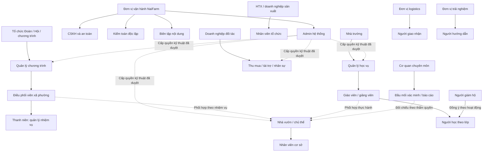

Mũi tên liền biểu thị quan hệ quản lý nghiệp vụ trong tổ chức hoặc phạm vi hoạt động (không mặc nhiên là quan hệ hành chính). Mũi tên đứt là phối hợp/cấp quyền kỹ thuật. Admin không phải cấp trên pháp lý của nhà trường, cơ quan, HTX hoặc chủ nhà vườn. Quản lý chương trình không có quyền đối với trường học hay doanh nghiệp ngoài hoạt động đã thỏa thuận.

### 5.7.1. Loại tổ chức và phạm vi quản lý

| Loại tổ chức | Ai quản trị nghiệp vụ | Phạm vi | Không được vượt quyền |
|---|---|---|---|
| Platform | Đơn vị vận hành | Cấu hình, xác thực, an toàn, kiểm toán, hỗ trợ | Không thay chủ thể quyết định nghiệp vụ |
| Farm | Chủ cơ sở | Hồ sơ, nhân viên, sản phẩm, lô, đơn, tour của mình | Không quản lý hộ khác |
| Cooperative / producer enterprise | Đại diện tổ chức | Thành viên, kho và giao dịch tổ chức, hợp đồng | Thành viên độc lập chỉ chia sẻ theo ủy quyền |
| Youth / community program | Quản lý chương trình | Chiến dịch, điều phối, nhiệm vụ, giờ và chứng nhận nội bộ | Không cấp chứng nhận pháp lý hoặc điểm học vụ |
| Farmer association | Người được giao phụ trách | Hộ tham gia chương trình hỗ trợ, tập huấn | Không tự đọc giao dịch riêng của hội viên |
| School | Quản lý học vụ | Lớp, giáo viên, học sinh/sinh viên, hoạt động | Không đọc trường khác; không tự cộng giờ đoàn |
| Business | Đại diện doanh nghiệp | Nhân sự, thu mua, tài trợ, hợp đồng | Không sở hữu hồ sơ người thụ hưởng |
| Logistics / experience | Quản lý đối tác | Chuyến giao hoặc lịch trải nghiệm của đơn vị | Chỉ dữ liệu tối thiểu phục vụ chuyến/booking |
| Authority / certification body | Đầu mối được xác minh | Báo cáo hoặc đối chiếu chứng từ theo thẩm quyền | Không có quyền admin mặc định |
| Research / expert group | Người chủ trì được mời | Đề tài, tư vấn, dữ liệu được cấp phép | Không tự xuất dữ liệu riêng hoặc công bố sai phạm vi |

**Địa bàn:** `unit_code` là phạm vi xã/phường của đối tượng nghiệp vụ, không phải quyền chung. Người dùng TP.HCM có thể mua hàng; thanh niên ngoài Đồng Nai có thể hỗ trợ online; điều phối viên được giao nhiều địa bàn phải có từng grant; không dùng địa chỉ cư trú để tự xác định quyền. Trường/HTX có thể hoạt động ở nhiều địa bàn nhưng vẫn chỉ thấy hồ sơ thuộc tổ chức và dự án được giao.

# 6. Định danh, định vị và hệ sinh thái

## 6.1. Tên và nhận diện

| Tên ứng viên | Ý nghĩa |
|---|---|
| NaiFarm (chọn) | Nông nghiệp Đồng Nai, dễ nhớ và mở rộng |
| NaiAgri | Nông nghiệp công nghệ cao |
| NaiRoots | Cội nguồn, bản sắc |
| NaiHarvest | Mùa thu hoạch |
| NaiGreen | Nông nghiệp bền vững |
| NaiFarm Connect | Kết nối cộng đồng |
| NaiOCOP | Bám sát chương trình OCOP |

NaiFarm là tên làm việc, cần kiểm tra trùng nhãn hiệu/tên miền trước thương mại hóa. Logo concept: mầm cây và đường luống ruộng tối giản, xanh rừng, nét tự nhiên; không dùng logo cơ quan hay biểu trưng OCOP trái phép. Tagline: **Gieo tri thức – Kết nối nhà nông – Lan tỏa giá trị.**

## 6.2. Mười phân hệ trong một nền tảng

| Phân hệ | Vai trò | Liên kết đề | Phạm vi |
|---|---|---|---|
| NaiMarket | Chợ nông sản, OCOP | R1, R3, R4 | P0 |
| NaiFarmer | Trợ lý nhà nông, sản phẩm, đơn | R1, R2, R5, B1 | P0 |
| NaiTrace | Hộ chiếu lô hàng, QR, nhật ký | R3 | P0 |
| NaiLive | Lịch và phiên livestream | R6 | Lịch P0, phiên P1 |
| NaiVolunteer | Nhiệm vụ và giờ tình nguyện | B3 | P0 |
| NaiAcademy | Học tập và thực hành | Sáng tạo | P1/P2 |
| NaiExplore | Du lịch, 360°, 3D | B2 | Bản đồ P0, trải nghiệm P1 |
| NaiMap | GIS nông nghiệp | B2 | P0 |
| NaiPass | Hồ sơ năng lực/chứng nhận | Sáng tạo | P1 |
| NaiImpact | Dashboard tác động | Tác động | P1 |

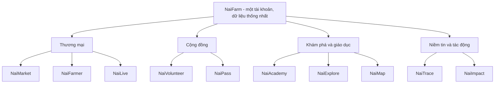

Không phải 10 ứng dụng, không bắt buộc 10 tên hiện trên thanh điều hướng. Tên phân hệ dùng để tổ chức nghiệp vụ và code; UI sử dụng từ ngữ đơn giản phù hợp từng vai trò.

# 7. Đặc tả 10 phân hệ

## 7.1. NaiMarket – Chợ nông sản và OCOP

**Mục tiêu:** chuyển nông sản thành sản phẩm số dễ khám phá, minh bạch và mua được.

| Chức năng | Đặc tả | Mức |
|---|---|---|
| Trang chợ | Tìm sản phẩm, danh mục, vùng, mùa vụ, trạng thái | P0 |
| Gian hàng | Câu chuyện, ảnh, vị trí, chứng nhận, sản phẩm | P0 |
| Danh mục OCOP | Lọc loại chứng nhận đã đối chiếu; phân biệt chưa xác minh | P0 |
| Chi tiết sản phẩm | Tên, ảnh, giá/đơn vị, tồn, mô tả, lô, QR | P0 |
| Giỏ hàng | Thêm/xóa, số lượng, tạm tính, phí giao, tổng | P0 |
| Đặt hàng | Địa chỉ giao hoặc nhận tại vườn/điểm nhận; xác nhận | P0 |
| Đơn hàng của tôi | Mã đơn, trạng thái, lịch sử, thông tin liên hệ | P0 |
| Nông sản theo mùa | Đang có hàng/sắp thu hoạch/hẹn mùa | P1 |
| Đặt trước | Điều kiện giao, thời gian dự kiến, số lượng, hoàn/hủy | P1/P2 |
| Combo đặc sản | Nhóm sản phẩm từ nhiều vùng, ghi nguồn từng thành phần | P1/P2 |
| Đánh giá | Sau giao dịch; chống đánh giá giả | P2 |
| Khiếu nại | Lý do, ảnh, phản hồi, xử lý | P2 |
| B2B | Nhu cầu thu mua, hợp tác xã/nhà hàng, báo giá | P2 |

**NaiBox 95:** hộp quà Hương vị Đồng Nai (điều, cà phê, trái cây sấy...) và Mùa trái ngọt (trái cây theo nguồn cung), QR kể câu chuyện từng vùng. Không bắt buộc combo đa nhà bán trong P0 vì phức tạp vận chuyển.

**Quy tắc:** giá và đơn vị phải rõ; không cho số lượng âm hoặc vượt tồn; kiểm tra tồn phía server; đơn demo dùng COD hoặc thanh toán giả lập ghi rõ; không tự đánh dấu đã trả tiền thật. Nếu hết hàng, gợi ý theo dõi mùa vụ. Không gắn sao OCOP giả cho sản phẩm.

## 7.2. NaiFarmer – Trợ lý nhà nông và AI

**Mục tiêu:** người 50 tuổi thực hiện thao tác chính dễ dàng mà không cần hiểu AI.

### Đăng bán bằng ảnh và lời nói trong 3 bước

1. Chụp/chọn ảnh sản phẩm; có hướng dẫn góc chụp.
2. Nói thông tin như “Tôi có 30 ký chôm chôm, bán 35 nghìn một ký”; có thể gõ thay thế.
3. Kiểm tra bản nháp (tên, mô tả, giá, đơn vị, tồn, lô) và bấm đăng; cho sửa trước khi công bố.

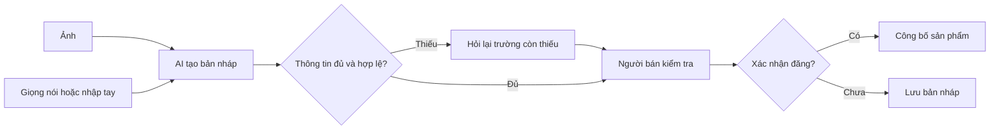

AI nhận diện nhóm nông sản từ ảnh, chuyển lời nói thành văn bản, trích xuất dữ liệu có cấu trúc và viết mô tả. Không tự thêm giống cụ thể nếu không chắc, chứng nhận OCOP/VietGAP, ngày thu hoạch, công dụng chữa bệnh, tiêu chuẩn an toàn hay nguồn gốc. Trường chưa rõ để trống/hỏi lại, không suy diễn. Nhận diện sai thì sửa tay; lỗi API có bản nháp thủ công; không mất ảnh hoặc dữ liệu nhập. Ghi rõ nội dung AI đề xuất.

### Trang chủ nhà nông

```text
┌────────────────────────────────────┐
│ Chào chú Ba Tư!     Thông báo      │
│ 3 đơn chờ xác nhận | 5 sản phẩm     │
│                                    │
│ [ CHỤP ẢNH / NÓI ĐỂ ĐĂNG SẢN PHẨM ]│
│                                    │
│ [Nhật ký mùa vụ] [Nhờ thanh niên]   │
│ [Lịch livestream] [Học cách bán]   │
│                                    │
│ Trang chủ  Sản phẩm  Đơn  Hỗ trợ   │
└────────────────────────────────────┘
```

Quản lý sản phẩm/tồn kho, đơn chờ xác nhận, đóng gói, giao/nhận; chỉnh sửa, ẩn sản phẩm; ghi nhật ký bằng ảnh/giọng nói; lịch mùa vụ; nhắc việc; doanh thu theo đơn hoàn thành; gửi yêu cầu hỗ trợ; xem bài hướng dẫn ngắn. Tính doanh thu phải phân biệt đơn hủy, chưa hoàn thành và đã hoàn thành.

**Bàn giao kỹ năng:** sau khi được thanh niên hỗ trợ, nhà nông thực hiện lại thao tác với hướng dẫn. Ghi nhận lần hoàn thành có xác nhận; tạo Farmer Pass dựa trên năng lực thật, không chỉ số lần được hỗ trợ.

## 7.3. NaiTrace – Hộ chiếu nông sản số

**Mục tiêu:** QR có nội dung truy xuất thực sự, không chỉ link quảng cáo.

Hộ chiếu chứa mã lô duy nhất, tên sản phẩm, nhà sản xuất, địa chỉ vùng trồng, giống (nếu có), thời gian thu hoạch, quy cách, nhật ký, ảnh, người ghi nhận, nguồn và thời gian cập nhật, trạng thái chứng nhận. Liên kết đơn với lô thực tế nếu có.

| Giai đoạn | Dữ liệu đề xuất |
|---|---|
| Khởi tạo | Mã lô, vùng trồng, giống, nhà sản xuất |
| Chăm sóc | Ngày, công việc, ảnh, ghi chú, người ghi |
| Thu hoạch | Ngày, khối lượng, người xác nhận |
| Phân loại và đóng gói | Quy cách, số lượng, ghi chú |
| Giao nhận | Đơn liên quan và trạng thái; không lộ dữ liệu người mua công khai |

### Mức độ tin cậy

| Trạng thái | Ý nghĩa |
|---|---|
| Nhà vườn tự khai báo | Dữ liệu do nhà sản xuất cung cấp, chưa đối chiếu độc lập |
| Thanh niên hỗ trợ ghi nhận | Có minh chứng người nhập/thu thập dữ liệu |
| Hồ sơ đã đối chiếu | Người được phân quyền kiểm tra tài liệu, phạm vi rõ |
| Chứng nhận có hiệu lực | Tài liệu đúng phạm vi, còn thời hạn; mức xác minh nguồn phải hiển thị riêng, không suy ra đã xác nhận từ đơn vị cấp |
| Chưa xác minh/hết hạn | Hiển thị rõ, không quảng cáo như chứng nhận hợp lệ |

QR dẫn `/trace/{public_batch_code}`; dùng mã không đoán được nếu hồ sơ có thông tin giới hạn; phiên bản công khai chỉ chứa dữ liệu được phép. Lịch sử sửa có người, thời gian, lý do. QR không chứng minh an toàn thực phẩm; tình nguyện viên không phải tổ chức chứng nhận. Không bắt buộc blockchain; cơ sở dữ liệu, phân quyền và nhật ký thay đổi đủ cho MVP.

**Mẫu demo:** `NF-DEMO-001`, Chôm chôm nhà vườn Ba Tư, Long Khánh, Thành phố Đồng Nai, hồ sơ chứng nhận chưa xác minh; nhật ký giả lập có các sự kiện chăm sóc, thu hoạch, đóng gói. QR không tìm thấy → thông báo rõ và cho nhập mã tay.

## 7.4. NaiLive – Livestream bán hàng, tham quan, học tập

| Loại | Nội dung |
|---|---|
| Live Commerce | Nhà vườn giới thiệu sản phẩm và bán trực tiếp |
| Live Farm Tour | Tham quan từ xa, hỏi về cây trồng và nhà vườn |
| Live Classroom | Nhà nông/chuyên gia hướng dẫn người học |

P0: tạo lịch, tiêu đề, thời gian, người hỗ trợ, nhà vườn, sản phẩm, trạng thái sắp diễn ra/đang diễn ra/đã kết thúc; đăng ký nhắc lịch nội bộ nếu triển khai được. P1: khung video, ghim sản phẩm, xem hộ chiếu QR, thêm giỏ, câu hỏi, link đặt trải nghiệm. Nếu video phát lại hoặc dữ liệu demo, hiển thị đúng nhãn, không tạo số người xem, bình luận hay doanh thu giả như live thật. P2: WebRTC, chat realtime, kiểm duyệt, nhắc lịch và quản lý video.

**Live to Learn:** với sự đồng ý, chuyển video thành phụ đề, trích đoạn quảng bá, bài học, câu hỏi và minh chứng. AI tóm tắt cần người duyệt. Không đăng lại mặt/giọng người tham gia trái phép, nhất là học sinh.

## 7.5. NaiVolunteer – Tình nguyện số theo nhiệm vụ

**Điểm khác biệt trung tâm:** biến nhu cầu cụ thể thành nhiệm vụ có người thụ hưởng, sản phẩm bàn giao và giờ xác nhận. Không chỉ đếm giờ.

| Loại nhiệm vụ | Ví dụ |
|---|---|
| Tại chỗ | Chụp ảnh, khảo sát, nhập nhật ký |
| Online | Thiết kế bao bì, viết nội dung, dịch thuật, dựng video |
| Công nghệ | Website, GIS, AI, 3D, tự động hóa |
| Giáo dục | Soạn bài học, hỗ trợ học sinh |
| Kinh tế | Phân tích gian hàng, quảng bá, thị trường |
| Du lịch | Nội dung tour, trải nghiệm, thuyết minh |
| Môi trường | Tái sử dụng phụ phẩm, giảm lãng phí an toàn |
| Chuyển giao | Hướng dẫn nhà nông tự đăng và quản lý đơn |

**Trường nhiệm vụ:** tiêu đề, nhà vườn thụ hưởng, mục tiêu, đầu ra, kỹ năng, thời lượng ước tính, online/trực tiếp/kết hợp, hạn, địa điểm công khai phù hợp, số người, người hướng dẫn, điều kiện an toàn, tiêu chí duyệt, trạng thái.

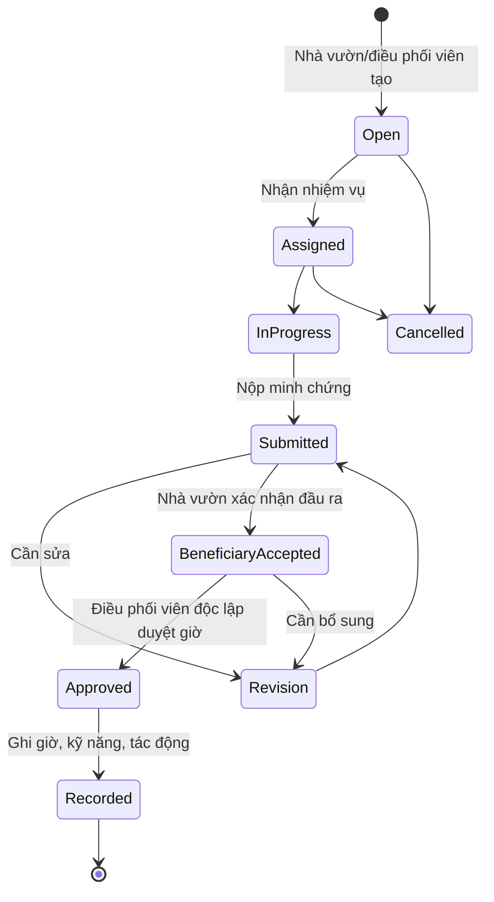

Ghép nhiệm vụ theo kỹ năng, lịch rảnh, khoảng cách và hình thức. P0 có thể dùng lọc/rules, không cần AI. Người nhận nộp ảnh, file, link, ghi chú, thời gian thực tế và sản phẩm bàn giao. Nhà vườn xác nhận chất lượng/đã nhận; điều phối viên độc lập bắt buộc kiểm tra minh chứng và duyệt giờ. Nếu nhà vườn không thể thao tác, sử dụng người đại diện được ủy quyền độc lập có lưu vết; không bỏ lớp kiểm tra. Không cộng giờ khi đang chờ duyệt; chống trùng, không tự duyệt nhiệm vụ của mình, ghi lịch sử điều chỉnh, có cơ chế khiếu nại.

Ví dụ: 3 giờ hỗ trợ có thể tạo 5 hồ sơ sản phẩm, bộ ảnh và một buổi hướng dẫn. Tất cả chỉ được tính khi đầu ra và giờ được xác nhận. Chỉ số tác động phải đo giá trị bàn giao, không dùng thời gian mở ứng dụng làm giờ tình nguyện.

| Nhiệm vụ demo | Hình thức | Ước tính |
|---|---|---:|
| Số hóa 5 sản phẩm Ba Tư | Trực tiếp | 2 giờ |
| Thiết kế bao bì hạt điều | Online | 3 giờ |
| Tạo mô hình 3D quả bưởi | Online | 4 giờ |
| Hướng dẫn nhà vườn livestream | Kết hợp | 2 giờ |

**Adopt a Farm:** nhóm liên ngành đồng hành một nhà vườn trong một học kỳ, giao sản phẩm, tài liệu, quyền quản lý phù hợp và hướng dẫn. **Farm Skill Exchange:** nhà nông chia sẻ tri thức nông nghiệp; thanh niên chia sẻ năng lực số. **Tình nguyện không giới hạn địa lý:** người ở TP.HCM có thể thiết kế cho nhà vườn Bù Đăng, người ở Long Khánh dựng video bưởi Tân Triều. Các hoạt động thương mại thường xuyên hoặc chuyên môn có giá trị lớn cần cơ chế thù lao phù hợp, không lạm dụng tình nguyện.

## 7.6. NaiAcademy – Giáo dục và lớp học nhà vườn

**Farm as a Classroom:** giáo viên/giảng viên chọn bài toán thật, người học tìm hiểu, thực hiện, nộp sản phẩm; giảng viên đánh giá theo mục tiêu học tập, nhà vườn xác nhận đầu ra có ích. Không mặc nhiên công nhận tín chỉ, điểm rèn luyện hay thay thế chương trình chính khóa.

### Học sinh phổ thông

| Môn/hoạt động | Nhiệm vụ |
|---|---|
| Công nghệ nông nghiệp | Quy trình trồng, chăm sóc, thu hoạch |
| Sinh học | Quan sát hoa, quả, hạt, rễ, vòng đời |
| Địa lý | Vùng trồng, điều kiện tự nhiên, bản đồ |
| Tin học | Hồ sơ sản phẩm, dữ liệu, QR |
| Toán | Sản lượng, doanh thu và chi phí giả định |
| Tiếng Anh | Giới thiệu đặc sản song ngữ |
| Giáo dục kinh tế và pháp luật | Kinh doanh, quyền người tiêu dùng |
| Trải nghiệm, hướng nghiệp | Tham quan, tìm hiểu nghề nông nghiệp và công nghệ |

### Sinh viên đại học/cao đẳng

| Ngành | Bài toán thực hành |
|---|---|
| Nông học | Theo dõi sinh trưởng, nhật ký |
| Bảo vệ thực vật | Ghi nhận hiện tượng và trao đổi chuyên gia; không chẩn đoán độc lập |
| Công nghệ sinh học | Quy trình sản xuất, sau thu hoạch |
| Công nghệ thực phẩm | Bao bì, bảo quản, chế biến an toàn |
| CNTT | Số hóa quy trình, website |
| AI | Nhận diện nông sản, trích xuất nhật ký |
| IoT | Mô hình theo dõi môi trường, tưới |
| Marketing | Chiến dịch và nội dung quảng bá |
| Quản trị kinh doanh | Chi phí, hiệu quả gian hàng |
| TMĐT | Đơn hàng, live, tối ưu nội dung |
| Logistics | Đóng gói, vận chuyển, điểm nhận |
| Du lịch | Thiết kế tour sinh thái |
| Thiết kế đồ họa | Bao bì, thương hiệu, ảnh/3D |
| Ngoại ngữ | Dịch nội dung, thuyết minh |

### Quy trình bài học/nhiệm vụ

- Chọn chủ đề và độ tuổi; xác định mục tiêu, thời gian, tài liệu và người hướng dẫn.
- Học lý thuyết ngắn qua video, ảnh, bản đồ, 3D hoặc buổi live.
- Làm bài kiểm tra kiến thức; thực hiện nhiệm vụ ứng dụng có rubric.
- Nộp kết quả, nhận phản hồi, chỉnh sửa; nếu phù hợp và được đồng ý thì bàn giao cho nhà vườn.
- Ghi nhận kết quả học tập và đóng góp tách biệt, chỉ công nhận khi đạt điều kiện.

### Bài học mẫu: Hành trình của hạt điều Đồng Nai (15 phút)

| Phần | Nội dung tương tác |
|---|---|
| 1 | Khám phá quả giả, quả thật chứa hạt, cuống và lá bằng 3D |
| 2 | Tìm hiểu vùng trồng trên bản đồ Đồng Nai |
| 3 | Xem quy trình chế biến qua video/ảnh đã duyệt |
| 4 | Câu hỏi ngắn: phần mọng nước là gì; hạt ở đâu; vì sao cần chế biến đúng quy trình |
| 5 | Nhiệm vụ ứng dụng: thiết kế nội dung giới thiệu hạt điều trung thực |

Mô hình phải được kiểm tra chuyên môn, minh họa không phải bản sao khoa học nếu chỉ dựng hình học đơn giản. Vỏ điều thô cần xử lý chuyên nghiệp; không hướng dẫn học sinh tự chế biến nguy hiểm.

### Ngân hàng bài toán thực tế

Nhà vườn đăng nhu cầu về bao bì, nhật ký, quảng bá, tưới, tour, chế biến. Trường/CLB/đội thi/nhóm nghiên cứu chọn bài toán; người hướng dẫn xác định phạm vi, quyền sở hữu và chia sẻ dữ liệu. Kết quả được bàn giao, ghi nhận tác giả và sự đồng ý công bố. Học sinh chưa thành niên cần giám sát, đồng ý phù hợp, không công khai thông tin riêng tư, không thực hiện việc nguy hiểm hoặc thay thế lao động thương mại.

## 7.7. NaiPass – Hồ sơ năng lực và chứng nhận điện tử

Chứng nhận không chỉ là ảnh đẹp, mà là kết quả có thể kiểm tra. Hai loại hộ chiếu:

| Loại | Nội dung | Điều kiện |
|---|---|---|
| Farmer Pass | Kỹ năng đăng bán, đơn hàng, nhật ký, QR, livestream, an toàn số | Thực hiện được thao tác và được người phụ trách xác nhận |
| Youth Impact Pass | Nhiệm vụ, giờ đã duyệt, kỹ năng, nhà vườn thụ hưởng, sản phẩm bàn giao, phản hồi | Nhiệm vụ hoàn thành, minh chứng phù hợp, người thụ hưởng xác nhận đầu ra và điều phối độc lập duyệt giờ |
| Learning Pass | Bài học, bài kiểm tra, nhiệm vụ ứng dụng | Đạt tiêu chí học tập, do đơn vị phù hợp xác nhận |

**Ba cấp nhà nông số:** Khởi đầu (có hồ sơ và biết đăng bán); Tự chủ (tự quản lý sản phẩm, đơn, nhật ký); Lan tỏa (có khả năng hướng dẫn người khác). Đây là cấp độ nội bộ đề xuất, không phải chuẩn công nhận của nhà nước.

**Kỹ năng tích lũy:** giao tiếp, làm việc nhóm, giải quyết vấn đề, quản lý thời gian, sáng tạo nội dung, thương mại điện tử, dữ liệu, thiết kế, hiểu biết nông nghiệp, du lịch và giáo dục cộng đồng. Gắn kỹ năng với tiêu chí nhiệm vụ và minh chứng, không tự đánh giá năng lực nghề nghiệp chỉ từ điểm số.

**Quy trình cấp:** nhiệm vụ đạt → kiểm tra giờ và đầu ra → xác nhận đơn vị cấp → sinh mã duy nhất → tạo bản PDF/QR → trang xác minh → có thể thu hồi/đính chính. P1 dùng mã nội bộ, QR và PDF; P2 cân nhắc Open Badges/Verifiable Credentials nếu phù hợp. Không cần blockchain.

```text
NAIFARM | YOUTH IMPACT PASS
CHỨNG NHẬN ĐÓNG GÓP (MẪU DEMO)
Nguyễn Minh Anh — nhân vật giả lập
12 giờ xác nhận | 4 nhiệm vụ | 2 nhà vườn
Kỹ năng: Truyền thông số, TMĐT, giao tiếp cộng đồng
Mã: NF-DEMO-2026-001 | QR xác minh
Đơn vị cấp: NaiFarm (minh họa) | Trạng thái: Mẫu
```

| Loại chứng nhận | Thẩm quyền phù hợp |
|---|---|
| OCOP | Cơ quan có thẩm quyền theo quy định |
| VietGAP, hữu cơ | Tổ chức chứng nhận đủ điều kiện |
| Hoàn thành tình nguyện | Đơn vị tổ chức chương trình/người được phân quyền |
| Hoàn thành bài học | Nền tảng hoặc nhà trường nếu có thỏa thuận |
| Đánh giá môn học | Giáo viên/giảng viên phụ trách |
| Kỹ năng nhà nông số | Đơn vị thực hiện chương trình đào tạo |

Không gắn logo Thành Đoàn, UBND, trường hoặc con dấu thật khi chưa được phép. Không tuyên bố chứng nhận nội bộ là chứng chỉ quốc gia, tín chỉ học tập, danh hiệu Sinh viên 5 tốt, điểm rèn luyện tự động. Chỉ công khai dữ liệu tối thiểu khi người nhận đồng ý; không hiện số điện thoại/địa chỉ/định danh cá nhân trên trang QR công khai.

## 7.8. NaiExplore – Du lịch nông nghiệp, tour 360° và 3D

**Mục tiêu:** biến khám phá từ xa thành hiểu biết, niềm tin, giao dịch hoặc trải nghiệm thực tế; không chỉ thêm hiệu ứng đẹp.

### Cấp 1: Tour nhà vườn 360°

Cổng vườn → khu cây trồng → khu chăm sóc → thu hoạch → đóng gói → gian hàng. Mỗi hotspot có câu chuyện, ảnh/video, thông tin cây, bài học, sản phẩm liên quan, CTA mua hàng/đặt trải nghiệm. Có sơ đồ, hướng dẫn kéo để xoay, phóng to, nút quay lại. Chế độ ảnh phẳng và văn bản cho thiết bị yếu hoặc người không dùng 3D. Ảnh panorama phải có quyền sử dụng, không nhận ảnh minh họa là không gian thật.

### Cấp 2: Thư viện 3D nông sản

| Đối tượng | Điểm tương tác |
|---|---|
| Chôm chôm | Vỏ, phần ăn được, hạt, vòng đời |
| Sầu riêng | Vỏ, múi, hạt, đặc điểm giống có nguồn |
| Bưởi | Mặt cắt, múi, vỏ, hoa |
| Điều | Quả giả, quả thật chứa hạt, cuống, nhân sau chế biến |
| Cà phê | Quả, các lớp quanh hạt, chế biến |
| Hồ tiêu | Chùm quả, các bước chế biến |
| Cây trồng | Rễ, thân, lá, hoa, quả, sinh trưởng |
| Hệ thống tưới | Cấu tạo, luồng nước minh họa |
| Nhà kính | Thiết bị và môi trường canh tác minh họa |

Tương tác: xoay 360°, zoom, reset góc, chọn bộ phận, hiện chú thích, mặt cắt nếu có tài sản 3D, câu hỏi ngắn, liên kết bài học, vùng trồng và sản phẩm. Dùng GLB/glTF có giấy phép, mô hình tự dựng hoặc photogrammetry khi có ảnh và quyền. Không tự nhận mô hình hình học/AI là bản sao khoa học hoặc bản sao nhà vườn thật. P1 chỉ một đến hai mô hình được kiểm thử, ưu tiên quả điều để đại diện phía Bắc và một trái cây Long Khánh/Tân Triều. AR/VR và digital twin là P2.

### Cấp 3: Đặt trải nghiệm tại nhà vườn

Các gói: Một ngày làm nông dân, khám phá vườn bưởi, nghề trồng điều, chế biến cà phê, STEM nông nghiệp, trải nghiệm trường học, cuối tuần gia đình. Thông tin gồm thời gian, giá, số người, độ tuổi, mùa, người hướng dẫn, hoạt động, điểm gặp, an toàn, thời tiết và hủy. P1 gửi yêu cầu đặt lịch, nhà vườn xác nhận; không cần thanh toán trực tuyến. Không khẳng định có tour thật nếu chưa xác minh cơ sở, năng lực phục vụ và điều kiện pháp lý.

## 7.9. NaiMap – Bản đồ số nông nghiệp Đồng Nai mới

| Lớp | Nội dung | Tương tác |
|---|---|---|
| Nhà vườn/trang trại | Điểm đã được cho phép công bố | Hồ sơ, sản phẩm |
| OCOP | Chủ thể, điểm giới thiệu/bán | Xem chứng nhận và sản phẩm |
| Mùa vụ/nguồn cung | Đang có hàng, sắp thu hoạch | Lịch và đặt trước |
| Tình nguyện | Nhu cầu hỗ trợ theo khu vực | Lọc và nhận nhiệm vụ |
| Học tập/thực hành | Điểm có chương trình phù hợp | Bài học, liên hệ |
| Du lịch | Điểm trải nghiệm | Tour ảo, đặt lịch |
| Livestream | Phiên theo nhà vườn | Xem lịch/phiên |
| Điểm nhận hàng | Điểm giao nhận đã xác nhận | Chọn nhận |

Bản đồ phải có dữ liệu 95 xã/phường mới, toggle layer, tìm kiếm tên hiện hành/tên vùng lịch sử, lọc sản phẩm, zoom, cụm marker, popup, legend, danh sách thay thế cho người dùng không dùng bản đồ. Khi chọn một nhà vườn, xem sản phẩm, mùa vụ, nhiệm vụ, trải nghiệm, lịch live. Có attribution đúng giấy phép bản đồ; không dùng sơ đồ minh họa như địa giới thực. Tọa độ riêng tư chỉ hiển thị khi chủ sở hữu cho phép, dùng vị trí gần đúng khi cần. Tọa độ demo ghi nhãn, không nhận là doanh nghiệp thật. P0 hiển thị marker và ít nhất 2 lớp nhà vườn/trải nghiệm, các lớp còn lại P1/P2.

## 7.10. NaiImpact – Đo lường tác động cộng đồng

Dashboard cho nhà nông, thanh niên, điều phối viên, quản lý chương trình, trường, doanh nghiệp và cơ quan theo quyền; dữ liệu tổng hợp công khai chỉ khi phù hợp. Mỗi chỉ số có định nghĩa, mốc thời gian, nguồn và phạm vi.

| KPI | Định nghĩa |
|---|---|
| Nhà vườn được hỗ trợ | Số nhà vườn duy nhất có nhiệm vụ đã xác nhận |
| Sản phẩm số hóa | Sản phẩm được công bố/hoàn thiện qua nhiệm vụ |
| Giờ tình nguyện | Tổng giờ đã duyệt, không trùng |
| Nhiệm vụ hoàn thành | Nhiệm vụ có minh chứng và xác nhận |
| Bài học hoàn thành | Lượt đạt tiêu chí bài học, phân biệt lượt và người |
| Nhà nông tự đăng bán | Số người đã thực hiện thao tác độc lập có xác nhận |
| Hồ sơ truy xuất | Tỷ lệ lô có thông tin và mức xác minh rõ |
| Giao dịch | Đơn hợp lệ, giá trị đơn hoàn thành; không tính đơn hủy |
| Trải nghiệm | Yêu cầu, lượt xác nhận và lượt tham gia thực tế |
| Hài lòng | Phản hồi có nguồn, số người trả lời |

Ví dụ dashboard DEMO: 24 nhà vườn, 136 sản phẩm, 320 giờ, 48 nhiệm vụ, 85 lượt học, 18 nhà nông tự đăng; số nhiệm vụ theo T7–T11: 4, 7, 9, 12, 16. **Tất cả giả lập.** Khi MVP có dữ liệu thật từ seed/demo, dashboard phải tính từ bản ghi thay vì hardcode không nhất quán.

## 7.11. Vai trò Điều phối viên cơ sở – Cán bộ Đoàn xã/phường

**Mục tiêu:** tạo lớp điều phối trung gian gọn nhẹ tại cấp xã/phường (95 đơn vị hành chính) nhằm bảo đảm nhiệm vụ tình nguyện đi đúng người – đúng nhu cầu, minh chứng đầu ra được kiểm tra chéo, và thông tin nhà vườn/chứng nhận được đối chiếu minh bạch trước khi công bố.

Các chức năng được tổ chức khớp 5 mục điều hướng của vai trò Điều phối (`Tổng quan, Cộng đồng, Nhiệm vụ, Xác minh, Tác động`):

| Nhóm chức năng | Đặc tả nghiệp vụ | Dữ liệu liên kết | Mức |
|---|---|---|---|
| **Tổng quan điều phối** | Hiển thị các đầu việc cần xử lý trong phạm vi `unit_code` xã/phường được giao: yêu cầu hỗ trợ mới, nhiệm vụ sắp quá hạn, minh chứng chờ duyệt, hồ sơ nhà vườn chờ đối chiếu | `support_requests`, `missions`, `certificates` | P0 |
| **Quản lý cộng đồng địa bàn** | Danh sách nhà vườn tại xã/phường kèm trạng thái hoạt động, số sản phẩm, thanh niên đang đồng hành và cấp độ nhà nông số (*Khởi đầu / Tự chủ / Lan tỏa*); danh sách thanh niên tham gia | `farms`, `profiles`, `farm_experiences` | P0/P1 |
| **Điều phối nhiệm vụ (`NaiVolunteer`)** | Kiểm tra phạm vi an toàn cho nhiệm vụ trực tiếp (đặc biệt khi có học sinh phổ thông); gắn tag ưu tiên hoặc ghép thanh niên phù hợp khi yêu cầu của nhà vườn chưa có người nhận; xử lý `Cancelled` hoặc chuyển tiếp nhiệm vụ online | `support_requests`, `missions` | P0 |
| **Đối chiếu hồ sơ & chứng nhận (`NaiTrace`)** | Kiểm tra ảnh chụp giấy tờ OCOP, VietGAP hoặc giấy tờ nguồn gốc do nhà vườn cung cấp; chuyển trạng thái từ *Nhà vườn tự khai báo* sang *Hồ sơ đã đối chiếu* (hoặc *Chưa xác minh/hết hạn*), ghi rõ phạm vi và thời điểm đối chiếu | `certificates`, `product_batches`, `audit_logs` | P0 |
| **Kiểm duyệt minh chứng & giờ tình nguyện** | Xem ảnh/file/link bàn giao trong `mission_submissions` kèm xác nhận của nhà vườn; chuyển trạng thái `Submitted` $\rightarrow$ `Approved` hoặc `Revision` (yêu cầu sửa); ghi `volunteer_logs` sau khi duyệt | `mission_submissions`, `volunteer_logs` | P0 |
| **Cấp/thu hồi chứng nhận nội bộ (`NaiPass`)** | Duyệt đề xuất cấp hoặc cấp theo ủy quyền `Youth Impact Pass` hoặc `Farmer Pass` bản nội bộ có mã QR xác minh; đề xuất thu hồi hoặc đính chính theo chính sách của tổ chức cấp (`revoked`) nếu phát hiện sai lệch minh chứng | `digital_credentials`, `user_skills` | P1 |
| **Theo dõi tác động (`NaiImpact`)** | Xem KPI tổng hợp theo xã/phường (số nhà vườn được hỗ trợ, số hộ tự đăng bán lại, giờ xác nhận, lượt học/trải nghiệm); xuất báo cáo định kỳ từ dữ liệu thực/seed đã xác nhận | `volunteer_logs`, `orders`, `learning_progress` | P1 |

### Ranh giới thẩm quyền và nguyên tắc kiểm soát

* **Không thay thế cơ quan chuyên môn:** Cán bộ Đoàn xã/phường chỉ thực hiện **đối chiếu tính khớp của tài liệu** do nhà vườn tự cung cấp (trạng thái *Hồ sơ đã đối chiếu*), **không** có thẩm quyền cấp mới, kiểm định chất lượng nông sản hay cấp chứng nhận OCOP/VietGAP/an toàn thực phẩm.
* **Không tự duyệt và không cộng trùng:** Hệ thống chặn điều phối viên tự duyệt nhiệm vụ mà chính mình là người nhận (`assignee_id != reviewer_id`). Mọi thao tác duyệt, từ chối hoặc thu hồi đều bắt buộc lưu vết vào `audit_logs` (người thực hiện, thời gian, lý do).
* **Phân quyền theo địa bàn (`unit_code`):** Điều phối viên cấp xã/phường chỉ thao tác trên dữ liệu thuộc chương trình và đơn vị hành chính được phân công trong 95 xã/phường; không xem thông tin riêng tư của đơn hàng khách hàng ngoài phạm vi cần thiết.
* **Không lạm dụng biểu trưng chính thức:** Không gắn logo, con dấu thật của Thành Đoàn, Đoàn xã/phường hay UBND lên thẻ chứng nhận nội bộ khi chưa có sự cho phép bằng văn bản.

## 7.12. Danh mục nghiệp vụ liên phân hệ và chủ thể quản lý (chuẩn toàn sản phẩm)

Bảng dưới là ma trận sở hữu nghiệp vụ (Business Capability Map). Các tên kỹ thuật trong bảng là bộ quyền tương thích tại mục 5.6.8; không phải role đăng nhập. Cấp quyền nguyên tử có scope, không cấp toàn bộ theo tên bộ quyền. Cột **chủ nghiệp vụ** là bên chịu trách nhiệm dữ liệu/quy trình, không đồng nghĩa người có toàn quyền kỹ thuật. Cột **duyệt** phân biệt xác nhận đầu ra, phê duyệt công bố, kiểm tra chuyên môn, cấp chứng nhận và xử lý tiền. Một capability có nhiều bước thuộc nhiều tổ chức; không chuyển hết sang Admin. Các màn hình S27–S76 là mở rộng của danh mục S01–S26 tại chương 10.

| Mã / phân hệ | Nghiệp vụ | Chủ nghiệp vụ | Tác nghiệp | Phê duyệt / đối chiếu | Màn hình | Mức | Quy tắc nghiệm thu |
|---|---|---|---|---|---|---|---|
| B01 / NaiMarket | Danh mục, tìm kiếm, lọc, gian hàng, OCOP | farm_owner | farm_staff, volunteer (ủy quyền), content_reviewer | farm_owner công bố; content_reviewer xử lý vi phạm; credential_verifier đối chiếu chứng nhận theo thẩm quyền | S01–S04 | P0 | Sản phẩm published, tồn khả dụng, hồ sơ nguồn rõ; OCOP chỉ khi đúng sản phẩm và hiệu lực. |
| B02 / NaiMarket | Giỏ, checkout, đơn, nhận hàng, thanh toán | farm_owner | customer, farm_staff, logistics_operator | Khách xác nhận đặt; nhà bán xác nhận đơn; thanh toán đối soát theo nhà cung cấp | S05–S07, S11 | P0/P2 | Đơn riêng mỗi nhà bán; lưu snapshot giá, giữ tồn nguyên tử, chống trùng, COD demo; hoàn theo chính sách. |
| B03 / NaiMarket | Mùa vụ, đặt trước, NaiSeason, Harvest Pre-order | farm_owner | farm_staff, customer, coop_manager | Nhà bán duyệt khả năng cung ứng và điều kiện giao | S26 | P1/P2 | Dự kiến không phải cam kết; giới hạn số lượng, thông báo thay đổi; hủy/hoàn khi không đáp ứng. |
| B04 / NaiMarket | NaiBox 95, combo, B2B, RFQ | coop_manager hoặc farm_owner | business_buyer, business_manager, coop_staff, finance_operator | Đại diện nhà bán và bên mua duyệt báo giá/hợp đồng riêng | S41–S44 | P2 | Mỗi thành phần có lô, giá, nguồn; báo giá có hạn, đơn/hợp đồng chỉ sau xác nhận hai bên. |
| B05 / NaiMarket | NaiRescue, Green Points, đánh giá, khiếu nại | farm_owner; support_agent quản lý vụ việc | customer, coop_manager, expert_mentor, finance_operator | Nhà bán chịu trách nhiệm chất lượng; chuyên gia nếu cần; CSKH xác minh theo chính sách | S45–S47 | P2 | Không bán hàng không an toàn; xác nhận khối lượng thực nhận; không tính điểm khi chưa xác minh. |
| B06 / NaiFarmer | Hồ sơ, phân công nhân viên, đăng nhanh, Voice-to-Market, Farm Story AI | farm_owner | farm_staff, volunteer có grant, dịch vụ AI | farm_owner duyệt công bố; đối chiếu tài liệu tách biệt | S08–S10, S27–S28 | P0/P1 | Lưu nháp, kiểm tra trường, quyền thời hạn, log tác giả/duyệt; không tự tạo chứng nhận. |
| B07 / NaiFarmer | Tồn kho, đơn, lịch, nhắc việc, doanh thu, bàn giao kỹ năng | farm_owner | farm_staff, volunteer, finance_operator | Chủ vườn xác nhận thao tác và tài chính; điều phối xác nhận kỹ năng theo rubric | S11, S25, S29 | P0/P1 | Tồn theo lô; không lộ doanh thu cho volunteer; doanh thu đơn hoàn thành; tự đăng độc lập mới tính tự chủ. |
| B08 / NaiTrace | Lô, nhật ký, QR, thu hoạch, đóng gói | farm_owner | farm_staff, volunteer được giao | Chủ vườn xác nhận dữ liệu khai báo; bên chuyên môn đối chiếu khi được giao | S03–S04, S30 | P0 | Mã lô duy nhất, nhật ký phiên bản; QR không lộ PII; không tự suy ra an toàn. |
| B09 / NaiTrace | Hồ sơ OCOP/VietGAP/hữu cơ và kiểm tra hiệu lực | farm_owner | local_coordinator, credential_verifier | Điều phối đối chiếu tài liệu; chỉ cơ quan/tổ chức có thẩm quyền xác nhận nguồn hoặc cấp thật | S24b, S31, S62 | P0/P2 | Tách tự khai, đối chiếu, xác nhận nguồn, hiệu lực; hết hạn/thu hồi gỡ nhãn; không đổi phạm vi chứng nhận. |
| B10 / NaiLive | Lịch, tổ chức live, ghim sản phẩm, chat, replay, Live to Learn, Ask the Farmer | farm_owner (live thương mại); teacher (live lớp) | volunteer, experience_host, expert_mentor, content_reviewer | Chủ vườn duyệt sản phẩm và phát; trường duyệt lớp; biên tập duyệt phát lại | S15–S16, S32 | P0/P1/P2 | Lịch khác trạng thái phát thật; quyền ghi hình; kiểm duyệt bình luận, dừng phát, nội dung trẻ em riêng. |
| B11 / NaiVolunteer | Yêu cầu, nhiệm vụ online/tại chỗ, ghép người, Adopt a Farm, Skill Exchange | program_manager hoặc local_coordinator theo ủy quyền | farm_owner, volunteer, teacher khi bài thực hành | Điều phối duyệt an toàn/phạm vi trước công bố; nhà vườn đồng ý đầu ra | S12–S14, S24a, S33–S35 | P0/P2 | Đủ tiêu chí, hạn, sức chứa, an toàn; tình nguyện tự nguyện; quyền dữ liệu tối thiểu, hết hạn sau việc. |
| B12 / NaiVolunteer | Nộp minh chứng, nhận bàn giao, duyệt giờ, khiếu nại | program_manager | volunteer, farm_owner, local_coordinator, auditor | Nhà vườn nhận đầu ra + điều phối độc lập duyệt giờ; quản lý chương trình giải quyết khiếu nại | S14, S24c, S36 | P0 | Không tự duyệt, không trùng giờ, chỉnh sửa bằng bút toán, minh chứng riêng tư; không tính giờ dự kiến. |
| B13 / NaiAcademy | Kho bài học, lớp, bài tập, quiz, 3D, live classroom | school_admin (lớp); content_reviewer (kho mở) | teacher, expert_mentor, student_minor, student_adult | Giáo viên/chuyên gia duyệt chuyên môn; trường duyệt hoạt động; biên tập công bố mở | S20–S22, S48–S52 | P1/P2 | Học liệu có nguồn, độ tuổi, phiên bản; enrollment theo lớp; rubric; không mặc nhiên công nhận tín chỉ. |
| B14 / NaiAcademy | Farm as a Classroom, Service-Learning, trải nghiệm trường học, hướng nghiệp | school_admin | teacher, guardian, farm_owner, experience_host, student_minor, student_adult | Trường duyệt kế hoạch; người giám hộ đồng ý khi cần; nhà vườn duyệt tiếp nhận; giáo viên chấm | S53–S55 | P2 | Đánh giá học tập, bàn giao, giờ tình nguyện là 3 nghiệp vụ độc lập; phương án thay thế khi không đồng ý. |
| B15 / NaiAcademy | NaiFarm Challenges, Field Lab, Farm Mentor, đồ án/NCKH, Digital Twin | school_admin hoặc tổ chức chủ trì | researcher, teacher, expert_mentor, farm_owner, business_manager | Chủ dữ liệu đồng ý; đơn vị chủ trì duyệt đề tài; chuyên gia đánh giá an toàn | S56–S57 | P2 | Hợp đồng quyền dữ liệu/IP, sandbox; cảm biến read-only mặc định; không đưa mô phỏng thành dữ liệu thật. |
| B16 / NaiPass | Youth Impact Pass, Farmer Pass, Learning Pass, kỹ năng, QR và PDF | Tổ chức cấp (program_manager hoặc school_admin theo loại) | local_coordinator, teacher, farm_owner, volunteer, student_adult | Người đủ quyền cấp độc lập; tổ chức cấp duyệt thu hồi/đính chính | S18, S25, S58–S59 | P1/P2 | Chứng nhận nội bộ khác chứng nhận pháp lý; mã duy nhất, public tối thiểu, không cấp khi chưa đạt. |
| B17 / NaiExplore | Tour 360°, mô hình 3D, bảo tàng số, AR/VR | content_reviewer (thư viện); farm_owner (tour riêng) | expert_mentor, volunteer, student_adult, experience_host | Chủ quyền ảnh đồng ý; chuyên gia kiểm tra khoa học; biên tập duyệt | S19–S20, S60 | P1/P2 | Giấy phép, attribution, phân biệt minh họa với scan thật; fallback 2D; không lộ vị trí riêng. |
| B18 / NaiExplore | Gói trải nghiệm, đặt chỗ, đoàn trường, check-in, hủy | experience_host hoặc farm_owner | customer, teacher, school_admin, guardian | Đơn vị tổ chức xác nhận sức chứa/an toàn; trường và giám hộ duyệt trẻ | S23, S53, S61 | P1/P2 | Ca, sức chứa, chính sách hủy, thời tiết, số người; không xác nhận quá chỗ; báo sự cố. |
| B19 / NaiMap | 8 lớp bản đồ, địa giới, vị trí, lọc, danh sách | platform_admin (dữ liệu chuẩn); chủ từng lớp nghiệp vụ | farm_owner, local_coordinator, teacher, experience_host, logistics_operator | Chủ điểm đồng ý công khai; admin kiểm tra nguồn địa giới; chủ lớp xác nhận trạng thái | S17, S63 | P0/P1/P2 | 95 xã/phường; version GIS; ẩn tọa độ riêng; marker lấy dữ liệu nguồn, không nhập trùng tùy ý. |
| B20 / NaiImpact | Dashboard, báo cáo, KPI, xuất dữ liệu, tài trợ | program_manager / từng tổ chức đối với phạm vi của mình | local_coordinator, school_admin, business_manager, authority_viewer, auditor | Chủ báo cáo duyệt phạm vi; cơ quan nhận theo thỏa thuận; audit kiểm tra nguồn | S24d, S64–S65 | P1/P2 | Không hardcode, dedup, demo tách thật, ngưỡng ẩn nhóm nhỏ, không xuất PII mặc định. |
| B21 / Quản trị chung | Định danh, tổ chức, thành viên, role grant, địa giới, cấu hình | platform_admin | school_admin, program_manager, farm_owner, business_manager | Quản lý tổ chức duyệt tư cách; admin kích hoạt grant; cấp quyền nhạy cảm cần người duyệt khác | S66–S69 | P0/P2 | Deny by default, MFA cho đặc quyền, không dùng role tự khai; thu hồi ngay khi rời tổ chức. |
| B22 / Quản trị chung | CSKH, kiểm duyệt, thông báo, tranh chấp, an toàn, quyền dữ liệu | support_agent / content_reviewer | platform_admin, auditor, owner nghiệp vụ | Người có thẩm quyền xử lý từng loại vụ; cấp cao hơn giải quyết khiếu nại | S47, S70–S72 | P1/P2 | Ticket có SLA, chứng cứ, lý do; không sửa âm thầm; dữ liệu riêng tư, quyền rút đồng ý. |
| B23 / Quản trị chung | Tài chính, đối soát, phí, hoàn, tài trợ, logistics | finance_operator của tổ chức tương ứng | business_manager, farm_owner, logistics_operator, support_agent | Người duyệt chi độc lập; đối soát với chứng từ hoặc đối tác thanh toán | S44, S73–S74 | P2 | Không dùng volunteer hours như tiền; ledger không xóa; webhook idempotent; tài trợ không mua ảnh hưởng. |
| B24 / Quản trị chung | Kiểm toán, quyền truy cập, tích hợp, sự cố, sao lưu | platform_admin (vận hành); auditor (độc lập) | security/ops theo grant, chủ tổ chức liên quan | Người phụ trách vận hành duyệt thay đổi; auditor đọc theo nhiệm vụ | S75–S76 | P0/P2 | Audit append-only, backup/restore, rate limit, quyền dịch vụ, rollback, tách môi trường demo. |

### 7.12.1. Nghiệp vụ dùng chung không phải phân hệ mới

NaiFarm có 10 phân hệ sản phẩm; lớp quản trị dùng chung gồm Identity & Access, Organization/Tenant, workflow approval, catalog và dữ liệu chuẩn, thông báo, upload/media, consent, audit, support/disputes, finance, safety, observability. Các workspace chuyên trách dùng cùng dịch vụ thay vì nhân bản dữ liệu hoặc tách thành nhiều app không liên kết. Mọi nghiệp vụ B01–B24 phải có ít nhất một owner, actor hợp lệ, quy tắc kiểm tra server, sự kiện audit, màn hình xử lý lỗi, đường chuyển cấp và tiêu chí nghiệm thu.

## 7.13. Đặc tả quản trị hệ thống và tổ chức

### 7.13.1. Vòng đời định danh và tổ chức

Đăng ký/đăng nhập → xác minh email hoặc điện thoại phù hợp → chọn nhu cầu sử dụng → chỉ cấp quyền cá nhân cơ bản → gửi yêu cầu tham gia/tạo tổ chức → người có quyền xác minh tư cách và phê duyệt → Admin kích hoạt role grant có scope, thời hạn → thành viên chọn workspace → thay đổi/đình chỉ/rời tổ chức → thu hồi grant và khóa phiên cần thiết. Không tự chọn role admin/cơ quan/giảng viên rồi có quyền. Mỗi tổ chức có hồ sơ pháp nhân hoặc thông tin chủ thể phù hợp, đầu mối, địa bàn, trạng thái `pending/active/suspended/closed`, hồ sơ đối chiếu và lịch sử. Nếu đại diện bị thay, cần quy trình xác minh lại; không chuyển quyền bằng chỉnh trực tiếp `owner_id`.

### 7.13.2. Admin và các bộ phận vận hành

| Hàng chờ/công việc | Người xử lý | Quyết định và giới hạn |
|---|---|---|
| Đăng ký tổ chức, xác minh người đại diện | platform_admin được giao | Duyệt tư cách tài khoản/tổ chức, không xác nhận chất lượng sản phẩm |
| Thành viên và quyền | Quản lý tổ chức yêu cầu; platform_admin cấp quyền nền tảng | Quyền scope tối thiểu, có expiry; cấp đặc quyền phải được duyệt độc lập |
| Nội dung vi phạm, bản quyền | content_reviewer; support_agent tiếp nhận | Ẩn/tạm khóa kèm lý do, cho phản hồi; không sửa sản phẩm thay người bán |
| Gian lận, tài khoản bị xâm nhập | platform_admin + support_agent | Tạm khóa, thu hồi phiên, bảo toàn log; chuyển cấp chủ nghiệp vụ |
| Tranh chấp đơn, trải nghiệm | support_agent, nhà bán/đơn vị trải nghiệm | Xử lý theo điều kiện giao dịch, finance xử lý tiền khi được duyệt |
| Khiếu nại giờ, điểm, chứng nhận | program_manager, school_admin hoặc tổ chức cấp | Admin chỉ chuyển ticket; không tự quyết nội dung nghiệp vụ |
| Dữ liệu địa giới và danh mục | platform_admin / quản trị dữ liệu được giao | Nhập nguồn có phiên bản, kiểm tra trùng, duyệt cập nhật, rollback |
| Audit, báo cáo sự cố | auditor / quản lý vận hành | Đọc theo vụ việc, bảo vệ dấu vết; không tự sửa hoặc xóa log |
| AI, API, lưu trữ, streaming | platform_admin / ops | Quota, cấu hình, cảnh báo, secret server-side, fallback, giám sát |
| Yêu cầu dữ liệu cá nhân | support_agent + người phụ trách quyền riêng tư | Xác minh chủ thể, xuất tối thiểu, chỉnh/xóa theo căn cứ và nghĩa vụ lưu giữ |

Admin không phải tài khoản superuser dùng thường ngày. Quyền khẩn cấp (break-glass) chỉ cho sự cố xác định, có phê duyệt hoặc cơ chế khẩn cấp có kiểm tra sau, ghi lý do, giới hạn thời gian, thu hồi phiên và audit độc lập; không dùng để làm đẹp dữ liệu demo.

## 7.14. Đặc tả doanh nghiệp, hợp tác xã và thương mại chuyên nghiệp

**Tổ chức bán** quản lý thành viên, quyền kho/kinh doanh, danh mục tổ chức, vùng nguyên liệu theo ủy quyền, năng lực cung ứng và lô tổng hợp. Lô hỗn hợp phải lưu nguồn thành phần, không ghi chung là một vùng nếu nguồn khác nhau. Hộ độc lập có quyền chấp nhận/từ chối giao dịch và rút chia sẻ. **Tổ chức mua** có nhân viên thu mua tạo yêu cầu, người quản lý duyệt hạn mức, kế toán đối soát. B2B không phải tình nguyện: yêu cầu báo giá, mẫu thử, tiêu chuẩn, hợp đồng, số lượng tối thiểu, thời gian giao, chứng từ, điều kiện thanh toán và đổi trả.

| Bước | Bên chịu trách nhiệm | Điều kiện / đầu ra |
|---|---|---|
| Yêu cầu mua | business_buyer | RFQ có quy cách, khối lượng, lịch, điểm nhận, hạn nhận báo giá |
| Báo giá | farm_owner/coop_manager | Giá/đơn vị, khả năng cung ứng, lô hoặc lịch dự kiến, thời hạn; không giữ tồn vô hạn |
| Duyệt và chấp nhận | business_manager và nhà bán | Bản điều khoản được xác nhận, snapshot giá và điều kiện |
| Thực hiện | farm_staff/coop_staff/logistics_operator | Phân lô, giao nhiều đợt, biên bản nhận và chênh lệch |
| Đối soát / tranh chấp | finance_operator, support_agent | Chứng từ, thanh toán, hoàn hoặc khiếu nại có lý do và người duyệt |
| Tài trợ cộng đồng | business_manager → program_manager | Đề xuất ngân sách, mục tiêu, điều khoản, phê duyệt, mốc bàn giao, báo cáo tổng hợp |

Tài trợ không mua chứng nhận, không ưu tiên sai lệch xếp hạng OCOP; hiển thị nội dung tài trợ minh bạch. Doanh nghiệp muốn tuyển dụng chỉ tiếp cận hồ sơ cá nhân khi người trưởng thành chủ động đồng ý và theo quy trình riêng; không dùng dữ liệu trẻ em.

## 7.15. Đặc tả nhà trường, người học, chuyên gia và hoạt động trải nghiệm

**Nhà trường** quản lý tổ chức, khóa/lớp, giáo viên, danh sách người học, đối tác thực hành, mục tiêu môn học, quyền phụ huynh, kế hoạch an toàn, quy trình phản hồi và báo cáo. Giáo viên quản lý chuyên môn lớp, không mặc định quyền quản lý toàn trường; chuyên gia tham gia duyệt học liệu theo lĩnh vực và phạm vi được giao. Nội dung mở phải được biên tập; bài làm riêng chỉ người học, giáo viên và người được phép đọc.

| Nghiệp vụ | Owner | Actor | Điểm kiểm soát |
|---|---|---|---|
| Tạo lớp / ghi danh | school_admin | teacher, student | Danh sách xác nhận, tránh lộ mã lớp; trường khác không truy cập |
| Soạn nội dung / 3D | teacher hoặc content_reviewer | expert_mentor, researcher, volunteer | Nguồn, giấy phép, khoa học, tuổi phù hợp, phiên bản |
| Giao bài / đánh giá | teacher | student_minor/student_adult | Rubric, hạn, phiên bản bài, phản hồi, khiếu nại điểm theo quy chế trường |
| Dự án liên ngành | school_admin/teacher | farm_owner, researcher, expert_mentor | Thỏa thuận đầu ra, người hướng dẫn, quyền dữ liệu/IP, bàn giao |
| Hoạt động có trẻ em | school_admin | teacher, guardian, experience_host | Duyệt rủi ro, đồng ý, giám sát, liên hệ khẩn cấp, phương án thay thế |
| Tình nguyện của người học | program_manager | volunteer đủ điều kiện, điều phối | Grant tình nguyện riêng trong W03, nhận việc tự nguyện; giờ khác điểm học tập |
| Cấp Learning Pass | school_admin hoặc đơn vị tổ chức học mở | teacher | Dữ liệu đạt rubric; loại nội bộ hay của trường hiển thị đúng |
| Công bố sản phẩm học tập | Người giữ quyền + đơn vị học thuật | student, teacher, content_reviewer | Xin đồng ý riêng, ghi tác giả; ẩn dữ liệu cá nhân, có quyền gỡ |

**Kỹ năng và nhiệm vụ:** mỗi bài tập có mục tiêu, kỹ năng chuyên môn và kỹ năng mềm, điều kiện đầu vào, rubric có mức đạt (chưa đạt/đạt/vượt yêu cầu), đầu ra, minh chứng và người đánh giá. Ví dụ môn Công nghệ học cấu tạo cây, đọc bản đồ, ghi nhật ký mô phỏng; sinh viên CNTT tạo prototype nhật ký; marketing làm bộ ảnh và nội dung; nông học kiểm tra dưới hướng dẫn chuyên môn; du lịch thiết kế tuyến trải nghiệm. Nhận xét kỹ năng không thay thế bằng cấp. Có thể đạt điểm học vụ mà không có giờ tình nguyện; cũng có thể có giờ tình nguyện mà không được cộng điểm môn.

**Bảo vệ học sinh:** phân nhóm tuổi theo chính sách và quy định áp dụng; tài khoản trường được kiểm soát, không mở nhiệm vụ tiếp xúc riêng với người lạ; không công bố họ tên, hình ảnh, vị trí, điểm hoặc dữ liệu nhạy cảm. Không thực hiện máy móc nguy hiểm, hóa chất, chế biến có rủi ro hoặc lao động thương mại thay người lớn. Người giám hộ được thông tin rõ, đồng ý riêng với chuyến đi/ghi hình/chia sẻ; rút đồng ý không bị ép tham gia. Chuyến đi có người phụ trách, tỷ lệ giám sát phù hợp, danh sách check-in/out, phương án thời tiết và sự cố; chỉ chia sẻ thông tin tối thiểu với nhà vườn.

## 7.16. Đặc tả cơ quan chuyên môn, Đoàn/Hội và quản trị dữ liệu công

Đơn vị chương trình Đoàn/Hội tạo chiến dịch, ban hành tiêu chí nội bộ, phân công điều phối, huấn luyện tình nguyện viên, theo dõi đầu ra, xử lý tranh chấp giờ và quản lý chứng nhận nội bộ. Hội Nông dân kết nối hộ, tập huấn và chuyên gia. Cơ quan quản lý/chuyên môn chỉ tham gia khi có căn cứ/thỏa thuận: đầu mối đọc báo cáo tổng hợp, người được giao đối chiếu nguồn chứng từ, không mặc định có quyền truy cập toàn bộ dữ liệu. Quyền của mỗi cơ quan theo lĩnh vực, địa bàn và mục đích được duyệt; không tự mô phỏng quy trình hành chính như đã được nhà nước chấp thuận.

| Nhóm nghiệp vụ | Người thực hiện | Giới hạn |
|---|---|---|
| Nhu cầu hỗ trợ địa bàn | Điều phối / Hội Nông dân | Theo hộ tham gia và quyền chia sẻ |
| Chiến dịch liên xã/phường | Quản lý chương trình | Phân công từng scope, có người chịu trách nhiệm |
| Đối chiếu giấy tờ OCOP | Điều phối viên | Kiểm tra khớp hồ sơ, không cấp hoặc tái công nhận |
| Xác nhận nguồn/hiệu lực | credential_verifier nếu được giao hợp pháp | Chỉ chứng từ thuộc thẩm quyền, ghi nguồn, thời gian |
| Thống kê chương trình | authority_viewer / program_manager | Chỉ số tổng hợp, không PII mặc định, xuất có log |
| Yêu cầu thông tin chi tiết | Đầu mối có thẩm quyền | Qua quy trình vụ việc, căn cứ và phạm vi rõ; không quyền đọc vô hạn |

Không sử dụng con dấu, logo, chữ ký số hay tên cơ quan để tạo chứng thư giả. Các chương trình có thể triển khai độc lập ở quy mô cộng đồng trước khi có tích hợp chính thức.

# 8. Danh mục sáng tạo mở rộng

| Ý tưởng | Giá trị | Phân kỳ |
|---|---|---|
| Voice-to-Market | Từ lời nói đến gian hàng, giảm rào cản số | P0 |
| Hộ chiếu nông sản | QR lô hàng có nhật ký và mức xác minh | P0 |
| Farm as a Classroom | Phòng thực hành mở, nhiệm vụ phục vụ cộng đồng | P1/P2 |
| Adopt a Farm | Nhóm liên ngành đồng hành một học kỳ | P2 |
| Farm Skill Exchange | Trao đổi tri thức hai chiều nhà nông–thanh niên | P1/P2 |
| NaiImpact Passport | Kỹ năng, giờ, tác động có minh chứng | P1 |
| NaiSeason | Lịch mùa vụ, theo dõi sắp thu hoạch | P1 |
| Harvest Pre-order | Đặt trước, chủ động đầu ra | P1/P2 |
| NaiRescue | Kết nối nông sản dư hoặc hình thức chưa đồng đều nhưng an toàn | P2 |
| Farm Story AI | Chuyển lời kể thành câu chuyện có kiểm duyệt | P1 |
| Live to Learn | Tái sử dụng livestream làm bài học và truyền thông | P1/P2 |
| Digital Farm Museum | Bảo tàng số nông sản, tri thức địa phương | P1/P2 |
| Farm Mentor | Kết nối người hướng dẫn/chuyên gia | P2 |
| NaiFarm Challenges | Ngân hàng bài toán, đồ án, NCKH/hackathon | P2 |
| NaiFarm Green Points | Ghi nhận hành động giảm lãng phí có xác minh | P2 |
| Farm Accessibility | Chữ lớn, giọng nói, mạng yếu | P0 |
| NaiBox 95 | Hộp quà xuyên vùng có QR câu chuyện | P1/P2 |
| Ask the Farmer | Hỏi đáp trực tiếp, tăng niềm tin | P1/P2 |
| NaiFarm Field Lab | Môi trường kiểm thử AI, IoT, GIS, đồ án | P2 |
| Farm Digital Twin | Bản sao số gắn dữ liệu cảm biến thật nếu có | P2 |

**Bốn điểm nhấn chiến lược:** (1) Một nhà vườn – một nhóm thanh niên đồng hành; (2) tình nguyện từ xa bằng kỹ năng; (3) ngân hàng đề bài thực tế cho trường học và nghiên cứu; (4) giảm lãng phí có kiểm soát. Với NaiRescue, phân biệt dư nguồn cung, không đạt quy cách, phù hợp chế biến và không bảo đảm an toàn; chỉ đưa sản phẩm đủ điều kiện vào chuỗi tiêu dùng. Không sử dụng điểm thưởng để đánh đổi an toàn.

**Sáu thông điệp sáng tạo:** lời nói → gian hàng; QR → hộ chiếu nông sản; tình nguyện phong trào → đầu ra có minh chứng; nhà vườn → lớp học; trải nghiệm ảo → tiêu dùng/du lịch thật; được hỗ trợ → tự chủ.

# 9. Luồng sử dụng

## 9.1. Luồng demo xuyên vai trò (ưu tiên cao nhất)

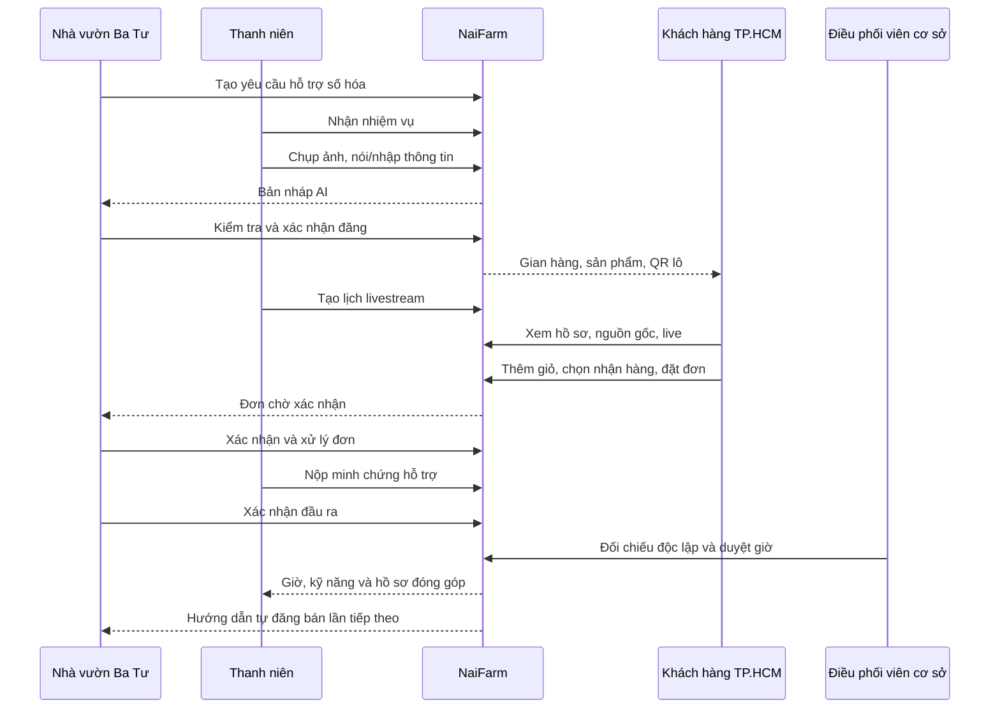

Luồng prototype có thể dùng chuyển vai trò demo rõ ràng, không yêu cầu BGK tự tìm đường. Tất cả liên kết phải dẫn tới dữ liệu thống nhất, không tạo mỗi màn hình một bộ số liệu khác nhau.

## 9.2. Luồng học tập

Giáo viên chọn chủ đề/nhà vườn → giao nhiệm vụ → người học xem bài học, 3D/360°/live → thực hành → nộp sản phẩm → giáo viên đánh giá → nhà vườn xác nhận đầu ra phù hợp → ghi nhận hoàn thành. Tách đánh giá học tập và xác nhận tình nguyện; không tự quy đổi.

## 9.3. Luồng du lịch

Bản đồ → lọc nhà vườn → xem mùa vụ và hồ sơ → tour 360°/3D → chọn trải nghiệm → gửi yêu cầu đặt lịch → nhà vườn xác nhận hoặc đề xuất lịch khác → tham gia → mua đặc sản và phản hồi. Hủy hoặc thời tiết xấu có trạng thái rõ.

## 9.4. Luồng hỗ trợ online

Nhà vườn nêu nhu cầu → lọc nhiệm vụ theo kỹ năng/hình thức → thanh niên nhận → thực hiện từ xa → nộp minh chứng/link/file → nhà vườn xác nhận đầu ra → điều phối viên độc lập duyệt minh chứng/giờ → yêu cầu chỉnh sửa hoặc ghi nhận giờ và hồ sơ năng lực. Chỉ công bố kết quả khi được phép.

## 9.5. Luồng điều phối và xác minh của Cán bộ Đoàn xã/phường

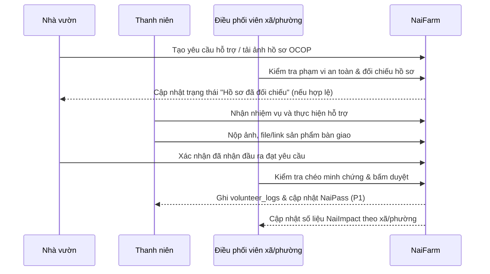

Quy tắc vận hành luồng: giờ tình nguyện chỉ được ghi nhận khi có đủ **hai lớp xác nhận** (nhà vườn xác nhận đầu ra + điều phối viên kiểm tra minh chứng), hoặc cơ chế đối chiếu độc lập nếu nhà vườn ủy quyền thao tác.

## 9.6. Trạng thái nghiệp vụ

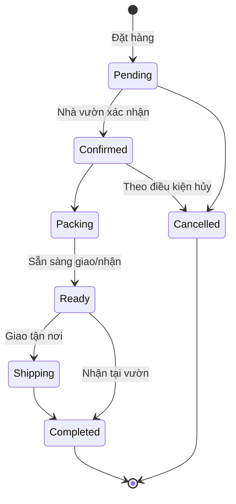

Tách trạng thái đơn và thanh toán; hủy phải giải phóng tồn giữ nếu có; không cho cập nhật trạng thái ngược tùy ý. Sản phẩm: draft → published → hidden/out_of_stock; chứng nhận nội bộ: eligible → reviewed → issued → revoked/expired; chứng từ OCOP: submitted → document_matched → source_confirmed nếu có xác nhận hợp lệ, hoặc rejected/expired/revoked; livestream: scheduled → live → ended hoặc cancelled (không tự chuyển sang live khi chưa phát).

## 9.7. Quy trình liên tổ chức và máy trạng thái chuẩn

Các trạng thái dưới là chuẩn logic backend; giao diện dịch sang tiếng Việt dễ hiểu. Chỉ service nghiệp vụ được chuyển trạng thái; UI không cập nhật trực tiếp DB. Mọi transition có actor, scope, điều kiện, lý do khi từ chối/hủy, thời gian, idempotency key nếu thao tác lặp và audit event.

| Đối tượng | Chuỗi chính | Ngoại lệ / người quyết định |
|---|---|---|
| Tổ chức | Draft → PendingReview → Active → Suspended/Closed | Admin xác minh, đại diện có quyền phản hồi, thu hồi grant khi đóng |
| Thành viên / grant | Invited → Accepted → Approved → Active → Expired/Revoked | Quản lý tổ chức phê duyệt; admin cấp quyền đặc biệt; không tự nâng quyền |
| Sản phẩm | Draft → ReviewByOwner → Published → Hidden/Archived | Chủ vườn duyệt; hết hàng là trạng thái tồn, không nhất thiết unpublish; vi phạm tạm ẩn có lý do |
| Chứng từ nguồn | Submitted → NeedsInfo/DocumentMatched → SourceConfirmed → Expired/Revoked | Điều phối chỉ DocumentMatched; người có thẩm quyền mới SourceConfirmed; có thể mismatch/rejected |
| Lô | Draft → Active → Exhausted/Closed | Owner xác nhận; hold/recall khi sự cố; QR hiển thị cảnh báo, không xóa lịch sử |
| Đơn | Pending → Confirmed → Packing → Ready → Shipping/PickedUp → Completed | Hủy theo điều kiện; DeliveryFailed/Disputed; hoàn tiền tách riêng |
| Thanh toán | Unpaid → Pending → Paid → RefundPending → PartiallyRefunded/Refunded | Finance/PSP đối soát; Failed/Expired; COD không giả thành đã thanh toán |
| Yêu cầu hỗ trợ | Draft → Submitted → Screening → Approved → Open → Fulfilled/Closed | Điều phối yêu cầu bổ sung/từ chối; nhà vườn hủy trước phân công hoặc theo điều kiện |
| Nhiệm vụ | Open → Assigned → InProgress → Submitted → BeneficiaryAccepted → Approved → Recorded | Revision, Cancelled, Disputed; hai lớp xác nhận độc lập; chỉnh giờ bằng bản ghi điều chỉnh |
| Livestream | Draft → Scheduled → Live → Ended → ReplayReview → ReplayPublished | Cancelled/Interrupted; replay không gắn Live; moderator có thể dừng |
| Học liệu | Draft → ExpertReview → EditorialReview → Published → Archived | Yêu cầu sửa; kiểm tra độ tuổi, quyền tác giả, phiên bản |
| Lớp / ghi danh | Planned → Active → Completed/Archived; Invited → Enrolled → Withdrawn/Completed | School admin và teacher theo scope; consent là gate riêng |
| Bài nộp | Assigned → Submitted → Graded → Finalized | Revision/Appealed; giáo viên đánh giá; điều phối không chấm |
| Chuyến học tập | Draft → SchoolApproved → ConsentCollected → HostConfirmed → InProgress → Completed | Hủy thời tiết, thiếu đồng ý hoặc an toàn; phương án thay thế, báo sự cố |
| Đặt trải nghiệm | Requested → Confirmed → CheckedIn → Completed | Declined/Reschedule/Cancelled/NoShow; giới hạn sức chứa, hoàn riêng |
| Chứng nhận nội bộ | Eligible → Requested → Reviewed → Issued → Expired/Revoked | Tổ chức cấp độc lập; sửa bằng chứng nhận mới tham chiếu bản cũ |
| RFQ/báo giá | Open → Quoted → Negotiating → Accepted → Contracted → Fulfilled | Expired/Rejected/Cancelled, nhà bán và bên mua cùng chấp nhận |
| Tài trợ | Proposed → DueDiligence → Approved → Committed → Disbursed → Reported/Closed | Từ chối, tạm dừng, đối soát, công khai tài trợ theo thỏa thuận |
| Ticket | Open → Assigned → Investigating → ProposedResolution → Resolved → Closed | Reopened/Escalated; chủ nghiệp vụ quyết định, CSKH theo dõi |
| Media/3D | Uploaded → Scanning → RightsReview → Published | Rejected/Removed; kiểm tra nguồn, riêng tư, quyền tác giả |

### 9.7.1. Tình nguyện và giáo dục: ba cổng xác nhận độc lập

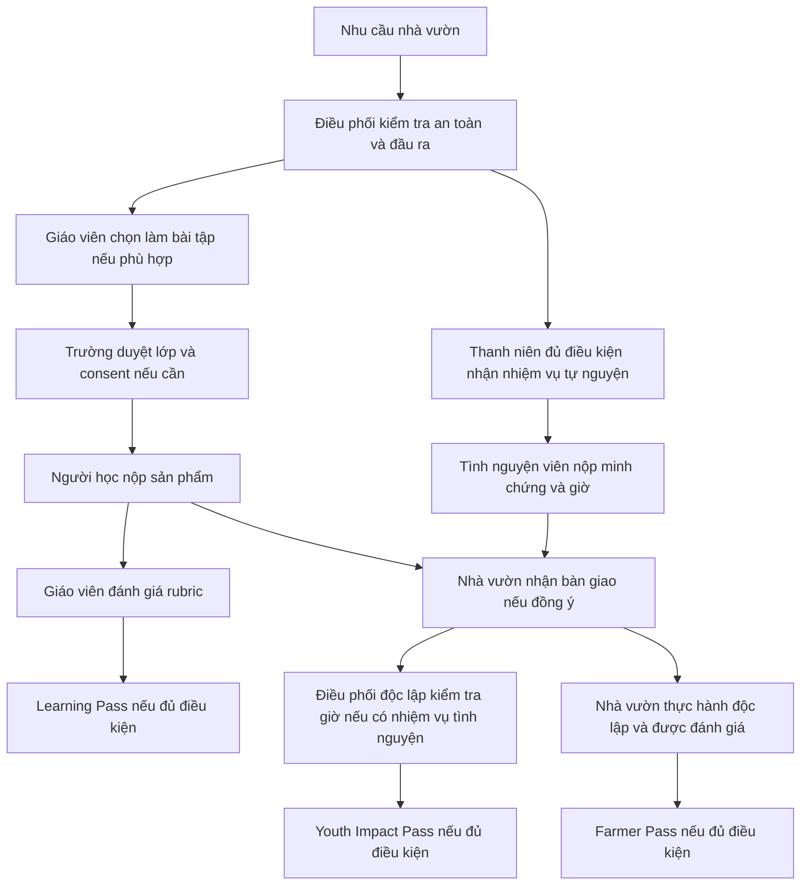

Cổng học vụ, bàn giao và giờ là các event khác nhau. Một sản phẩm có thể làm minh chứng ở nhiều cổng khi có quyền, nhưng không nhân đôi giờ hoặc số nhà vườn. Học sinh chưa thành niên mặc định theo luồng trường, không tự động tạo giờ tình nguyện.

### 9.7.2. Giao dịch thương mại và vận chuyển

Khách chọn lô khả dụng → checkout kiểm tra giá/phí/tồn ở server → giữ tồn với hạn → tạo đơn theo nhà bán → nhà vườn xác nhận → đóng gói gắn lô → bàn giao người vận chuyển hoặc nhận tại vườn → xác nhận thực nhận → hoàn thành/đối soát → đánh giá hoặc ticket. Nhà vườn không đổi snapshot giá sau checkout; người giao chỉ có quyền cập nhật chuyến được giao. Hết tồn đồng thời trả lỗi rõ, giữ giỏ, không tạo đơn âm. Đơn nhiều nhà bán chia theo fulfillment group; P0 giới hạn một nhà bán. Đơn thất bại/hủy giải phóng giữ tồn đúng một lần; refund không tự tạo giao dịch thanh toán thật trong demo.

### 9.7.3. Truy xuất và thu hồi

Nhà vườn nhập lô, nhật ký, chứng từ → người được giao đối chiếu → trạng thái công khai theo phạm vi → khách quét QR → nếu phát hiện sai/hết hạn, ghi sự kiện cảnh báo → owner tạm dừng bán lô → CSKH thông báo các đơn liên quan trong phạm vi quyền → cơ quan/chuyên gia được giao xử lý theo thẩm quyền → đóng vụ việc có biên bản. Không xóa lịch sử hoặc tiếp tục hiển thị nhãn còn hiệu lực khi đã thu hồi.

### 9.7.4. Cấp và thu hồi quyền, khiếu nại

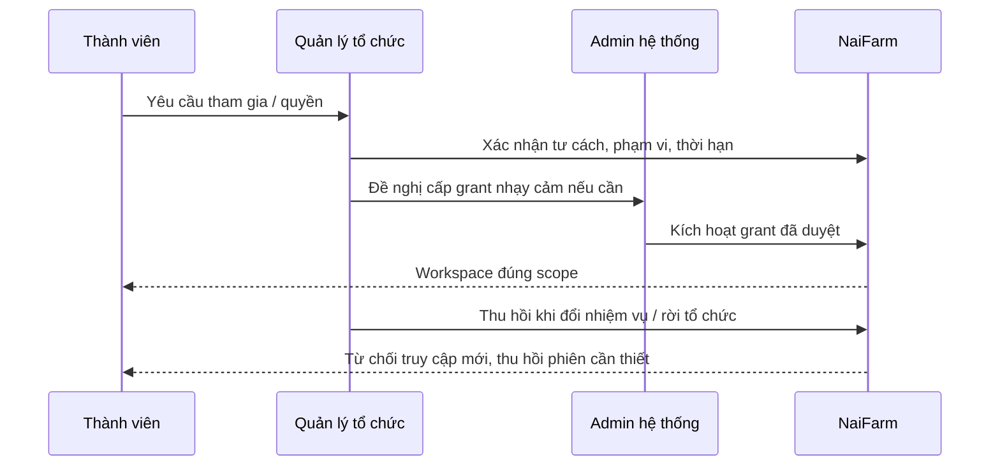

Khiếu nại đi theo chủ nghiệp vụ: giờ → quản lý chương trình; điểm → trường; đơn/booking → nhà bán/host và CSKH; chứng từ → đơn vị có thẩm quyền; tài khoản/quyền → Admin; tiền → tài chính và người duyệt độc lập. Người bị khiếu nại không là người duy nhất quyết định. Người dùng thấy mã ticket, trạng thái, phản hồi và đường chuyển cấp.

# 10. Danh mục màn hình và UX/UI

## 10.1. Danh mục 18 màn hình trọng tâm và 8 mở rộng

| ID | Màn hình | Thành phần cần có | Vai trò | Liên kết |
|---|---|---|---|---|
| S01 | Trang chủ chợ | Tìm kiếm, danh mục, mùa vụ, sản phẩm, nhà vườn | Khách | P0 |
| S02 | Hồ sơ nhà vườn | Câu chuyện, vị trí, ảnh, chứng nhận, sản phẩm | Khách | R1 |
| S03 | Chi tiết sản phẩm | Ảnh, giá, số lượng, lô, QR, mua | Khách | R3 |
| S04 | Hộ chiếu/nhật ký | Timeline, mã lô, nguồn, mức xác minh | Khách | R3 |
| S05 | Giỏ hàng | Số lượng, tạm tính, xóa, tiếp tục | Khách | R4 |
| S06 | Đặt hàng | Giao/nhận, địa chỉ, phí, tổng, xác nhận | Khách | R4 |
| S07 | Theo dõi đơn | Mã đơn, trạng thái, lịch sử | Khách | P0 |
| S08 | Trang chủ nhà nông | Đơn chờ, đăng nhanh, hỗ trợ, nhật ký | Nhà nông | P0 |
| S09 | Đăng bằng ảnh/giọng | Chụp ảnh, nói, nhập tay, tiến trình | Nhà nông | R2 |
| S10 | Duyệt bản nháp AI | Tên, mô tả, giá, đơn vị, tồn, sửa, đăng | Nhà nông | B1 |
| S11 | Quản lý đơn | Bộ lọc, trạng thái, chi tiết, hành động | Nhà nông | R5 |
| S12 | Gửi yêu cầu hỗ trợ | Nhu cầu, đầu ra, hình thức, thời gian | Nhà nông | P0 |
| S13 | Trang nhiệm vụ | Kỹ năng, online/trực tiếp, nhà vườn | Thanh niên | B3 |
| S14 | Chi tiết/nộp minh chứng | Đầu ra, nhận, nộp, giờ, duyệt | Thanh niên/nhà nông | B3 |
| S15 | Lịch livestream | Danh sách/lịch, tạo, trạng thái | Thanh niên | R6 |
| S16 | Phiên live | Video, ghim sản phẩm, nguồn gốc, mua | Khách | P1 |
| S17 | Bản đồ nhà vườn | Lớp, bộ lọc, popup, trải nghiệm | Khách | B2 |
| S18 | Hồ sơ năng lực | Giờ, kỹ năng, chứng nhận, QR | Thanh niên | P1 |
| S19 | Tour 360° | Panorama, hotspot, điều hướng | Khách | P1 |
| S20 | Thư viện 3D | Mô hình, bộ phận, chú thích | Khách/người học | P1 |
| S21 | NaiAcademy | Danh mục bài học theo chủ đề/môn | Người học | P1 |
| S22 | Bài học/nhiệm vụ | Nội dung, quiz, tiến độ, sản phẩm | Người học | P1 |
| S23 | Đặt trải nghiệm | Lịch, giá, số người, an toàn, gửi yêu cầu | Khách | P1 |
| S24 | Điều phối/tác động | Duyệt, nhiệm vụ, KPI | Điều phối | P0/P1 |
| S25 | Farmer Pass | Năng lực, hướng dẫn, cấp độ | Nhà nông | P1 |
| S26 | Lịch mùa vụ | Theo dõi, đặt trước, thời gian dự kiến | Khách | P1/P2 |

Màn hình đăng nhập/chọn vai trò, chi tiết đơn, xác minh chứng nhận, tạo nhật ký và trạng thái lỗi có thể được thiết kế bổ sung dưới dạng màn hình hoặc modal. 18 là mục tiêu thiết kế, không phải tối thiểu BTC; BTC yêu cầu tối thiểu 6. Nếu thời gian hạn chế, hoàn thành R1–R6 và B1–B3 trước. Màn hình ngoài MVP ghi rõ phạm vi định hướng.

### 10.1.1. Tách màn hình S24 – điều phối viên xã/phường

| ID | Màn hình / Góc nhìn con | Thành phần cần có | Vai trò | Liên kết |
|---|---|---|---|---|
| S24a | Tổng quan điều phối | Bộ đếm việc chờ xử lý theo `unit_code`, danh sách ưu tiên, lối tắt duyệt nhanh | Điều phối | P0/P1 |
| S24b | Đối chiếu hồ sơ & chứng nhận | Ảnh chứng từ nhà vườn tải lên, lịch sử thay đổi, nút chuyển *Hồ sơ đã đối chiếu* / *Yêu cầu bổ sung* kèm lý do | Điều phối | P0 |
| S24c | Duyệt minh chứng & giờ | Sản phẩm bàn giao của thanh niên, phản hồi của nhà vườn, nút `Approved` / `Revision`, số giờ duyệt | Điều phối | P0 |
| S24d | Cộng đồng & KPI tác động | Danh sách nhà vườn (mức tự chủ), thanh niên theo kỹ năng, biểu đồ KPI theo xã/phường, nút xuất báo cáo | Điều phối | P1 |

S24a–S24c là chức năng điều phối tối thiểu P0; S24d là dashboard mở rộng P1. Không dùng S24 làm Admin hệ thống.

### 10.1.2. Danh mục màn hình mở rộng toàn sản phẩm

Các ID S27–S76 bổ sung cho 26 màn hình gốc; một màn hình có thể có nhiều tab/modal. Không yêu cầu dựng tất cả trong 24 giờ. Khi hiện thực hóa đầy đủ, từng màn hình phải kết nối service, permission, dữ liệu và trạng thái thật.

| ID | Màn hình | Bộ quyền / actor theo scope | Nội dung / thao tác |
|---|---|---|---|
| S27 | Hồ sơ và thành viên nhà vườn | farm_owner | Sửa hồ sơ, phân quyền nhân viên, ủy quyền nhiệm vụ |
| S28 | Bản nháp và quyền thanh niên | volunteer, farm_owner | Danh sách việc được giao, bản nháp, duyệt công bố |
| S29 | Kho, mùa vụ, tài chính nhà vườn | farm_owner, farm_staff | Lô, giữ tồn, doanh thu đơn hoàn thành |
| S30 | Nhật ký mùa vụ và quản lý lô | farm_owner, farm_staff | Nhập ảnh/giọng, sự kiện, QR, lịch sử |
| S31 | Hồ sơ chứng từ nhà vườn | farm_owner | Upload riêng, trạng thái, yêu cầu bổ sung, hết hạn |
| S32 | Studio livestream và kiểm duyệt | volunteer, farm_owner, teacher, content_reviewer | Tạo lịch, ghim sản phẩm, quyền ghi hình, replay, báo cáo |
| S33 | Chiến dịch và phân bổ điều phối | program_manager | Chiến dịch, scope, tiêu chí, phân công, duyệt |
| S34 | Cộng đồng Hội Nông dân và đào tạo | farmer_association | Hộ đồng ý tham gia, nhu cầu tập huấn, giới thiệu chuyên gia |
| S35 | Nhóm đồng hành / trao đổi kỹ năng | program_manager, volunteer, farm_owner | Adopt a Farm, milestone, bàn giao, mentor |
| S36 | Sổ giờ và xử lý khiếu nại | local_coordinator, program_manager | Hai lớp xác nhận, giờ, chỉnh sửa, kháng nghị |
| S37 | Hồ sơ và thành viên hợp tác xã | coop_manager | Tư cách, hộ, ủy quyền, nhân viên |
| S38 | Nguồn cung và kho hợp tác xã | coop_manager, coop_staff | Lô hỗn hợp, tồn, truy xuất thành phần |
| S39 | Tổ chức doanh nghiệp và nhân sự | business_manager | Tư cách, thành viên, hạn mức, quyền |
| S40 | Dashboard doanh nghiệp / đối tác | business_manager | RFQ, tài trợ, đơn, báo cáo tổng hợp |
| S41 | Tìm nguồn cung và RFQ | business_buyer | Lọc nguồn, quy cách, khối lượng, gửi yêu cầu |
| S42 | Quản lý báo giá của nhà bán | farm_owner, coop_manager, coop_staff | Báo giá, hiệu lực, thương lượng |
| S43 | Phê duyệt mua và hợp đồng | business_manager, business_buyer, coop_manager | Duyệt hạn mức, xác nhận hai bên, giao nhiều đợt |
| S44 | Đối soát giao dịch B2B | finance_operator | Chứng từ, công nợ, đối soát, thanh toán |
| S45 | NaiRescue và Green Points | farm_owner, coop_manager, customer | Điều kiện an toàn, nguồn dư, khối lượng thực nhận |
| S46 | Đánh giá sau giao dịch | customer, farm_owner | Đánh giá đủ điều kiện, phản hồi, báo cáo |
| S47 | Khiếu nại của khách / nhà bán | customer, farm_owner, support_agent | Ticket, bằng chứng, xử lý và kháng nghị |
| S48 | Quản trị nhà trường | school_admin | Tổ chức, giáo viên, lớp, chính sách, đối tác |
| S49 | Lớp và giáo án | teacher | Lớp, ghi danh, bài học, rubric, phân công |
| S50 | Không gian học sinh | student_minor | Bài được giao, quiz, nộp bài, phản hồi, lịch đã duyệt |
| S51 | Không gian sinh viên | student_adult | Bài tập, đồ án, nhóm, hồ sơ học tập |
| S52 | Chấm bài và kỹ năng | teacher | Rubric, phiên bản, điểm, phản hồi, khiếu nại |
| S53 | Kế hoạch chuyến trải nghiệm | teacher, school_admin, experience_host | Mục tiêu, rủi ro, ca, sức chứa, duyệt kế hoạch |
| S54 | Cổng người giám hộ | guardian | Hoạt động, đồng ý/từ chối, rút consent, liên hệ |
| S55 | Giám sát chuyến học tập | teacher, experience_host | Check-in/out, danh sách tối thiểu, sự cố |
| S56 | Ngân hàng đề bài Field Lab | researcher, teacher, farm_owner | Đề xuất, dữ liệu, IP, duyệt, kết quả |
| S57 | Cổng chuyên gia / mentor | expert_mentor | Tư vấn, duyệt khoa học, giám sát thí nghiệm |
| S58 | Cấp chứng nhận nội bộ | program_manager, school_admin, local_coordinator | Điều kiện, minh chứng, issuer, QR, PDF |
| S59 | Tra cứu và thu hồi chứng nhận | Tổ chức cấp, guest (tra cứu công khai) | Mã, phạm vi, hiệu lực, lý do, thay thế |
| S60 | CMS nội dung 3D/360/bảo tàng | content_reviewer, expert_mentor | Upload, license, chú thích, duyệt, fallback |
| S61 | Quản lý trải nghiệm và booking | experience_host, farm_owner | Ca, giá, sức chứa, check-in, hủy |
| S62 | Đối chiếu chuyên môn chứng từ | credential_verifier | Nguồn chứng từ, phạm vi, phản hồi, lịch sử |
| S63 | Quản trị GIS và lớp dữ liệu | platform_admin, owner từng lớp | Nguồn, version, quyền vị trí, kiểm tra đơn vị |
| S64 | Dashboard chương trình / trường / Hội | program_manager, school_admin, farmer_association | KPI theo scope, xuất báo cáo có log |
| S65 | Cổng cơ quan / đối tác báo cáo | authority_viewer, business_manager | Chỉ số tổng hợp và yêu cầu thông tin |
| S66 | Admin tổng quan vận hành | platform_admin | Hàng chờ, lỗi, tổ chức, quyền, tình trạng dịch vụ |
| S67 | Admin tài khoản và tổ chức | platform_admin | Xác minh tư cách, trạng thái, thu hồi phiên |
| S68 | Admin phân quyền và ủy quyền | platform_admin | Grant scope, thời hạn, phê duyệt, thu hồi |
| S69 | Admin dữ liệu chuẩn và cấu hình | platform_admin | Địa giới, danh mục, đơn vị, AI quota, cấu hình |
| S70 | CSKH và hàng chờ tranh chấp | support_agent | Ticket, SLA, chuyển cấp, giải quyết |
| S71 | Kiểm duyệt và an toàn | content_reviewer, support_agent | Vi phạm, gỡ, báo cáo, phản hồi |
| S72 | Quyền riêng tư và thông báo | Mọi role đã đăng nhập; support_agent | Consent, preference, yêu cầu xuất/xóa, quyền truy cập |
| S73 | Cổng giao nhận | logistics_operator | Chuyến, nhận hàng, tracking, bằng chứng, sự cố |
| S74 | Tài chính và tài trợ | finance_operator, business_manager, program_manager | Ledger, hoàn, ngân sách, duyệt độc lập |
| S75 | Kiểm toán và truy vết | auditor | Audit, case, bất thường, xuất theo quyền |
| S76 | Vận hành kỹ thuật / tích hợp | platform_admin | Service health, API, backup, sự cố, rollback |

## 10.2. Điều hướng và kiến trúc thông tin tối ưu (6 workspace)

| Workspace | Route gốc | Menu cấp 1 (mobile/desktop) | Tab và màn hình nghiệp vụ dùng lại |
|---|---|---|---|
| W01 Cá nhân | `/account` | Chợ; Khám phá; Đơn & lịch; Cá nhân | S01–S07, S16–S17, S19–S23, S26, S45–S47, S54, S59, S72 theo quyền |
| W02 Nhà nông | `/farmer` | Tổng quan; Sản phẩm & mùa vụ; Đơn & kho; Hỗ trợ; Hồ sơ | S02–S04, S08–S12, S14–S15, S25, S27–S32, S35, S37–S38, S42–S47, S53, S55–S56, S61, S72, S74 theo quyền |
| W03 Thanh niên & người học | `/volunteer` | Tổng quan; Nhiệm vụ; Học tập; Hồ sơ năng lực | S09–S10 (nháp được giao), S13–S16, S18–S22, S28, S32, S35, S50–S51, S56, S59, S72 theo quyền |
| W04 Điều phối | `/coordinator` | Tổng quan; Cộng đồng; Nhiệm vụ; Xác minh; Tác động | S24a–d, S33–S36, S58–S59, S64, S72, S74 theo quyền |
| W05 Tổ chức & đối tác | `/organization` | Tổng quan; Thành viên; Công việc; Phê duyệt; Báo cáo | S32, S39–S44, S48–S49, S52–S53, S55–S60, S62, S64–S65, S72–S74 theo loại tổ chức và quyền |
| W06 Quản trị nền tảng | `/admin` | Tổng quan; Tài khoản & tổ chức; An toàn & hỗ trợ; Dữ liệu & cấu hình; Kiểm toán | S47, S60, S63, S66–S72, S74–S76 theo quyền |

Danh mục S01–S76 là **nhóm chức năng/màn hình tham chiếu**, không phải 76 trang độc lập hoặc 76 menu. S24a–d là các view con của S24. Màn hình công khai có URL chuẩn dùng chung, không sao chép cho từng workspace. Màn hình nhiều người tham gia dùng cùng component và ID, action và projection khác nhau. Các mã S và B giữ nguyên để truy vết nguồn V2, không cần đánh lại số. Bảng trên là điểm vào chính, không thay thế kiểm tra quyền tại 7.12, 10.1 và 12.3.

### 10.2.1. Những cụm giao diện nên hợp nhất

| Cụm dùng chung | Các ID nguồn | Cách thiết kế, không nhân bản |
|---|---|---|
| Danh mục + hồ sơ sản phẩm/QR | S01–S04, S26, S45 | Chợ có bộ lọc, sản phẩm và nhà vườn; QR mở chi tiết lô; mùa vụ/nguồn dư là tab hoặc bộ lọc |
| Đăng nhanh + duyệt nháp | S09–S10, S28 | Một wizard, vai trò nháp/duyệt theo grant; preview và xác nhận công bố riêng |
| Hồ sơ cơ sở, thành viên, nguồn cung | S27, S29–S31, S37–S38 | Một màn hình cơ sở với tab nhân sự, sản phẩm, kho, lô, giấy tờ; HTX có bộ chọn cơ sở/hộ |
| Giao dịch và hỗ trợ | S05–S07, S11, S42–S47, S73–S74 | Một service đơn hàng; khách xem đơn mình, nhà bán xử lý, vận chuyển xem chuyến được giao, đối soát/tab RFQ theo quyền |
| Nhiệm vụ và duyệt giờ | S12–S14, S24a–d, S33–S36 | Cùng hồ sơ nhiệm vụ; request/assignment/submission/review và timeline; hàng chờ duyệt theo người phụ trách |
| Live | S15–S16, S32 | Lịch, studio, xem live/replay; phân quyền host, cohost, người xem, moderation; không tạo app live riêng |
| Học & thực hành | S20–S22, S48–S57 | Một kho học liệu; học sinh/sinh viên cùng layout W03 nhưng giới hạn theo tuổi; lớp, chấm, giáo án, đề tài trong W05; consent W01 |
| Hồ sơ năng lực | S18, S25, S58–S59 | Một service credential và trang verify; UI hiển thị loại pass phù hợp, người cấp có màn duyệt riêng |
| Bản đồ, 3D, du lịch | S17, S19–S20, S23, S53, S55, S60–S61, S63 | Dùng chung media viewer, bản đồ và booking engine; chủ vườn quản lý ca, trường duyệt đoàn, admin quản trị GIS |
| Dashboard tổ chức | S33–S34, S39–S40, S48, S64–S65 | Một layout có bộ chọn tổ chức; KPI và tab theo loại/scope, không clone dashboard |
| Hàng chờ, kiểm duyệt và quản trị | S62, S66–S72, S75–S76 | Một khung queue/case; mỗi loại hồ sơ có người xử lý và guard riêng; audit chỉ đọc |

### 10.2.2. Quy tắc UX chống rối

Mobile tối đa 4–5 mục chính, thao tác phụ đặt trong tab hoặc menu thêm; desktop sidebar nhóm chức năng và breadcrumb. Trang tổng quan mỗi workspace là các việc cần làm theo ngữ cảnh, không đưa toàn bộ chức năng vào một màn hình. Không dùng các tên phân hệ NaiMarket/NaiTrace/NaiPass như 10 cổng login. Tên thương hiệu phân hệ chỉ hỗ trợ nhận diện; người dùng thấy từ ngữ dễ hiểu. Dùng search có scope, thông báo thống nhất, back đúng màn, bộ lọc giữ lại, empty/loading/error/offline/forbidden/success, xác nhận thao tác nhạy cảm. Tất cả route alias cũ phải chuyển đến workspace chuẩn sau kiểm tra grant; không giữ portal cũ độc lập. Người dùng không có quyền phải nhận 403/404 phù hợp, không chỉ ẩn nút.

## 10.3. Design system – Modern Agricultural Editorial

| Token | Giá trị | Công dụng |
|---|---|---|
| Forest | `#245B3D` | Màu chính, CTA, thương hiệu |
| Leaf | `#6C9C5B` | Màu phụ, minh họa thiên nhiên |
| Rice | `#F5F3E9` | Nền sáng ấm |
| Harvest | `#D7A34D` | Mùa vụ, điểm nhấn |
| Earth | `#25352B` | Chữ chính |
| White | `#FFFFFF` | Surface, form |

Font Be Vietnam Pro hoặc sans-serif hỗ trợ tiếng Việt; fallback system. Hình ảnh chân thật, ưu tiên ảnh địa phương được phép, ánh sáng tự nhiên, không dùng ảnh AI để giả danh nhà vườn. Bố cục sạch, khoảng thở, màu ấm và xanh trầm, hạn chế gradient/neon/glassmorphism, icon robot, badge vô nghĩa; dùng icon thống nhất có nhãn. Landing có tiêu đề “Từ vườn nhà đến mọi nhà”, CTA Khám phá nông sản/Tham quan nhà vườn; không để hero che nhiệm vụ chính trên mobile.

**Nhà nông 50 tuổi:** chữ 17–18px hoặc chế độ lớn; nút khoảng 48–56px; 4–6 hành động ưu tiên; 3 bước đăng bán; ngôn ngữ “Nhờ thanh niên giúp”, “Chụp ảnh để bán”, không dùng thuật ngữ AI phức tạp; thông báo chữ + icon, không chỉ màu; xác nhận trước xóa/ẩn/công bố. Kiểm tra độ tương phản, focus, điều hướng bàn phím, nhãn form, ảnh alt, giảm chuyển động. Thiết kế mobile-first 360–430px, mở rộng desktop; bản đồ, live, 3D có chế độ nhẹ.

## 10.4. Trạng thái rỗng, lỗi và ngoại lệ bắt buộc thiết kế

| Tình huống | Xử lý UX |
|---|---|
| Chưa có sản phẩm | Hướng dẫn đăng đầu tiên, CTA ảnh/giọng |
| AI sai/thiếu | Chỉnh sửa, yêu cầu bổ sung, không tự đăng |
| Nhận giọng nói thất bại | Ghi lại hoặc nhập tay |
| Camera/micro bị từ chối | Hướng dẫn quyền, chọn ảnh/nhập tay |
| Mạng yếu/mất kết nối | Lưu nháp nếu có, cảnh báo, thử lại, tránh tạo trùng |
| Đang tải | Skeleton/tiến trình, không bấm lặp |
| Hết hàng | Tắt mua, theo dõi mùa, gợi ý tương tự |
| Chứng nhận hết hạn/chưa có | Trạng thái rõ, không dùng nhãn đã xác minh |
| QR không hợp lệ | Thông báo và nhập mã tay |
| Live chưa bắt đầu | Lịch, nhắc, nội dung chuẩn bị |
| Live bị hủy/mất kết nối | Trạng thái, lịch thay thế hoặc replay |
| Không tìm thấy trên bản đồ | Nới bộ lọc, danh sách thay thế |
| Nhiệm vụ chờ duyệt | Không cộng giờ, hiển thị tiến độ |
| Minh chứng cần sửa | Phản hồi và nộp lại |
| Đặt hàng lỗi | Giữ giỏ, lý do, thử lại |
| Đơn hủy | Trạng thái, chính sách, hoàn tiền nếu có |
| Không có quyền | Giải thích, trở về trang đúng vai trò |
| Mô hình 3D không tải | Ảnh tĩnh, chú thích và thử lại |
| Không có lịch trải nghiệm | Đề xuất gửi yêu cầu/lịch khác |

### 10.5. Ngoại lệ theo vai trò và liên tổ chức

| Tình huống | Xử lý UX |
|---|---|
| Phường chưa có hồ sơ/minh chứng chờ duyệt | Hiển thị trạng thái trống tích cực kèm số liệu tóm tắt tuần hiện tại và lối tắt xem danh sách nhà vườn trên địa bàn |
| Ảnh chứng từ OCOP bị mờ, hết hạn hoặc sai tên chủ thể | Khóa nút xác nhận, bắt buộc chọn lý do từ chối và gửi thông báo hướng dẫn nhà vườn/thanh niên chụp lại |
| Điều phối viên bấm duyệt nhiệm vụ do chính tài khoản mình thực hiện | Chặn thao tác ở server, hiển thị thông báo quy tắc kiểm tra chéo và chuyển sang người phụ trách khác |
| Tài khoản điều phối chưa được gán `unit_code` xã/phường | Không hiển thị dữ liệu địa bàn khác, hướng dẫn liên hệ quản trị hệ thống để cấp phạm vi quản lý |

| Tình huống | Cách xử lý |
|---|---|
| Quyền vừa hết hạn / bị thu hồi | Dừng thao tác, refresh grant, chuyển workspace hợp lệ; không cho gửi lại request bằng cache |
| Nhà vườn thay người đại diện | Tạm khóa quyền nhạy cảm, xác minh người mới, lưu lịch sử và thu hồi grant cũ |
| Giá/tồn thay đổi lúc checkout | Hiển thị chênh lệch, xác nhận lại; không tự tính tiền khác |
| Đơn giao thất bại | Ticket, lý do, ảnh nếu phù hợp; thông báo các bên, không tự đánh dấu hoàn thành |
| Đề nghị hợp tác xã truy cập hộ chưa đồng ý | Chỉ thấy lời mời, không đọc dữ liệu riêng; yêu cầu đồng ý theo scope |
| Doanh nghiệp RFQ quá hạn | Đóng báo giá, cho tạo yêu cầu mới; không tự giữ hàng |
| Học sinh chưa có consent | Khóa hoạt động cần đồng ý, cung cấp bài thay thế; không công bố thông tin |
| Chuyến học tập có thời tiết xấu | Giáo viên/host đề xuất đổi hoặc hủy; thông báo giám hộ và cập nhật ca |
| Lớp chưa có học viên | Hướng dẫn ghi danh an toàn, không hiển thị dữ liệu trường khác |
| Điểm học tập có khiếu nại | Giữ bài và rubric phiên bản, chuyển trường xử lý, không tự cộng giờ |
| Chứng nhận nội bộ bị thu hồi | Trang QR hiển thị trạng thái thu hồi, lưu lý do phù hợp, bản cấp mới tham chiếu bản cũ |
| Video/3D thiếu license | Chặn công bố, yêu cầu nguồn/quyền, gỡ khi có vi phạm |
| Cơ quan yêu cầu dữ liệu ngoài scope | Từ chối mặc định, chuyển quy trình xác minh căn cứ |
| Admin cố sửa đơn hoặc giờ trực tiếp | Từ chối, hướng đến ticket/chủ nghiệp vụ; audit |
| Giao dịch/tài trợ chưa đối soát | Hiển thị đang chờ, không tính đã nhận tiền hoặc doanh thu |
| API bản đồ/AI/live lỗi | Fallback có nhãn, ghi trạng thái thật; không giả lập kết quả như thật |

# 11. Dữ liệu mẫu và địa giới

## 11.1. Nhà vườn Ba Tư — dữ liệu giả lập

| Trường | Giá trị |
|---|---|
| ID | `farm-ba-tu-demo` |
| Tên | Nhà vườn Ba Tư |
| Chủ vườn | Chú Ba Tư, 50 tuổi |
| Địa chỉ minh họa | Phường Long Khánh, Thành phố Đồng Nai |
| Quy mô | 2,5 ha |
| Cây chính | Chôm chôm, sầu riêng |
| Sản phẩm | 5 |
| Đoàn viên | 2 |
| Chứng nhận | Chưa xác minh; hồ sơ minh họa nếu cần |

| ID | Tên sản phẩm | Giá demo/kg | Trạng thái demo |
|---|---|---:|---|
| P01 | Chôm chôm Java | 35.000 đ | Hẹn mùa hoặc lô demo |
| P02 | Chôm chôm nhãn | 45.000 đ | Hẹn mùa |
| P03 | Chôm chôm tuyển chọn | 60.000 đ | Hẹn mùa |
| P04 | Sầu riêng Ri6 | 85.000 đ | Theo lô giả lập xác nhận |
| P05 | Sầu riêng tuyển chọn | 120.000 đ | Theo lô giả lập xác nhận |

Không khẳng định ngày 24/11 là chính vụ. Sử dụng một lô đang bán ghi nhãn giả lập để demo đặt đơn; các sản phẩm hẹn mùa không cho đặt đơn giao ngay. Giá, giống, ngày và tồn chỉ dùng thiết kế. Nếu đổi lô demo, đồng bộ toàn bộ S03, S04, giỏ, đơn, live và nhà vườn.

### Kịch bản seed nhất quán (đề xuất)

- `NF-DEMO-001`: lô chôm chôm P01, tồn 30 kg giả lập, 35.000 đ/kg, nhật ký có 3–5 mốc giả lập; chứng nhận chưa xác minh.
- Khách Ngọc Linh mua 2 kg từ lô trên; tiền hàng 70.000 đ; nếu phí giao demo 20.000 đ thì tổng 90.000 đ. Chọn nhận tại vườn thì phí demo 0 đ. Tạo mã đơn và trạng thái chờ xác nhận.
- Thanh niên Minh Anh nhận nhiệm vụ số hóa; người hỗ trợ thứ hai dùng tên giả lập khác; nhiệm vụ có đầu ra, giờ thực hiện/duyệt. Chỉ phát sinh giờ và chứng nhận sau xác nhận.
- Lịch live liên kết `farm-ba-tu-demo`, P01, thời gian minh họa; replay ghi nhãn demo. Không bịa số người xem thật.
- Demo dashboard có thể dùng bộ seed rộng hơn; nếu hiển thị số liệu tổng hợp từ seed phải khớp dữ liệu và ghi nhãn.

## 11.2. Nhà vườn giả lập đại diện toàn thành phố

| Khu vực hiện hành | Tên cơ sở giả lập | Sản phẩm/chủ đề |
|---|---|---|
| Phường Long Khánh | Nhà vườn Ba Tư | Chôm chôm, sầu riêng |
| Phường Bình Lộc | Vườn trải nghiệm Mùa Xanh | Trái cây và trải nghiệm |
| Phường Tân Triều | Vườn Bưởi An Lành | Bưởi, chế biến |
| Xã Gia Kiệm | Trang trại Đất Đỏ | Cây ăn quả |
| Xã Bù Đăng | Vườn Điều Bình Minh | Hạt điều |
| Xã Phú Riềng | Nông trại Hạt Việt | Điều, nông sản |
| Phường Lộc Ninh | Vườn Tiêu Xanh | Hồ tiêu |
| Xã Thọ Sơn | Tổ nông nghiệp Bản Xanh | Rau nhíp, bản địa |
| Xã Bù Gia Mập | Nông trại Đồi Xanh | Điều, chế biến |

Tên cơ sở, hoạt động và danh mục sản phẩm là minh họa; không phải danh bạ doanh nghiệp thật. Địa giới tham chiếu [S4], cần đối chiếu trước nhập tọa độ.

## 11.3. Danh mục 95 đơn vị hành chính – yêu cầu dữ liệu

Tham chiếu tài liệu tuyên truyền địa phương [S4], và nghị quyết liên quan; khi nhập DB phải dùng mã chính thức, kiểm tra hình học và tên chuẩn. Tên Trị An xuất hiện ở cả danh mục xã/phường trong nguồn [S4]; không tự suy đoán hoặc gộp, cần đối chiếu văn bản và mã hành chính gốc trước khi tạo bản ghi.

**33 phường theo danh mục nguồn [S4]:** An Lộc, Bảo Vinh, Biên Hòa, Bình Long, Bình Lộc, Bình Phước, Chơn Thành, Đồng Xoài, Hàng Gòn, Hồ Nai, Long Bình, Long Hưng, Long Khánh, Minh Hưng, Phước Bình, Phước Long, Phước Tân, Tam Hiệp, Tam Phước, Tân Triều, Trấn Biên, Trảng Dài, Xuân Lập, Nhơn Trạch, Long Thành, Trảng Bom, Trị An, Xuân Lộc, Dầu Giây, Tân Phú, Đồng Phú, Tân Khai, Lộc Ninh.

**62 xã theo danh mục nguồn [S4]:** An Phước, An Viễn, Bàu Hàm, Bình An, Bình Minh, Bình Tân, Bom Bo, Bù Đăng, Bù Gia Mập, Cẩm Mỹ, Đa Kia, Đại Phước, Đak Lua, Đak Nhau, Đak Ơ, Định Quán, Đồng Tâm, Gia Kiệm, Hưng Phước, Hưng Thịnh, Long Hà, Long Phước, La Ngà, Lộc Hưng, Lộc Quang, Lộc Tấn, Lộc Thành, Lộc Thạnh, Minh Đức, Nam Cát Tiên, Nghĩa Trung, Nha Bích, Phú Hòa, Phú Lâm, Phú Lý, Phú Nghĩa, Phú Riềng, Phú Trung, Phú Vinh, Phước An, Phước Sơn, Phước Thái, Sông Ray, Tà Lài, Tân An, Tân Hưng, Tân Lợi, Tân Quan, Tân Tiến, Thanh Sơn, Thiện Hưng, Thọ Sơn, Thống Nhất, Thuận Lợi, Trị An, Xuân Bắc, Xuân Định, Xuân Đông, Xuân Đường, Xuân Hòa, Xuân Phú, Xuân Quế, Xuân Thành.

**Cảnh báo dữ liệu:** danh sách xã trích nguồn trên có dấu hiệu không nhất quán với tổng số công bố (đếm tên và đối chiếu Trị An trước khi sử dụng). Không dùng danh sách văn bản này như bộ dữ liệu đã chuẩn hóa. Nếu không kịp xác minh, demo chỉ dùng các đơn vị đã đối chiếu và ghi “phạm vi mở rộng 95 xã/phường”.

# 12. Kiến trúc, công nghệ và dữ liệu

## 12.1. Kiến trúc đơn giản, một codebase

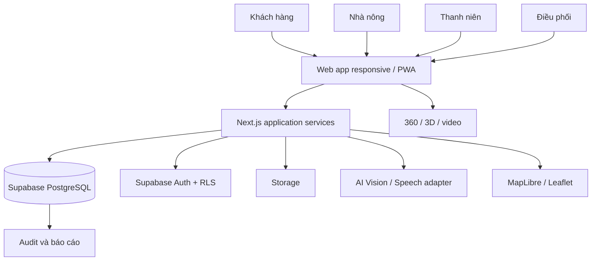

Không chia microservice trong 24 giờ; một DB, một deployment, module hóa theo nghiệp vụ; tách domain/service khỏi UI để mở rộng. Nếu API ngoài không có key hoặc vượt quota, fallback thủ công minh bạch; không báo đã chạy AI thật nếu chỉ dùng dữ liệu mẫu.

| Thành phần | Lựa chọn đề xuất |
|---|---|
| Thiết kế | Figma/Penpot, prototype và PDF |
| Frontend | Next.js, React, TypeScript |
| UI | Tailwind CSS, shadcn/ui hoặc component tự xây |
| DB/Auth/Storage | Supabase PostgreSQL, Auth, Storage |
| Phân quyền | RBAC + RLS, server-side validation |
| AI | Gemini API hoặc multimodal tương đương; adapter có fallback |
| Giọng nói | Web Speech API nếu hỗ trợ, nhập tay dự phòng |
| QR | qrcode, trang truy xuất công khai |
| GIS | Leaflet/MapLibre, GeoJSON; PostGIS khi cần |
| 3D | Three.js hoặc model-viewer, GLB/glTF |
| Tour 360° | Pannellum/Marzipano |
| Live | Lịch, video nhúng/replay; LiveKit/WebRTC nếu đủ khả năng |
| Realtime | Supabase Realtime nếu cần |
| Chứng nhận | pdf-lib, QR xác minh |
| Dashboard | Recharts hoặc biểu đồ đơn giản |
| Kiểm thử | Playwright, test unit nghiệp vụ |
| Deploy | Vercel, GitHub |

Kiểm tra phiên bản, giấy phép, chi phí, hạn mức, tài khoản và điều kiện sử dụng thực tế. Không đảm bảo dịch vụ miễn phí hoặc khả dụng vô hạn. Không đưa key vào frontend/repo; biến môi trường server-side và `.env.example` không chứa secret.

## 12.2. Mô hình dữ liệu

| Bảng | Trường chính / mục đích | Mức |
|---|---|---|
| profiles | id, display_name, age_band, unit_code (địa bàn hồ sơ nếu cần), locale, status; không dùng `role` đơn làm nguồn phân quyền | P0 |
| administrative_units | code, name, type, parent, geojson_ref, source_version | P0/P1 |
| farms | id, owner_id, name, story, unit_code, area, location, is_demo | P0 |
| products | id, farm_id, name, desc, price, unit, stock, status | P0 |
| certificates | id, farm_id, product_id nullable, issuer, type, validity, verification_status, reviewed_by, reviewed_at, review_note, source_confirmed_by, source_ref | P0 |
| product_batches | id, product_id, public_code, harvest_date, quantity, source_status | P0 |
| farm_diaries | id, batch_id, event_at, type, notes, evidence, author | P0 |
| orders | id, customer_id, farm_id, status, fulfillment, total, payment_status | P0 |
| order_items | order_id, product_id, batch_id, qty, unit_price | P0 |
| livestreams | id, farm_id, host_id, scheduled_at, media_url, status | P0 |
| support_requests | id, farm_id, title, need, desired_output, status | P0 |
| missions | id, request_id, program_id, farm_id, unit_code, assignee_id (P0 một người), skill, mode, expected_hours, criteria, status | P0 |
| mission_submissions | id, mission_id, submitter_id, version, evidence, output, actual_hours, beneficiary_status, review_status | P0 |
| volunteer_logs | id, mission_id, volunteer_id, submission_id, approved_minutes, reviewer_id, beneficiary_confirmation_id, timestamp, adjustment_of nullable | P0 |
| skills | id, title, criteria | P1 |
| user_skills | user_id, skill_id, evidence, confirmed_by | P1 |
| digital_credentials | id, holder_id, issuer_org_id, issuer_actor_id, type, scope, code, status, issued_at, valid_until, evidence_ref, revoked_at, supersedes_id | P1 |
| courses | id, title, audience, learning_objectives | P1 |
| lessons | course_id, title, content, media, quiz | P1 |
| learning_progress | user_id, lesson_id, score, completion, evidence | P1 |
| farm_experiences | id, farm_id, title, dates, capacity, rules | P1 |
| experience_bookings | experience_id, customer_id, party_size, status | P1 |
| media_assets | id, type, URL, license, attribution, is_demo | P1 |
| audit_logs | actor, entity, action, timestamp, changes | P0 |

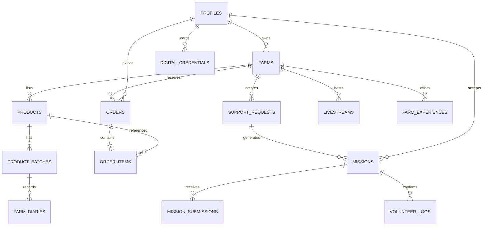

### 12.2.1. Mô hình dữ liệu đa tổ chức và các nghiệp vụ mở rộng

Bảng gốc ở trên giữ cho MVP. Mở rộng chuẩn dưới đây có thể triển khai dần; các tên nhóm có dấu `/` là các bảng riêng có FK tương ứng, không phải một tên bảng chứa dấu gạch. UUID cho khóa nội bộ, public code riêng cho QR, `created_at/updated_at`, `created_by`, `status`, `is_demo` hoặc môi trường tách biệt khi cần. Tiền lưu đơn vị nhỏ nhất dạng integer, giờ lưu phút integer, khối lượng theo đơn vị chuẩn và decimal có precision. Không nhân bản danh tính sang bảng role.

| Bảng / nhóm bảng | Trường / mục đích chính | Mức |
|---|---|---|
| organizations | id, type, name, verified_status, owner_contact, unit_code, status | P0/P2 |
| organization_memberships | id, org_id, user_id, status, invited_by, approved_by, joined_at, revoked_at | P0 |
| access_grants (tương thích `role_grants`) | id, user_id, workspace_key, action_key, org_id nullable, scope_type, scope_id, valid_from, expires_at, status, approved_by; bundle_key nullable chỉ truy vết cấu hình | P0 |
| permission_definitions / permission_bundles / bundle_permissions | action_key, resource, conditions, version; bundle_key, action_key; mẫu cấp quyền không phải account role | P0 |
| delegations | id, grantor_id, grantee_id, farm_id, mission_id, actions, expires_at, revoked_at | P0 |
| programs / program_units | id, owner_org_id, criteria_version, start/end, unit_code, assignment | P0/P2 |
| organization_verifications | org_id, representative_id, private_doc_ref, reviewer, status, reviewed_at | P0/P2 |
| farm_memberships / cooperative_links | farm_id, org_id, user_id, scopes, consent_id, status | P1/P2 |
| certificate_reviews | certificate_id, reviewer_id, check_type, result, reason, source, reviewed_at | P0 |
| batch_events / batch_components | batch_id, source_batch_id, event, quantity, actor, time | P0/P2 |
| inventory_reservations / stock_movements | product_id, batch_id, order_id, quantity, expires_at, reason, idempotency_key | P0 |
| order_status_events | order_id, from_status, to_status, actor_id, reason, time | P0 |
| payments / payment_events / refunds | order_id, provider_ref, amount_minor, currency, status, idempotency_key, approval | P2 |
| shipments / delivery_events / pickup_points | order_id, assigned_org/actor, fulfillment details, status, proof_ref | P2 |
| mission_assignments | mission_id, user_id, assigned_at, status, scope, unique active assignment | P0/P2 |
| beneficiary_confirmations / mission_reviews | submission_id, beneficiary_id, reviewer_id, decision, hours, reason, time | P0 |
| skill_assessments / credential_reviews | holder_id, skill_id, rubric_version, assessor_id, evidence_id, decision | P1 |
| schools / classes / enrollments | org_id, class_id, teacher_id, learner_id, status, term | P2 |
| guardian_links / consent_records | child_id, guardian_id, verified_by, activity_id, consent_type, version, state, timestamp | P2 |
| assignments / rubrics / submissions / grades | class_id, assignment_id, learner_id, version, criteria, score, teacher_id | P1/P2 |
| learning_content_versions / content_reviews | lesson_id, version, age_band, source, license, reviewer, decision | P1/P2 |
| field_trips / trip_participants / safety_incidents | school_id, host_id, slot_id, safety_plan, consent_id, attendance, incident_ref | P2 |
| experience_slots / booking_events | experience_id, slot_id, capacity, reserved_count, booking_id, event | P1/P2 |
| rfqs / quotes / contracts / contract_deliveries | buyer_org_id, seller_org/farm_id, qty, specs, snapshot, approvals, delivery schedule | P2 |
| sponsorships / sponsorship_milestones | sponsor_org_id, program_id, purpose, budget, status, approvals, evidence | P2 |
| rescue_listings / rescue_transfers / green_point_events | batch_id, safety_status, qty_offered/accepted, verifier, recipient_ref | P2 |
| research_projects / data_access_requests / project_deliverables | school/org_id, farm_id, supervisor, data_scope, consent, IP_terms, status | P2 |
| live_products / live_sessions / live_comments | livestream_id, product_id, media_state, moderator, consent, comment_status | P1/P2 |
| media_rights / media_reviews / model_hotspots | asset_id, license, owner, allowed_uses, review, coordinates/annotation | P1/P2 |
| map_publications / geo_versions | source_entity, unit_code, public_location, visibility, source_version, approved_by | P0/P1 |
| support_tickets / ticket_events / moderation_cases | case_id, category, entity_ref, assigned_actor, severity, status, evidence, decision | P1/P2 |
| notifications / preferences | recipient_id, event_id, channel, consent, delivery_status | P0/P1 |
| ledger_entries / approval_requests | org_id, ref, amount, currency, direction, approver, status, immutable_event | P2 |
| report_exports / access_logs / privacy_requests | actor_id, scope, reason, dataset, export_ref, status, timestamp | P1/P2 |
| outbox_events / integration_events | entity_id, event_type, payload_minimized, idempotency_key, retry_count, status | P0/P2 |

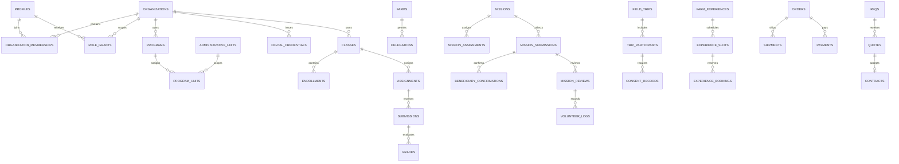

**Ràng buộc dữ liệu:** FK bắt buộc giữa farm/product/batch; order item phải cùng seller và batch thuộc product; snapshot giá/đơn vị không đổi sau đặt; unique `public_code`, `credential.code`, idempotency key theo actor/action; kiểm tra `approved_minutes >= 0`, giờ hợp lý và không chồng thời gian đã duyệt; unique ghi nhận gốc theo assignment, bút toán điều chỉnh append-only; membership không cấp role tự động; `unit_code` lấy từ farm/program authoritative, không tin client truyền; soft delete hoặc lưu lịch sử với record có giao dịch; file riêng tư dùng ACL/signed URL thời hạn ngắn; phân biệt dữ liệu demo và thật trong truy vấn KPI. Không dùng số liệu demo làm dữ liệu sản xuất.

## 12.3. Quyền và bảo mật – RBAC kết hợp phạm vi dữ liệu (ABAC)

Mặc định từ chối. `workspace_key` chỉ định ngữ cảnh giao diện W01–W06; `access_grants` cấp từng `action_key` theo tổ chức, farm, lớp, chương trình, địa bàn, assignment, vụ việc và thời hạn. Các bundle tương thích chỉ là cấu hình seed/chuyển đổi, không phải nguồn quyền tự động; `delegations` cho quyền nhỏ theo nhiệm vụ. Tài khoản có nhiều grant nhưng mỗi yêu cầu phải xác định workspace/scope hợp lệ. Không cộng quyền xuyên workspace để truy cập dữ liệu ngoài phạm vi. Quyền chỉ đọc không kéo theo quyền sửa, quyền duyệt không kéo theo quyền cấp chứng nhận, quyền admin không mặc nhiên bypass RLS.

| Hành động | Bộ quyền tương thích có thể được cấp | Scope bắt buộc | Điều kiện nghiệp vụ |
|---|---|---|---|
| Đọc hồ sơ công khai | guest và mọi role | public | Chỉ trường đã publish và cho phép |
| Quản lý tài khoản cá nhân | Mọi role đăng nhập | self | Không tự đổi role/grant/age_band nhạy cảm |
| Tạo/sửa nháp sản phẩm, lô, nhật ký | farm_owner, farm_staff, volunteer có delegation | farm + mission nếu volunteer | Quyền thao tác cụ thể, hết hạn; giữ author |
| Công bố sản phẩm, giá, tồn | farm_owner hoặc staff được ủy quyền rõ | farm | Chủ vườn duyệt nháp volunteer; không công bố chứng nhận sai |
| Tạo đơn / xem đơn của mình | customer | self | Giá/tồn server; chỉ bản ghi customer_id của mình |
| Xử lý đơn bán | farm_owner, farm_staff | farm | Transition hợp lệ; không sửa đơn khách của hộ khác |
| Giao nhận | logistics_operator | shipment assigned | Chỉ địa chỉ/điện thoại cần thiết trong thời gian chuyến |
| Yêu cầu hỗ trợ | farm_owner | farm | Mục tiêu, đầu ra, đồng ý chia sẻ |
| Sàng lọc và mở nhiệm vụ | local_coordinator, program_manager | program + unit | An toàn, người thụ hưởng, phạm vi |
| Nhận / nộp nhiệm vụ | volunteer | assignment self | Đủ điều kiện, không vượt capacity, không tự duyệt |
| Xác nhận bàn giao | farm_owner hoặc đại diện độc lập được ủy quyền | farm + submission | Người nhận đầu ra; không phải người nộp |
| Duyệt giờ | local_coordinator hoặc program_manager có grant review | program + unit + submission | Đã có xác nhận người thụ hưởng; reviewer != submitter; conflict check |
| Đối chiếu chứng từ | local_coordinator | unit + certificate case | DocumentMatched; không SourceConfirmed |
| Xác nhận nguồn chứng từ | credential_verifier | issuer + assigned case | Đúng tư cách/thẩm quyền và loại giấy tờ |
| Tạo lịch / ghim sản phẩm live | volunteer có delegation, farm_owner, teacher, experience_host | farm / class / experience | Host và quyền ghi hình hợp lệ, ghim sản phẩm đúng nhà bán |
| Tạo lớp / quản lý giáo viên | school_admin | school org | Không thấy trường khác |
| Giao bài / chấm | teacher | assigned class | Chỉ lớp được giao; log thay đổi điểm |
| Học, nộp bài, xem kết quả | student_minor, student_adult | enrolled class + self | Kiểm tra age/consent; chỉ bài mình |
| Đồng ý hoạt động trẻ em | guardian | verified child + activity | Không truy cập học sinh khác; rút theo chính sách |
| Phê duyệt chuyến trường | school_admin | school + activity | Kế hoạch, an toàn, người phụ trách; consent riêng |
| Đặt lịch / xác nhận trải nghiệm | customer (self), experience_host/farm_owner (host) | self / experience | Giữ chỗ nguyên tử, trẻ cần quy trình trường/giám hộ |
| Duyệt học liệu / 3D | teacher, expert_mentor, content_reviewer | assigned content | Duyệt chuyên môn và quyền nội dung riêng |
| Cấp chứng nhận nội bộ | program_manager, school_admin, local_coordinator có issuer delegation | issuer org + credential type | Eligibility, reviewer độc lập; không cấp OCOP |
| Quản lý HTX / hộ thành viên | coop_manager | organization + consented links | Không tự chiếm quyền hộ |
| RFQ / báo giá / duyệt mua | business_buyer, business_manager, farm_owner, coop_manager | buyer/seller org or farm | Buyer/seller xác nhận riêng, hạn mức |
| Xử lý tài trợ / thanh toán / hoàn | finance_operator, business_manager, program_manager theo action | org + case | Maker-checker; webhook không tin client |
| Báo cáo | program_manager, local_coordinator, school_admin, farmer_association, authority_viewer, business_manager | approved org/program/unit/purpose | Chỉ tổng hợp mặc định, export log |
| Tư vấn / đề tài | expert_mentor, researcher | assigned project | Consent, data access, IP, safety |
| Cấp/thu hồi quyền | platform_admin; quản lý tổ chức với quyền được cấp | org/scope | Cấm tự nâng quyền; quyền đặc biệt có phê duyệt |
| Xử lý vụ việc | support_agent, content_reviewer | assigned case | Chỉ phạm vi cần; không quyết thay chủ nghiệp vụ |
| Đọc audit | auditor | assigned audit scope | Read-only; không xóa, không chỉnh sửa |
| Quản trị cấu hình và hệ thống | platform_admin | platform technical scope | Không tự duyệt giờ, điểm, giá, chứng nhận; log đặc quyền |

#### 12.3.0. Quyền nguyên tử và cấu hình tái sử dụng

| Họ quyền | Ví dụ action | Ngữ cảnh |
|---|---|---|
| Cá nhân / công khai | `profile.edit_self`, `order.create`, `order.read_self`, `guardian.consent` | self hoặc liên kết trẻ + activity |
| Sản xuất / bán | `product.draft`, `product.publish`, `batch.record`, `order.confirm`, `farm.member_invite`, `experience.manage` | farm/HTX/cơ sở, người được ủy quyền |
| Học tập / nhiệm vụ | `lesson.read`, `assignment.submit`, `mission.accept`, `mission.submit`, `project.submit` | lớp, assignment, project, tuổi và consent |
| Điều phối | `request.screen`, `mission.assign`, `mission.review_hours`, `certificate.document_review`, `program.manage` | program + unit + case |
| Tổ chức | `org.member_manage`, `class.manage`, `grade.finalize`, `rfq.create`, `contract.approve`, `shipment.deliver`, `certificate.source_review`, `report.read_aggregate` | tổ chức, lớp, hợp đồng, chuyến, hồ sơ và căn cứ |
| Quản trị / tài chính | `grant.issue`, `ticket.resolve`, `content.moderate`, `geo.publish`, `refund.request`, `refund.approve`, `audit.read`, `ops.manage` | tổ chức hoặc nền tảng theo nhiệm vụ, maker-checker |

Bảng này là ví dụ action; các quyền đầy đủ suy ra có kiểm soát từ B01–B24, bảng ma trận 12.3 và máy trạng thái 9.7, không dùng wildcard `*`. Các template member/manager/reviewer/read-only chỉ tạo danh sách action đề nghị, quyền cuối cùng phải được người có thẩm quyền duyệt. W06 không có `grade.finalize`, `mission.review_hours`, `product.publish`, `certificate.source_review` chỉ vì là admin. `content_reviewer` kiểm duyệt nền tảng tại W06; duyệt học thuật/chuyên môn W05 dùng `teacher`/`expert_mentor` và action chuyên môn, nếu tổ chức có biên tập viên riêng thì cấp `content.review` theo tổ chức tại W05. `finance_operator` chọn workspace theo tổ chức của khoản tiền, không gộp quyền tài chính xuyên tenant.

## 12.3.1. Thuật toán kiểm tra server

```text
can(actor, action, resource, workspace):
  if action is public_read: return resource.public_projection_is_allowed
  require authenticated active actor and valid workspace
  load authoritative resource and ownership links from DB
  find active access_grant for actor + workspace_key + action_key + matching authoritative scope
  if no grant: deny
  require active membership/org when applicable
  require delegation not expired for temporary farm/mission operations
  require record state permits transition and no conflict of interest
  require age/consent/approval gates as applicable
  enforce field-level projection, rate limits and idempotency
  perform atomic transaction, append audit event and notification outbox
```

RLS cho select/insert/update/delete theo scope authoritative; viết riêng policy cho từng bảng nhạy cảm và public view. API không chấp nhận `owner_id`, `reviewer_id`, `unit_code` hoặc trạng thái chứng nhận do client tự đặt; derive từ session và quan hệ DB. Service role chỉ server, không đưa ra client, không sử dụng cho truy vấn người dùng thường ngày. Kiểm tra cả danh sách, chi tiết, export, signed URL, realtime subscription và search index. Upload kiểm tra MIME/dung lượng/malware theo khả năng triển khai, dữ liệu riêng không vào bucket public. Log không lưu secret, token, dữ liệu trẻ em hoặc giấy tờ đầy đủ.

MFA cho tài khoản đặc quyền khi triển khai thật, chính sách phiên, rate limit, chống IDOR, CSRF/XSS/SQL injection, quản lý secret, backup và restore test; môi trường demo tách production. Tối thiểu hóa dữ liệu đưa vào AI; chỉ gửi ảnh/giọng nói khi được đồng ý, xóa theo chính sách lưu giữ. Rà soát quy định hiện hành về TMĐT, bảo vệ người tiêu dùng, dữ liệu cá nhân và trẻ em, an toàn thực phẩm, du lịch, sở hữu trí tuệ, chứng nhận và giao dịch điện tử trước triển khai thật; không mặc định đáp ứng pháp luật chỉ vì thiết kế có RBAC.

### 12.3.2. Phân lớp xác minh chứng từ

`self_declared`, `document_matched`, `source_confirmed`, `expired`, `revoked`, `rejected` là mức/trạng thái hồ sơ theo quy trình; hiệu lực tính theo ngày và phạm vi cấp. Tên người hỗ trợ nhập liệu là metadata, không phải cấp chứng nhận. Chỉ hiển thị nhãn nguồn đã xác nhận khi đúng nguồn có thẩm quyền; nếu chỉ đối chiếu hình ảnh thì hiển thị “đã đối chiếu tài liệu, chưa xác nhận từ đơn vị cấp”. Admin hoặc điều phối không được nâng lên `source_confirmed` nếu không có role và case chuyên môn riêng.

## 12.4. Các route và API minh họa

| Route | Chức năng |
|---|---|
| `/market`, `/farms/[id]`, `/products/[id]` | Chợ, hồ sơ, sản phẩm |
| `/trace/[code]`, `/cart`, `/checkout`, `/orders/[id]` | QR và giao dịch |
| `/farmer`, `/farmer/products/new`, `/farmer/orders` | Nhà nông |
| `/farmer/support`, `/volunteer/missions/[id]` | Yêu cầu/nhiệm vụ |
| `/live`, `/live/[id]`, `/explore/map` | Live và bản đồ |
| `/academy`, `/academy/lessons/[id]`, `/explore/3d` | Học và 3D |
| `/passport`, `/verify/[code]`, `/impact` | Hồ sơ và tác động |
| `/coordinator`, `/coordinator/missions`, `/coordinator/verifications`, `/coordinator/impact` | Điều phối xã/phường (scope program + unit) |
| `/account`, `/account/orders`, `/account/family`, `/account/settings` | W01 Cá nhân, giám hộ có liên kết |
| `/volunteer`, `/volunteer/missions`, `/volunteer/learning`, `/volunteer/projects`, `/volunteer/passport` | W03 Thanh niên và người học, dùng chung module theo quyền |
| `/organization`, `/organization/[orgId]/work`, `/organization/[orgId]/members`, `/organization/[orgId]/approvals`, `/organization/[orgId]/reports` | W05, các tab học vụ, thu mua, logistics, chuyên môn, báo cáo theo scope |
| `/admin`, `/admin/users`, `/admin/organizations`, `/admin/permissions`, `/admin/settings` | W06 Quản trị hệ thống, không phải điều phối |

**Quy tắc route:** `/program`, `/association` → tab W04; `/cooperative`, `/host` → tab W02; `/school`, `/teacher`, `/business`, `/logistics`, `/authority` → tab W05; `/learn/school`, `/learn/student`, `/lab` (người học/nhóm nghiên cứu) → W03; `/guardian` → W01; `/editor`, `/support`, `/audit` → W06 nếu là chức năng nền tảng. `/finance` → tab tài chính theo tổ chức đang chọn, không đoán scope. Chuyên gia/mentor dùng W05, không tự mở portal lab. `/admin/missions`, `/admin/verifications`, `/admin/impact` từ role4 chuyển về W04 đúng quyền. Các alias chỉ cần nếu đã có route V2; dự án mới không phải tạo. API dùng cùng service và ID, không nhân bản endpoint theo chức danh.

API/service tối thiểu: draft product, publish, read batch, create order, transition order, create/accept mission, submit/review mission, create/read live schedule, list map points. P1 thêm issue/revoke credential, lesson progress, booking. Dùng schema validation, response lỗi rõ, idempotency ở tạo đơn/ghi giờ.

### 12.4.1. API nghiệp vụ chuẩn cho mọi workspace

Endpoint minh họa, dùng cùng service và middleware quyền; hành động nhạy cảm là command thay vì generic PATCH. Mọi endpoint có schema validation, `403` cho quyền không đủ, `409` cho trạng thái/tồn xung đột, `422` cho dữ liệu sai, idempotency ở thao tác ghi quan trọng.

| Nhóm | Endpoint / command |
|---|---|
| Identity / organizations | `POST /api/orgs`, `/orgs/:id/invite`, `/memberships/:id/approve`, `/grants/:id/revoke`, `GET /api/me/workspaces` |
| Farm / market | `POST /api/farms/:id/products/draft`, `/products/:id/publish`, `/batches/:id/events`, `GET /api/public/trace/:code` |
| Orders | `POST /api/orders`, `/orders/:id/confirm`, `/orders/:id/pack`, `/orders/:id/cancel`, `/orders/:id/complete` |
| Certificate review | `POST /api/certificates/:id/document-review`, `/source-review`, `/flag` |
| Missions | `POST /api/support-requests`, `/requests/:id/screen`, `/missions/:id/accept`, `/missions/:id/submit`, `/submissions/:id/beneficiary-confirm`, `/submissions/:id/review-hours`, `/logs/:id/adjust` |
| Livestream | `POST /api/lives`, `/lives/:id/schedule`, `/start`, `/end`, `/replay-review`; `GET /api/public/lives` |
| Education | `POST /api/classes`, `/classes/:id/enroll`, `/assignments`, `/assignments/:id/submit`, `/submissions/:id/grade`, `/activities/:id/approve`, `/consents/:id/revoke` |
| Credential | `POST /api/credentials/request`, `/credentials/:id/issue`, `/credentials/:id/revoke`; `GET /api/public/verify/:code` |
| Explore / Map | `GET /api/public/map`, `POST /api/experiences`, `/slots/:id/book`, `/bookings/:id/confirm`, `/check-in`, `/cancel`; `/media/:id/review` |
| B2B / finance | `POST /api/rfqs`, `/quotes`, `/quotes/:id/accept`, `/contracts/:id/approve`, `/refunds/:id/approve`, `/sponsorships/:id/approve` |
| Logistics | `POST /api/shipments/:id/pickup`, `/events`, `/deliver`, `/incident` |
| Support / reports | `POST /api/tickets`, `/tickets/:id/escalate`, `/resolve`; `GET /api/reports/:scope`; `POST /api/exports`, `/privacy-requests` |
| Admin / audit | `GET /api/admin/queues`, `POST /api/admin/org-verifications/:id/decision`, `/geo-versions/:id/publish`; `GET /api/audit/cases/:id/events` |

### 12.4.2. Thông báo và sự kiện xuyên phân hệ

`product.published`, `order.created`, `order.status_changed`, `certificate.expiring`, `support_request.screened`, `mission.assigned`, `submission.beneficiary_accepted`, `hours.approved`, `credential.issued/revoked`, `lesson.assigned`, `grade.finalized`, `consent.withdrawn`, `booking.confirmed/cancelled`, `ticket.escalated`, `grant.revoked` là event có ID duy nhất. Outbox xử lý retry, dedup và thông báo đúng người nhận/scope. Không gửi thông tin nhạy cảm qua push công khai. Dashboard dùng dữ liệu nghiệp vụ thật từ các event/bản ghi, không tạo chỉ số song song mâu thuẫn.

# 13. Phạm vi MVP và kế hoạch 24 giờ

## 13.1. P0 – cốt lõi phải chạy

| Chức năng | Tiêu chí nghiệm thu |
|---|---|
| Ba vai trò bắt buộc + điều phối + admin tối thiểu | 5 workspace demo W01–W04 + W06, grant/scope đúng; W05 chỉ khi triển khai đối tác; Admin chỉ quản tài khoản/tổ chức/quyền tối thiểu; điều phối duyệt riêng |
| Hồ sơ nhà vườn | Câu chuyện, địa chỉ mới, ảnh, trạng thái chứng nhận |
| Đăng sản phẩm | Ảnh + giọng nói nếu hỗ trợ + nhập tay, bản nháp, lưu DB |
| AI | Mô tả gợi ý, người dùng duyệt, lỗi có fallback |
| QR | Mã dẫn tới đúng lô, nhật ký, trạng thái nguồn |
| Đặt hàng | Tạo đơn hợp lệ, kiểm tra số lượng và phương thức nhận |
| Quản lý đơn | Xem và cập nhật đúng trạng thái |
| Lịch livestream | Tạo, xem, liên kết sản phẩm/nhà vườn |
| Bản đồ | Điểm nhà vườn/trải nghiệm, lọc và popup, attribution |
| Nhiệm vụ | Tạo/điều phối/nhận/nộp, nhà vườn xác nhận đầu ra, điều phối độc lập duyệt giờ |
| Điều phối và admin | S24a–c + S66–68 tối giản; scope theo địa bàn, không tự duyệt, không lẫn admin và điều phối |

## 13.2. P1 – điểm nhấn chọn lọc sau P0

Một phiên live minh họa/replay có sản phẩm ghim; chứng nhận PDF + QR nội bộ; một mô hình 3D hoặc panorama 360° có tương tác; một bài học và quiz; dashboard đọc dữ liệu; đặt trải nghiệm dạng yêu cầu. Ưu tiên một luồng hoàn chỉnh hơn nhiều tính năng nửa vời. P1 không phải cam kết tất cả hoàn thành.

## 13.3. P2 – roadmap

Thanh toán thật, logistics tích hợp, live nhiều người dùng, AR/VR, IoT thật, digital twin, dự báo nguồn cung/năng suất, nhận diện sâu bệnh chuyên sâu, tích hợp cơ quan chứng nhận/truy xuất, LMS trường học, B2B, đa ngôn ngữ và mở rộng toàn địa bàn. Chỉ công bố tích hợp thật khi có phép, dữ liệu và kiểm thử.

## 13.4. Kế hoạch 24 giờ (đề xuất, điều chỉnh theo đội)

| Giờ từ khi bắt đầu | Công việc | Đầu ra |
|---|---|---|
| 0–2 | Chốt P0, design tokens, repo, DB, env, seed | Base chạy, quyền và schema |
| 2–7 | Xây chợ, hồ sơ, sản phẩm, QR, giỏ | Luồng khách hàng |
| 2–7 (song song) | Nhà nông, AI draft, quản lý đơn | Luồng nhà nông |
| 7–12 | Tích hợp tạo đơn, nhiệm vụ, xác nhận giờ, live schedule | Dữ liệu xuyên vai trò |
| 12–15 | Bản đồ, trạng thái lỗi, responsive | Hoàn thành P0 |
| 15–19 | P1 ưu tiên chứng nhận và một trải nghiệm 3D/360 hoặc bài học | Điểm khác biệt |
| 19–22 | Test E2E, deploy, seed, sửa lỗi | Bản demo ổn định |
| 22–24 | Đóng băng tính năng, rehearsal, backup, tài liệu | Sẵn sàng trình diễn |

Phân vai theo năng lực: UX/frontend, backend/auth/order, AI/trace, community/map/media, tích hợp/QA/demo. Không giả định số thành viên cố định. Mỗi người có owner và tiêu chí nghiệm thu; merge sớm, tránh chờ cuối giờ. Nếu có ít người, ưu tiên R1–R6 và B1–B3; 3D/academy/cert chỉ làm một minh họa nếu còn đủ thời gian.

# 14. Vận hành, tài chính và tác động

## 14.1. Đối tác tiềm năng (chưa cam kết)

| Bên | Vai trò dự kiến |
|---|---|
| Đoàn Thanh niên | Điều phối tình nguyện số |
| Hội Nông dân | Kết nối nhu cầu, đào tạo |
| Trường đại học/cao đẳng | Đồ án, thực hành, Service-Learning |
| Trường phổ thông | Trải nghiệm và hướng nghiệp |
| Hợp tác xã | Liên kết nhà vườn, nguồn cung |
| Doanh nghiệp công nghệ | Hạ tầng, cố vấn, tài trợ |
| Logistics | Giao nhận khi có thỏa thuận |
| Nhà nông | Sản xuất, kinh doanh, tri thức |
| Thanh niên | Thực hiện nhiệm vụ |
| Khách hàng | Tiêu dùng, phản hồi, trải nghiệm |

Thí điểm phạm vi nhỏ, có đơn vị chịu trách nhiệm, quy trình xác minh nhà vườn, đào tạo tình nguyện viên, xử lý khiếu nại và bảo vệ dữ liệu. Có thể thử tại cụm nhà vườn cây ăn quả và một cụm sản phẩm điều phía Bắc, nhằm thể hiện địa bàn sau hợp nhất, nhưng không nhận là đã có đối tác.

### 14.1.1. Trách nhiệm vận hành theo tổ chức và lộ trình triển khai

Chọn đơn vị vận hành chịu trách nhiệm điều khoản sử dụng, bảo mật, hỗ trợ và phối hợp. Mỗi tổ chức đối tác có đầu mối, phạm vi dữ liệu, thỏa thuận trách nhiệm, quy trình cấp quyền và rút khỏi chương trình. Không yêu cầu cơ quan nhà nước quản trị kỹ thuật NaiFarm. Đoàn/Hội quản lý chương trình, trường quản lý người học, nhà bán quản lý hàng hóa, doanh nghiệp quản lý nhân sự và giao dịch của mình, cơ quan chuyên môn quản lý quyết định thuộc thẩm quyền.

| Giai đoạn | Mục tiêu | Điều kiện go/no-go |
|---|---|---|
| Thi 24 giờ | P0, W01–W04 và W06 tối giản (5 workspace), R1–R6/B1–B3, demo có nhãn | Luồng chính, phân quyền, audit, fallback, không lỗi nghiêm trọng |
| Pilot cộng đồng | Điều phối đa địa bàn, nhà nông, nhiệm vụ, hỗ trợ, nội dung, chứng nhận nội bộ | Đơn vị vận hành, đồng ý người tham gia, quy trình xử lý khiếu nại và đào tạo |
| Pilot giáo dục/trải nghiệm | School admin, giáo viên, người học, giám hộ, host, chuyên gia, học liệu | Thỏa thuận trường/vườn, rủi ro, consent, bảo vệ trẻ em, rubric, an toàn thực địa |
| Thương mại mở rộng | HTX, B2B, logistics, tài chính, NaiRescue, tài trợ | Điều kiện pháp lý, đối soát, quyền dữ liệu, hợp đồng, tiêu chuẩn an toàn |
| Mở rộng 95 xã/phường | Chương trình nhiều địa bàn, cơ quan báo cáo, chuyên môn, nghiên cứu | Xác minh nguồn dữ liệu, phân quyền tổ chức, kiểm toán, khả năng hỗ trợ và hạ tầng |

**SLA nội bộ đề xuất, không phải cam kết hiện tại:** nhiệm vụ/đối chiếu thông thường phản hồi trong 2 ngày làm việc; ticket giao dịch phản hồi trong 1 ngày làm việc; sự cố an toàn, mất dữ liệu hoặc tài khoản đặc quyền ưu tiên xử lý ngay khi phát hiện theo quy trình sự cố. Tất cả phải có người trực, escalation, và được điều chỉnh theo nguồn lực thực tế.

## 14.2. Duy trì tài chính

Miễn phí chức năng cơ bản cho nhà nông/thanh niên; nguồn lực tiềm năng: tài trợ chuyển đổi số, hợp tác đào tạo, dịch vụ nâng cao cho doanh nghiệp, số hóa chuyên sâu, tổ chức trải nghiệm, phí giao dịch hợp lý về sau. Công khai phí và điều kiện, không thu phí để mua thành tích tình nguyện. Chi phí hạ tầng gồm lưu trữ ảnh/video, AI, bản đồ, streaming, xác minh, hỗ trợ khách hàng; dự toán sau khi có quy mô và giá dịch vụ thực tế.

## 14.3. Mục tiêu thí điểm 3 tháng (giả định)

| KPI | Mục tiêu đề xuất |
|---|---:|
| Nhà vườn tham gia | 30 |
| Thanh niên | 100 |
| Hồ sơ sản phẩm số hóa | 150 |
| Nhiệm vụ hoàn thành có minh chứng | 100 |
| Giờ được xác nhận | 300 |
| Nhà nông tự đăng bán sau đào tạo | ≥70% số được đào tạo |
| Bài học xây dựng | 10 |
| Hoạt động trải nghiệm | 5 |
| Hài lòng nhà vườn | ≥80% trong nhóm phản hồi |

Đây là mục tiêu, không phải kết quả. Điều chỉnh sau khảo sát, xác định nguồn lực và baseline. Đánh giá trước/sau năng lực số, thời gian đăng sản phẩm, số đơn hoàn thành, đầu ra thực tế, phản hồi và tỷ lệ duy trì. Không suy ra doanh thu tăng do nền tảng nếu chưa có thiết kế đánh giá phù hợp.

# 15. Lợi thế cạnh tranh và rủi ro

| Tiêu chí | Sàn TMĐT phổ biến | Nền tảng tình nguyện | NaiFarm đề xuất |
|---|---|---|---|
| Bán nông sản | Có | Không trọng tâm | Có |
| Live | Có ở nhiều nền tảng | Không trọng tâm | Bán, tham quan, học |
| Lô hàng/nhật ký | Tùy nền tảng | Không trọng tâm | Tích hợp |
| Nhiệm vụ hỗ trợ | Tùy nền tảng | Có thể có | Cốt lõi |
| Tình nguyện online | Không trọng tâm | Tùy nền tảng | Theo kỹ năng |
| Chuyển giao số | Tùy chương trình | Tùy chương trình | Theo dõi tự chủ |
| Chứng nhận | Tùy nền tảng | Có thể có | Minh chứng và tác động |
| Thực hành liên ngành | Không trọng tâm | Hạn chế tùy mô hình | Farm as a Classroom |
| 3D/du lịch/bản đồ | Tùy nền tảng | Không trọng tâm | Kết nối địa phương |

Đây là so sánh định hướng loại hình, không phải nghiên cứu đầy đủ đối thủ. Không tuyên bố đầu tiên, duy nhất, chưa từng có. Lợi thế bảo vệ được là cơ chế tích hợp và quy trình chuyển giao cho nhà nông.

| Rủi ro | Biện pháp |
|---|---|
| Phạm vi quá lớn | P0/P1/P2, không bỏ 6 màn hình |
| Nhà nông khó dùng | Test thao tác, chữ lớn, giọng, trợ giúp |
| AI bịa nội dung | Human-in-the-loop, trường chưa rõ, audit |
| Chứng nhận/QR giả | Kiểm tra nguồn, mức xác minh, mã duy nhất, thu hồi |
| Giờ tình nguyện gian lận | Minh chứng, duyệt độc lập, chống trùng |
| Lạm dụng lao động | Tự nguyện, phạm vi, cơ chế phản hồi/thù lao phù hợp |
| Mạng yếu | Nháp, retry, ảnh nhẹ, 3D tải theo nhu cầu |
| Lộ dữ liệu | RLS, consent, tối thiểu hóa, quyền riêng tư |
| Địa giới sai | Nguồn chính thức, mã đơn vị, version GIS |
| Nông sản không an toàn | Không dùng AI/QR làm bảo chứng, kiểm soát tiêu thụ |
| Tour không an toàn | Xác nhận cơ sở, độ tuổi, thời tiết, hướng dẫn |
| API/live không ổn định | Fallback, replay ghi nhãn, kiểm thử trước |
| Tính bền vững | Chuyển giao kỹ năng, hợp tác dự kiến, theo dõi chi phí |

# 16. Chiến lược sơ loại, hồ sơ và demo

## 16.1. Lịch làm sơ loại theo phương án ban đầu

| Khung giờ 24/11/2026 | Công việc |
|---|---|
| 10h00–10h30 | Chốt ý tưởng, persona, luồng, design system |
| 10h30–12h00 | Sáu màn hình bắt buộc |
| 12h00–13h00 | Bản đồ, tình nguyện, chứng nhận, 3D/giáo dục |
| 13h00–13h45 | Prototype xuyên luồng, kiểm tra điều hướng |
| 13h45–14h15 | Thuyết minh 3 trang |
| 14h15–14h40 | Xuất PDF, kiểm tra file |
| 14h40–15h00 | Sao lưu, kiểm tra và bàn giao |

Đây là lịch đề xuất của vòng sơ loại, không phải lịch mới hay cam kết thời gian còn lại. Nếu đã vượt mốc, ưu tiên sản phẩm bắt buộc; tuân thủ thời điểm dừng thi.

## 16.2. Cấu trúc nộp

```text
Doi[ma doi]_De3/
  01_NaiFarm_Thiet_ke_UX_UI.pdf
  02_NaiFarm_Prototype/  (hoặc đường dẫn trong thuyết minh)
  03_NaiFarm_Thuyet_minh.pdf
```

Đặt tên màn hình rõ (S01–S26, R1–R6); PDF xuất từ công cụ thiết kế, không lỗi font/cắt nội dung. Thuyết minh tối đa 3 trang: trang 1 bối cảnh/vấn đề/persona/giải pháp; trang 2 luồng và sáng tạo; trang 3 MVP, kiến trúc, công nghệ, tác động và AI đã dùng. Ghi thực tế công cụ AI, ví dụ phân tích đề, nghiên cứu, tạo nháp nội dung hoặc hỗ trợ thiết kế/lập trình; không ghi công cụ không dùng. Không nộp blueprint dài này thay thuyết minh.

## 16.3. Kịch bản demo 4 phút

| Thời gian | Demo |
|---|---|
| 0–30s | Nỗi đau nhà vườn Ba Tư, bối cảnh Đồng Nai mới |
| 30–60s | Đăng bằng ảnh/giọng, AI nháp và xác nhận |
| 60–90s | Thanh niên nhận nhiệm vụ, số hóa |
| 90–120s | Khách xem hồ sơ, QR lô và nhật ký |
| 120–150s | Lịch/live, ghim sản phẩm, giỏ và đặt hàng |
| 150–180s | Nhà vườn xác nhận đơn, đầu ra nhiệm vụ |
| 180–210s | Bản đồ, 3D/360°, bài học nhà vườn |
| 210–240s | Chứng nhận, tác động, năng lực tự chủ, thông điệp |

Có thể giảm thời lượng theo yêu cầu BGK. Chuẩn bị đường dẫn/tài khoản demo, dữ liệu seed có thể reset, bản PDF backup; không tuyên bố video replay là live thật. Mở đúng màn hình, không dành nhiều thời gian đăng nhập hay giải thích stack.

## 16.4. Đoạn giới thiệu đề xuất

Đồng Nai hôm nay không chỉ là một trung tâm công nghiệp, mà còn là vùng đất hội tụ những giá trị nông nghiệp đặc sắc, từ chôm chôm Long Khánh, bưởi Tân Triều đến hạt điều Bình Phước và nhiều sản phẩm bản địa khác.

Tuy nhiên, một nhà nông có sản phẩm tốt chưa chắc đã biết cách đưa sản phẩm ấy đến với người tiêu dùng trên môi trường số. Trong khi đó, nhiều thanh niên có kiến thức, kỹ năng và mong muốn cống hiến nhưng cần môi trường phù hợp để biến những năng lực ấy thành giá trị thực tế.

Từ khoảng cách đó, chúng tôi đề xuất NaiFarm – một hệ sinh thái Chợ OCOP Thanh niên, nơi nhà nông được hỗ trợ chuyển đổi số, người tiêu dùng tiếp cận nông sản minh bạch, thanh niên phát triển kỹ năng thông qua những nhiệm vụ thực tế và nhà trường có thêm không gian tổ chức hoạt động giáo dục trải nghiệm.

Với NaiFarm, mỗi nhà vườn không chỉ là một gian hàng trực tuyến mà còn có thể trở thành một lớp học thực tiễn, một điểm đến du lịch và một không gian đổi mới sáng tạo cộng đồng. Chúng tôi không chỉ mong muốn giúp nhà nông bán được nhiều sản phẩm hơn, mà còn giúp họ từng bước tự chủ công nghệ; không chỉ ghi nhận thời gian tình nguyện, mà còn ghi nhận những giá trị thật sự được tạo ra.

NaiFarm – Gieo tri thức, kết nối nhà nông, lan tỏa giá trị Đồng Nai.

## 16.5. Câu hỏi phản biện dự kiến

| Câu hỏi | Hướng trả lời |
|---|---|
| Khác sàn TMĐT ở đâu? | Bán hàng là lõi, nhưng nhu cầu hỗ trợ → nhiệm vụ → bàn giao → tự chủ là cơ chế khác biệt; giáo dục và du lịch gắn vào chính luồng này. |
| Có quá nhiều tính năng không? | P0 bám sáu màn hình và ba điểm cộng; P1 minh họa chọn lọc; P2 roadmap, một codebase. |
| QR có bảo đảm nguồn gốc? | QR dẫn hồ sơ lô và mức xác minh; không bảo đảm tuyệt đối, chứng nhận phải đối chiếu. |
| Nhà nông không biết dùng AI? | Chỉ ảnh, nói, kiểm tra; có nhập tay và thanh niên hỗ trợ. |
| Chứng nhận tình nguyện có giá trị pháp lý? | Ghi nhận nội bộ có mã xác minh; chỉ cơ quan/đơn vị phù hợp được công nhận chính thức. |
| 3D có thiết thực? | Giúp người học hiểu sản phẩm, khách hình dung trước khi mua/đi; liên kết bài học và nhà vườn; không ưu tiên hơn giao dịch. |
| Làm sao duy trì thanh niên? | Nhiệm vụ theo kỹ năng, online, kết quả bàn giao, phản hồi, đồng hành dài hạn và cơ chế phù hợp. |
| Có hợp tác nhà trường/Đoàn chưa? | Là đối tác tiềm năng, không nhận đã ký kết; thí điểm có quy trình và thỏa thuận. |
| Dữ liệu Đồng Nai đúng không? | Dùng địa giới 95 xã/phường theo nghị quyết, nguồn có mốc; dữ liệu nhà vườn demo được ghi rõ. |

# 17. Checklist nghiệm thu

## 17.1. Đề thi và UX

- [ ] R1 hồ sơ nhà vườn có câu chuyện, vị trí, chứng nhận hoặc trạng thái chưa xác minh.
- [ ] R2 đăng sản phẩm bằng ảnh và giọng nói; có bản nháp và chỉnh sửa.
- [ ] R3 chi tiết sản phẩm, QR lô và nhật ký mùa vụ.
- [ ] R4 giỏ hàng, đặt hàng, giao/nhận.
- [ ] R5 quản lý đơn nhà vườn.
- [ ] R6 lịch livestream của thanh niên.
- [ ] B1 AI mô tả từ ảnh; B2 bản đồ và du lịch; B3 giờ tình nguyện.
- [ ] Prototype đi trọn ít nhất một luồng; dữ liệu xuyên màn hình nhất quán.
- [ ] Chữ dễ đọc, responsive, điều hướng rõ, trạng thái rỗng/lỗi/đang tải.
- [ ] Tất cả ảnh, bản đồ, tài sản 3D có quyền sử dụng hoặc ghi rõ minh họa.

## 17.2. Chung kết/triển khai

- [ ] Role và quyền server/RLS; khách không xem đơn người khác.
- [ ] Đăng sản phẩm lưu DB; lỗi AI không chặn nhập tay; không tự thêm chứng nhận.
- [ ] QR đúng lô; mã sai báo lỗi; dữ liệu công khai không chứa PII.
- [ ] Tồn kho, tổng tiền, hình thức nhận và trạng thái đơn đúng; không tạo trùng.
- [ ] Nhiệm vụ có minh chứng, không tự duyệt; giờ cập nhật một lần sau xác nhận.
- [ ] Lịch live hoạt động; live/replay/demo phân biệt.
- [ ] Bản đồ dùng nguồn/attribution; điểm demo được gắn nhãn.
- [ ] P1 nếu triển khai: chứng nhận xác minh/thu hồi; 3D/360 có fallback; bài học có tiến độ.
- [ ] Kiểm thử mobile, desktop, mạng yếu, lỗi quyền, dữ liệu trống.
- [ ] Không commit secret; deploy và chạy smoke test; seed/reset demo.
- [ ] Không có nút giả vờ thực hiện giao dịch thật hoặc số liệu demo không ghi nhãn.

## 17.3. Nộp và thuyết trình

- [ ] Đúng thư mục `Doi[ma doi]_De3`.
- [ ] PDF đủ màn hình bắt buộc, tên rõ, mở được, không lỗi font.
- [ ] Prototype hoặc link truy cập được.
- [ ] Thuyết minh không vượt 3 trang, đủ 5 mục yêu cầu.
- [ ] Ghi đúng AI sử dụng, nguồn và dữ liệu giả lập.
- [ ] Có backup, rehearsal, dừng đúng giờ theo BTC.

## 17.4. Checklist nghiệm thu vai trò, nghiệp vụ và bảo mật (V3, giữ T01–T32)

Không chỉ kiểm tra giao diện. Mỗi test ghi role, workspace, dữ liệu trước/sau, kết quả mong đợi, log và bằng chứng; có test tích cực và test bị từ chối. Các phần P2 chưa triển khai phải ghi trạng thái “đặc tả / roadmap”, không đánh dấu PASS.

| ID | Kiểm thử | Kết quả cần đạt |
|---|---|---|
| T01 | Khách chưa đăng nhập mở QR và gian hàng | Chỉ dữ liệu public; không đọc đơn, chứng từ riêng |
| T02 | Nhà vườn A truy cập farm B bằng URL/API | 403/404 phù hợp, không lộ dữ liệu |
| T03 | Volunteer có delegation tạo nháp | Được tạo nháp đúng farm, chủ vườn duyệt; hết hạn thì bị chặn |
| T04 | Đăng sản phẩm bằng ảnh/giọng, AI lỗi | Nháp vẫn còn; sửa tay, không bịa chứng nhận |
| T05 | Hai khách đặt cùng lượng tồn cuối | Không bán vượt tồn, rollback nếu lỗi |
| T06 | Hủy đơn và retry | Giải phóng tồn đúng một lần, không nhân đôi đơn/hoàn |
| T07 | Nhà vườn xác nhận đầu ra, chưa có điều phối | Không cộng giờ, không tự cấp pass |
| T08 | Điều phối ngoài địa bàn, hoặc tự duyệt | Bị chặn ở server và RLS; log |
| T09 | Điều phối đối chiếu OCOP | Chỉ DocumentMatched; không được SourceConfirmed nếu không có quyền chuyên môn |
| T10 | Chứng nhận hết hạn/thu hồi | Gỡ nhãn hiệu lực, QR vẫn hiển thị trạng thái |
| T11 | Cấp/thu hồi Youth/Farmer/Learning Pass | Eligibility, issuer, mã và lịch sử đúng; không cấp chứng nhận nhà nước |
| T12 | Admin cố đổi giá, điểm hoặc giờ | Bị chặn nếu không có grant nghiệp vụ riêng hợp lệ; không bypass xung đột |
| T13 | Người dùng tự khai role admin/teacher | Không được đặc quyền; yêu cầu xét duyệt |
| T14 | Grant bị thu hồi khi đang đăng nhập | Request tiếp theo bị từ chối; subscription/URL riêng hết quyền theo chính sách |
| T15 | Trường A đọc lớp trường B | Bị chặn; giảng viên chỉ lớp được giao |
| T16 | Học sinh không có consent cho chuyến | Không ghi danh chuyến; có bài thay thế |
| T17 | Giám hộ xem trẻ không liên kết | Bị chặn; không lộ danh sách lớp |
| T18 | Giáo viên chấm bài / nhà vườn nhận bàn giao | Hai bản ghi độc lập; không tự cộng giờ |
| T19 | HTX đọc dữ liệu hộ chưa cho phép | Bị chặn; chỉ quan hệ được đồng ý |
| T20 | RFQ, báo giá quá hạn hoặc chưa duyệt | Không tạo hợp đồng/đơn trái điều kiện |
| T21 | Logistics đọc đơn không được giao | Bị chặn; chuyến được giao chỉ dữ liệu cần thiết |
| T22 | Booking vượt sức chứa / hủy thời tiết | Không vượt chỗ; thông báo và hoàn nếu có |
| T23 | Replay video | Ghi đúng replay; không tạo số người xem giả |
| T24 | Học liệu/3D không license hoặc không duyệt | Không publish; fallback 2D có nhãn |
| T25 | Cơ quan/doanh nghiệp đọc báo cáo | Aggregate đúng phạm vi; không PII hoặc trường khác mặc định |
| T26 | Finance tự duyệt khoản hoàn mình tạo | Bị chặn; đối soát idempotent |
| T27 | Khiếu nại giờ, điểm, đơn | Chuyển đúng chủ nghiệp vụ, không quyết thay; người bị khiếu nại không duyệt duy nhất |
| T28 | Dữ liệu demo và dữ liệu thật | Không trộn vào KPI; dashboard tính từ bản ghi có nguồn |
| T29 | Địa giới và marker | Mã 95 xã/phường, version nguồn; không công bố tọa độ riêng |
| T30 | Upload/URL riêng, quyền thay đổi | Không truy cập trái phép; không log PII/secret |
| T31 | Audit và báo cáo | Actor, thời gian, scope, lý do; không sửa/xóa tùy ý |
| T32 | Backup/restore, lỗi API | Có fallback, phục hồi dữ liệu thử nghiệm, không giả chức năng hoạt động |

### 17.4.1. Kiểm thử bổ sung cho kiến trúc 6 workspace

| ID | Tình huống | Kết quả cần đạt |
|---|---|---|
| T33 | Sinh viên vừa học vừa tình nguyện | Một tài khoản, một W03, hai tab theo grant; bài học không tự cộng giờ |
| T34 | Người chỉ mua hàng hoặc học sinh được mời | Không hiển thị workspace thừa; học sinh không có quyền mua hàng/tình nguyện mở mặc định |
| T35 | HTX vừa sản xuất vừa thu mua | W02 cho bán, W05 cho mua nếu được cấp; không truy cập hộ thành viên chưa đồng ý |
| T36 | Một nhiệm vụ qua 4 workspace | Cùng ID, không sao chép dữ liệu; W03 nộp, W02 xác nhận, W04 duyệt giờ, W05 chấm học vụ nếu liên quan |
| T37 | Tổ chức trường, logistics, doanh nghiệp, cơ quan dùng chung W05 | Menu đúng loại và grant, không đọc chéo tenant, URL đoán không cấp quyền |
| T38 | Đổi workspace hoặc alias cũ | Guard lại ở server, xóa cache nhạy cảm, điều hướng đúng context; không có portal độc lập bị bỏ guard |
| T39 | Nhân viên tài chính của hai tổ chức | Chỉ thấy ledger của context hiện tại; không tự duyệt khoản đã tạo; audit độc lập |
| T40 | Admin không có quyền nghiệp vụ | Không tự duyệt nguồn, điểm, giờ, giá, tiền; thao tác đặc quyền có audit |
| T41 | Tất cả S01–S76 và B01–B24 | Có điểm vào trong 6 workspace hoặc public; chức năng dùng lại service; không thiếu nghiệp vụ do gộp menu |
| T42 | Thu hồi grant/membership khi đang dùng app | Request tiếp theo bị chặn, menu và deep link cập nhật; không giữ quyền do bundle cũ |

## 17.5. Definition of Done toàn sản phẩm

Mỗi capability B01–B24: có owner và role actor; scope/permission server; UI thao tác thật; dữ liệu có schema và ràng buộc; trạng thái và ngoại lệ; audit/notification; test hợp lệ và test phủ định; tài liệu quyền và cách vận hành; dữ liệu demo có nhãn; có cơ chế hỗ trợ và chuyển cấp. Mỗi workspace phải có menu theo quyền, route guard, dashboard theo dữ liệu thật và kênh hỗ trợ. Không nghiệm thu một màn hình chỉ vì có ảnh, nút hoặc mock tĩnh nếu nghiệp vụ chưa chạy. Đối với cuộc thi, chỉ đánh giá phần cam kết P0 và P1 đã chọn; toàn bộ mô hình mở rộng vẫn là đặc tả cho sản phẩm hoàn chỉnh.

# 18. Nguồn tham khảo

Các nguồn S1–S11 được đối chiếu thông qua kết quả truy xuất trong lần tổng hợp này. S0 là đề thi do đội cung cấp. Các nguồn bổ sung bên dưới được giữ từ phân tích trước hoặc dùng để tra cứu tiếp; kiểm tra trực tiếp trước khi trích dẫn học thuật, pháp lý hoặc đưa dữ liệu vào sản phẩm. Không dùng số liệu không có mốc hoặc ghép số liệu cũ và mới như cùng thời điểm.

| Mã | Nguồn | Nội dung |
|---|---|---|
| S0 | `CamScanner 24-11-2026 08.45.pdf` – Đề thi chính thức Hackathon Thành phố Đồng Nai 2026, 4 trang | Trang 1–2 quy định, nộp, thang điểm; trang 3–4 đề 3 |
| S1 | [Nghị quyết 202/2025/QH15](https://vanban.chinhphu.vn/?classid=1&docid=213930&orggroupid=1&pageid=27160) | Sắp xếp đơn vị hành chính cấp tỉnh |
| S2 | [Nghị quyết 30/2026/QH16](https://xaydungchinhsach.chinhphu.vn/nghi-quyet-so-30-2026-qh16-thanh-lap-thanh-pho-dong-nai-119260430102336551.htm) | Thành lập Thành phố Đồng Nai |
| S3 | [Sở KH&CN Đồng Nai – Thành phố trực thuộc Trung ương](https://skhcn.dongnai.gov.vn/vi/news/tin-tong-hop/dong-nai-chinh-thuc-tro-thanh-thanh-pho-truc-thuoc-trung-uong-1191.html) | Diện tích, dân số, 95 đơn vị |
| S4 | [Tài liệu tuyên truyền thành lập Thành phố Đồng Nai](https://daklua.dongnai.gov.vn/vi/news/thong-bao/tai-lieu-tuyen-truyen-thanh-lap-thanh-pho-dong-nai-214.html?download=1&id=0) | Danh mục xã/phường tham chiếu; cần đối chiếu mã, lưu ý bất nhất danh sách |
| S5 | [Viện Nghiên cứu chiến lược, chính sách Công Thương, 20/8/2026](https://vioit.moit.gov.vn/vn/tin-dia-phuong/dong-nai-nang-cao-chat-luong-san-pham-ocop--moi-xa-mot-san-pham--6993.4175.html) | 460 sản phẩm, 286 chủ thể đầu 2026 |
| S6 | [Thống kê Đồng Nai – KTXH quý III và 9 tháng 2026](https://thongke.dongnai.gov.vn/pages/newsdetail.aspx?CatId=93&NewsId=1330) | Diện tích, sản lượng cây ăn quả, mã vùng trồng |
| S7 | [Báo Đồng Nai – Mục tiêu OCOP đến 2030](https://baodongnai.com.vn/kinh-te/dich-vu/202608/dong-nai-dat-muc-tieu-co-300-san-pham-ocop-moi-va-cong-nhan-lai-den-nam-2030-1bc3675/) | 300 sản phẩm, QR, TMĐT |
| S8 | [Báo Đồng Nai – Infographic Kế hoạch 218/KH-UBND](https://baodongnai.com.vn/media/infographic/202608/infographic-chuong-trinh-moi-xa-mot-san-pham-ocop-tren-dia-ban-dong-nai-co-muc-tieu-cu-the-den-nam-2030-ra-sao-20828a0/) | Kế hoạch 12/8/2026 |
| S9 | [Phường Bình Lộc – Hội nghị 3/7/2026](https://binhloc.dongnai.gov.vn/vi/news/kinh-te-moi-truong/hoi-nghi-ket-noi-quang-ba-trung-bay-va-tieu-thu-san-pham-ocop-gan-voi-cac-diem-du-lich-sinh-thai-nha-vuon-nam-2026-510.html) | Kết nối OCOP với du lịch sinh thái |
| S10 | [Hội Nông dân Thành phố Đồng Nai](https://hoinongdan.dongnai.gov.vn/pages/newsdetail.aspx?CatId=117&NewsId=3539) | Kết nối OCOP/nhà vườn |
| S11 | [Sở Công Thương – Xúc tiến thương mại OCOP](https://sct.dongnai.gov.vn/vi/news/Tin-tuyen-truyen/xuc-tien-thuong-mai-dong-luc-de-san-pham-ocop-dong-nai-chinh-phuc-thi-truong-lon-54163.html) | Xúc tiến, thị trường, sản phẩm |

Nguồn bổ sung để kiểm tra tiếp:

- [Sở Công Thương – Hướng dẫn tiêu chí nông thôn mới 2026–2030](https://sct.dongnai.gov.vn/vi/news/Quan-ly-thuong-mai/huong-dan-thuc-hien-va-xet-cong-nhan-tieu-chi-thuoc-bo-tieu-chi-quoc-gia-ve-xa-nong-thon-moi-giai-doan-2026-2030-thuoc-linh-vuc-cong-thuong-tren-dia-ban-thanh-pho-dong-nai-nt-53859.html).
- [Báo Đồng Nai – Kết nối OCOP với du lịch sinh thái](https://baodongnai.com.vn/trang-dia-phuong/202607/ket-noi-ocop-voi-du-lich-sinh-thai-7fd3370/).
- [Trung tâm Mã số Mã vạch Quốc gia – Truy xuất nông sản Đồng Nai](https://www.nbc.gov.vn/tintuc/truy-xuat-nguon-goc-nang-suc-canh-tranh-nong-san-dong-nai).
- [Báo Đồng Nai – Phát triển kênh TMĐT](https://baodongnai.com.vn/kinh-te/202609/phat-trien-kenh-thuong-mai-dien-tu-cho-san-pham-dia-phuong-9df7593/).
- [Báo Đồng Nai – OCOP và phát triển kinh tế nông thôn](https://baodongnai.com.vn/kinh-te/nong-nghiep/202607/chuong-trinh-ocop-dong-luc-phat-trien-kinh-tenong-thon-ben-vung-9100531/).
- [Cục Sở hữu trí tuệ – Bảo hộ chỉ dẫn địa lý Bình Phước cho hạt điều](https://www.ipvietnam.gov.vn/web/guest/tin-tuc-su-kien/-/asset_publisher/7xsjBfqhCDAV/content/bao-ho-chi-dan-ia-ly-binh-phuoc-cho-san-pham-hat-i-1).
- Chương trình GDPT hiện hành môn Công nghệ và Hoạt động trải nghiệm, hướng nghiệp: đối chiếu văn bản Bộ GD&ĐT và mục tiêu cụ thể theo lớp trước khi sử dụng cho giảng dạy.

## 18.1. Nguồn yêu cầu và truy vết hợp nhất

| Mã | Tài liệu | Phạm vi giữ và chuẩn hóa |
|---|---|---|
| S0 | Đề thi PDF gốc (4 trang) | R1–R6, B1–B3, người dùng bắt buộc, dữ liệu Ba Tư, thang điểm, nộp bài |
| I1 | `NaiFarm_Master_Blueprint_Hackathon_Dong_Nai_2026.md` (bản 1.0) | 19 chương, 10 phân hệ, 20 ý tưởng, 26 màn hình, dữ liệu, nguồn, P0/P1/P2, demo, checklist |
| I2 | `NaiFarm_Master_Blueprint_Hackathon_Dong_Nai_2026(role4).md` | Persona Thu Hà, nghiệp vụ điều phối, luồng kiểm tra chéo, S24a–d, ngoại lệ, `unit_code`, review metadata, route chuẩn hóa |
| I3 | Yêu cầu mở rộng của V2 | Toàn bộ hệ thống vai trò, admin riêng, trường/học sinh/giám hộ, doanh nghiệp/HTX, cơ quan chuyên môn, logistics, tài chính, kiểm toán, dữ liệu và phân quyền đầy đủ |
| I4 | `NaiFarm_Master_Blueprint_Dong_Nai_2026_v2_Enterprise_Business_Roles.md` | Nguồn toàn bộ 28 danh mục, 24 capability, 76 nhóm màn hình và T01–T32; V3 gộp giao diện, giữ quyền và nghiệp vụ |
| I5 | Yêu cầu tối ưu hiện tại | 4 persona gốc + 2 workspace thực sự độc lập, tái sử dụng dịch vụ và menu theo quyền |

Các nguồn công khai S1–S11 và nguồn bổ sung được giữ nguyên từ blueprint 1.0 để đội đối chiếu. V2 tập trung hợp nhất nghiệp vụ; V3 tối ưu workspace và phân quyền. Không tuyên bố đã kiểm chứng lại từng nguồn bên ngoài trong lần tối ưu này. Các đề xuất phân quyền, SLA, mô hình vận hành và chức năng mới không phải nội dung bắt buộc của đề thi hoặc kết luận pháp lý; cần kiểm chứng, thỏa thuận và triển khai thực tế trước khi công bố.

# 19. Phương án chốt

**NaiFarm – Youth-powered Digital Agriculture Ecosystem.** Một nền tảng, nhiều giá trị, một cộng đồng cùng phát triển.

```text
Một nhà vườn
   ├── Một gian hàng số          → thương mại
   ├── Một hộ chiếu nông sản     → niềm tin
   ├── Một không gian tình nguyện → chuyển đổi số
   ├── Một lớp học thực tiễn     → giáo dục
   ├── Một điểm đến trải nghiệm  → du lịch
   └── Một hồ sơ năng lực số     → tự chủ và tác động
```

Thương mại và truy xuất là nền tảng; thanh niên là cơ chế vận hành; giáo dục thực hành là điểm khác biệt; bản đồ, livestream, 3D là cầu nối trải nghiệm; chứng nhận là ghi nhận có minh chứng; dữ liệu tác động là phương tiện đánh giá.

**Không phải giúp thanh niên bán hàng thay nhà nông, mà là tạo môi trường để thanh niên trưởng thành thông qua việc giúp nhà nông phát triển và từng bước tự chủ.**

---

## Phụ lục – Prompt kích hoạt tài liệu cho đội thiết kế/phát triển (tùy chọn)

```text
Đọc toàn bộ NaiFarm_Master_Blueprint_Dong_Nai_2026_v3_Optimized_6_Workspaces.md và đề thi gốc.
Sử dụng đây làm nguồn đặc tả thống nhất cho NaiFarm, Đề 3 Chợ OCOP Thanh niên.
Bám đúng 6 màn hình R1–R6 và 3 điểm cộng B1–B3. Không bỏ chức năng chính để chạy theo phần mở rộng.
Chỉ xây 6 workspace chuẩn W01–W06 và public, giữ 4 persona gốc. Không xây 28 role đăng nhập, 23 portal hoặc dashboard theo chức danh. Gộp chức năng theo chương 5/10, dùng grant nguyên tử + scope, các bundle cũ chỉ là cấu hình. Thiết kế mobile-first, menu 4–5 mục, component và service dùng chung, dữ liệu nhất quán. Ưu tiên ba persona bắt buộc và điều phối trong vòng thi.
Chỉ dùng Thành phố Đồng Nai mới, địa giới và dữ liệu có nguồn; không tự tạo chứng nhận, số liệu thật, quan hệ đối tác hoặc tích hợp chưa có.
Nếu đang ở sơ loại, hoàn thiện PDF thiết kế, prototype và thuyết minh tối đa 3 trang theo đề; không biến blueprint thành hồ sơ nộp.
Nếu ở chung kết, ưu tiên P0 chạy thật (bao gồm điều phối và admin tối thiểu), kiểm thử từng luồng, sau đó chọn P1 phù hợp thời gian; P2 ghi rõ roadmap. Nếu phát triển sản phẩm đầy đủ sau cuộc thi, triển khai tất cả capability B01–B24 và workspace theo quyền đã đặc tả; không bỏ đối tượng hay quyền nghiệp vụ mở rộng; không gọi chức năng placeholder là hoàn thành.
Không tuyên bố mock, replay, 3D minh họa hoặc API fallback là hoạt động thực tế đã xác minh.
Sử dụng công cụ và tài nguyên hợp pháp hiện có; ghi đúng công cụ AI đã dùng và mục đích.
Tự rà soát checklist nghiệm thu, sửa lỗi trong phạm vi cho phép, xuất kết quả và báo cáo chính xác phần hoàn thành, phần còn lại.
```
